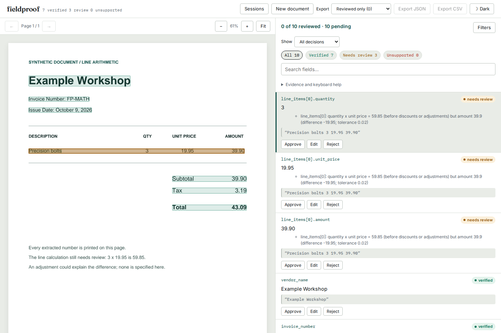
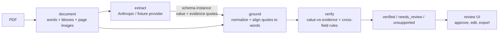

# fieldproof

**Document extraction that shows its work: every field linked to the exact words it came from.**

[](https://pypi.org/project/fieldproof/)
[](LICENSE)
[](https://antonsoo.github.io/fieldproof/)

LLMs are good at pulling structured data out of invoices, contracts, and forms.
In production the question is never "can it extract a total" - it's "can I trust
*this* total, on *this* document, without a human re-reading the whole page."
Most extraction pipelines give you a JSON blob and a confidence number pulled
out of nowhere. fieldproof instead makes the model cite a verbatim quote for
every field, locates that quote on the page with word-level bounding boxes,
checks that the quote actually supports the value it's attached to, runs
cross-field arithmetic and date-ordering checks, and gives a human a review UI
to confirm or fix whatever's left. Every field ends up `verified`,
`needs_review`, or `unsupported` - never a bare number with no way to check it.


<details>
<summary>Dark mode</summary>


</details>

The source checkout also checks which item a quoted number belongs to. A unique
`2` borrowed from another line no longer verifies as the quantity for `Delivery 3`.
Invoice and receipt rows get this check by default; custom schemas can declare
the relationship. The [PDF example and receipt audit](studies/row-association/README.md)
show the caught errors, extra reviews and remaining table-column/skew mistakes.
This change is unreleased.

## The quote can be right while the calculation is wrong

The source checkout (unreleased) also checks each invoice line's quantity times
unit price. In the new [synthetic invoice](examples/line-arithmetic.pdf), every
extracted value is printed on the page, but `3 x 19.95` is `59.85`, not the
printed `39.90`. The previous checkout verified all ten fields; the current
one sends the three participating fields to review and retains the exact
operands, result and difference. Discounts or other adjustments can explain
such a difference; review is not a declaration that the invoice is wrong.



Arithmetic uses decimal calculations with an inclusive `0.02` tolerance.
Missing inputs produce `not_checked`, distinct from a passing calculation.
The [arithmetic study](studies/arithmetic-evidence/README.md) retains 13 controlled
PDFs' results, 4,800 independent rational-arithmetic comparisons, before/after
measurements, and actual browser correction exports. These constructed cases
do not measure extraction accuracy on real invoices. See the
[rules and report format](docs/arithmetic-checks.md), including the limits on
rounding, discounts and subsequent human edits.

## A quote must keep the sign

The source checkout (unreleased) catches a positive `100` quoted from a PDF's
`- $100.00`, preserving the minus in the review highlight. Numeric checks no
longer accept fragments of `1e6` or `AB123CD`, treat a percentage as a plain
amount, or erase a printed digit before comparison.

In 44 deliberately constructed PDFs, incorrect or unsupported claims verified
fell from 21 of 23 to zero; all 21 supported claims now verify. A fresh audit of
133,722 cases on the receipt corpus found no newly verified wrong location,
with five additional reviews among 6,031 fields quoted as written with context. The cases, costs,
limits, installed-package screenshots and actual corrected exports are in the
[numeric evidence study](studies/numeric-evidence/README.md).

## Measured on 1,052 real receipts

The figures below describe the earlier grounding update, before the numeric
evidence change above; its fresh comparison is recorded separately.

Grounding and verification were run on CORD v2 and SROIE receipts, which come
with the words on the page and the correct field values. No model was called:
what a model returns was imitated by rule, with values rewritten or damaged by
a letter, a digit or a cent.

- **The released version (0.2.7) verified names the page does not say.** A
  name with one letter changed was `verified` 78% of the time (1,754 of 2,251),
  and a total one cent off 42% of the time (265 of 631). It accepted almost
  none of the other wrong amounts and dates.
- **The source checkout (unreleased) accepts neither, by rule**: a text value
  must be a run of the page's words and a number must match to the printed
  precision. The cost is the same event from the other side: when OCR has
  garbled one character and the model repairs it, 0.2.7 verified the name 83%
  of the time and the checkout sends every one to review. An opt-in
  `text_edit_tolerance` restores most of both.
- **0.2.7 also verified totals a thousand times too small.** Indonesian
  receipts write sixty thousand as `60.000`. Reading that as sixty, 0.2.7
  verified the wrong value 382 times in 408 and the right one 7 times in 409.
  Nothing on those receipts says what the dot means, so the checkout verifies
  neither reading and says why (1 and 9), and verifies the right one 385 times
  in 409 once the caller says how such documents write numbers
  (`default_number_style="thousands"`).
- **Dates are read**: `23-01-2019` was not a date to 0.2.7. 40% of dates were
  verified at the right place, 63% now, and 98% when the caller says the
  receipts write the day first (`default_date_order="dmy"`).

The rules were written with these receipts in view; none of this is out of
sample. The study, its numbers and what it does not show:
[`studies/cord-grounding`](studies/cord-grounding/README.md).

## Live demo

**[antonsoo.github.io/fieldproof](https://antonsoo.github.io/fieldproof/)** - three
synthetic sample documents (invoice, receipt, contract), grounded and
verified ahead of time by the real Python pipeline. It opens on the invoice
with its first flagged field selected; switch documents from the top bar, or
link straight to one (`#receipt`, `#contract`). The candidate extractions
are hand-written fixtures in the shape an LLM returns, with deliberately
planted errors - a hallucinated PO number, a total
that doesn't match its line items, and a misread date - so you can see exactly
what the verifier catches. No backend: the demo runs entirely on precomputed
JSON and static page images.

The locally built, unreleased demo adds a fourth **Arithmetic** sample
(`#line-arithmetic` after the demo's base path). It uses the same verification
pipeline and supports correction, reload and export. The published site has
not been updated by this change.

Review decisions persist in browser storage for the synthetic samples. If that
storage is unavailable, they remain in the current tab and the UI says so;
export before reloading. Progress and the Pending/Reviewed filter help track
human decisions separately from the original automated checks.
On phones, Fields and Document views give each task enough room. Inspecting a
field opens its evidence page; returning to Fields retains the selection and
any correction draft. Filters expand on demand.

## Quickstart

```bash
pip install fieldproof
```

The sample documents used below live in the repo (`examples/`), so clone it
to try them:

```bash
git clone --depth 1 https://github.com/antonsoo/fieldproof && cd fieldproof
fieldproof extract examples/invoice.pdf --schema invoice --provider fixture \
  --fixture examples/fixtures/invoice.json --out result.json
```

`--provider fixture` replays a stored JSON extraction (no API key needed,
useful for CI/offline). To extract with Claude instead, set
`ANTHROPIC_API_KEY` and pass `--provider anthropic` (`--model` picks the
model; `--max-tokens` raises the output limit for a document whose
extraction is cut off at the default 16,000). To review the result in
the browser instead: `fieldproof serve`. The PyPI package includes the built
UI, fonts and all, so the page asks no host but your own server for anything,
and its Content-Security-Policy would not let it: a document you review stays
on your machine. From a source checkout, build the UI first (see
[Development](#development)).

## Features

- **Reject discarded claims (source checkout, unreleased)** - duplicate JSON
  members and unknown fields cannot silently disappear from an extraction before
  review. The CLI, uploaded fixtures and provider replies share the same checks;
  errors name the input and member path. Non-finite JSON numbers and unpaired
  Unicode surrogates are refused too. Failed imports retain the previous report
  and human corrections. In the [controlled PDF replay](studies/claim-integrity/README.md),
  a conflicting total and an extra unsupported claim previously both produced
  `4 verified, 0 needs review, 0 unsupported`; each is now an explicit input error.

- **Grounded extraction** - every field is `{value, evidence, page}`, not a
  bare value. Built-in Pydantic templates for invoices, receipts, and
  contract key terms; bring your own schema and it works the same way.
- **Provider-agnostic** - an `Extractor` protocol with an Anthropic
  (Claude) implementation using structured outputs, and a fixture provider
  for tests, CI, and offline demos.
- **Real grounding, not string search** - exact match first, then a match
  that differs only in case, then (for a quote that is only a number or a
  date) the same value written differently, then rapidfuzz-based fuzzy
  alignment as a fallback, tolerant of curly quotes, ligatures and hyphenated
  line-wraps. A fuzzy match counts as strong evidence only if its letters and
  digits agree with the page, so a quote that differs from the page by a
  letter, an OCR misread a model has repaired included, goes to review
  (source checkout; `verify(..., text_edit_tolerance=1)` allows it for long
  text fields). Exact matches are required to land
  on whole word boundaries (a quote never matches mid-token), and a quote
  that occurs more than once resolves only when one occurrence shares a visual
  line with a strongly grounded, value-supported sibling (source checkout).
  Other repeated quotes need review. Maps back to word bounding boxes and
  merges them into per-line highlight rectangles.
- **Verification, not just a confidence score** - numbers, dates, currency,
  and strings are independently re-derived from the matched evidence and
  compared to the claimed value; invoice quantity times unit price is checked
  against the line amount (source checkout), line items against subtotal,
  subtotal + tax against total, and due date against issue date.
- **Item association (source checkout)** - a quoted line-item number must
  share its description's visual line. `report.row_checks` keeps both source
  locations and distinguishes same-line, separate and unavailable evidence.
  Wrapped rows may need review; sharing a line does not prove a table column.
- **Column contradictions (source checkout)** - complete, explicitly labelled
  invoice tables can expose a quantity/unit-price swap even when multiplication
  passes. `report.column_checks` records aligned, contradictory and unavailable
  evidence with header and number locations. See the
  [controlled layouts and coverage limits](studies/column-evidence/README.md).
- **A review UI that shows the reasoning** - flagged fields sort to the top;
  click a field to jump to its evidence on the page; hover a highlight to
  see which field it supports; currency fields display formatted (`312.50`,
  `2,458.00`) while the underlying value and export stay machine numbers;
  approve, edit, or reject; corrections preserve numbers, strings and booleans.
  Reviewed-only JSON/CSV/XLSX export is the default; an explicit all-fields scope
  includes pending decisions. Both scopes exclude rejected fields.
- **Optional OCR (source checkout, unreleased)** - `extract` and `verify`
  fall back to local Tesseract when every PDF page lacks extractable text.
  The CLI previously stopped before reaching its OCR loader. Results now record
  the engine, language, rendering resolution and blank recognized pages in
  `report.ocr`; verification checks recognized text, with an explicit warning.
  [Actual OCR runs and limits](studies/ocr-fallback/README.md).

## Usage

### CLI

```bash
fieldproof extract doc.pdf --schema invoice --provider anthropic --out result.json
fieldproof verify result.json doc.pdf   # re-ground/re-verify an existing extraction
fieldproof serve --port 8000            # API + review UI
```

**Report protection (source checkout, unreleased).** CLI output cannot replace
the source PDF or consumed fixture, including through path aliases. `verify`
still updates its result in place, but a failed write preserves the previous
report. Output symlinks are refused; successful reports are private (0600 on
POSIX). The [actual CLI replay](studies/report-files/README.md) retains source
overwrite and kernel-enforced short-write reproductions, plus unchanged normal
report bytes.

For image-only PDFs, install this source checkout with `pip install '.[ocr]'`
and install Tesseract with its English language data through your system's
package manager. The same `extract` and `verify` commands then use the fallback
automatically; no remote OCR service is called. The CLI uses English at 144 DPI,
with a 30-second Tesseract timeout per page and the document limits described in
the [OCR study](studies/ocr-fallback/README.md). The library's `load_scanned_pdf`
also accepts `language`, `timeout` and `limits`. PDFs containing some native text
still use the native loader; this does not add OCR for individual image-only pages
inside a mixed document. The review server still requires a text layer.

A number written `60.000` is sixty or sixty thousand, and `03/04/2026` is 4
March or 3 April. When nothing else in the document settles which, the field
is `needs_review`. `--number-style thousands` (or `decimal`) and `--date-order
dmy` (or `mdy`) on either command supply a fallback when no decisive convention
is found (source checkout, unreleased). A unique convention inferred from the
document takes precedence. If the document shows conflicting conventions,
ambiguous values stay in review even with a supplied fallback. Explicit amounts
and unambiguous dates remain usable. The [mixed-convention study](studies/mixed-conventions/README.md)
retains actual PDF and CLI before/after reports and explains the heuristic limits.

Only a complete, calendar-valid numeric date can settle the date order. An
unrelated `99/01/2026`, a phone-number fragment or `ABC14/03/2026XYZ` cannot
override your `--date-order` default or verify an ambiguous issue date. The
[date evidence study](studies/date-conventions/README.md) includes a runnable
PDF example, before/after results and the cost of rejecting fused OCR tokens
(source checkout, unreleased).

Extracted date **values** must be one calendar-valid `YYYY-MM-DD` date, as the
built-in schemas request. Evidence can still say `March 4, 2026` or use a numeric
local format. A value such as `not 2026-03-04`, `03/04/2026`, or two alternative
dates needs review; the verifier no longer selects a convenient substring or
assumes the claim's day/month order. Invoice date ordering remains `not_checked`
until both claims meet this format. [Actual PDF and CLI captures](studies/date-claims/README.md)
retain the original values, evidence and page highlights. This is a source
correction, not a PyPI release.

Written date **evidence** must keep its complete day and year too. The source
checkout sends `May 1, 20260` to review instead of verifying May 1, 2026 by
dropping a digit. Grounding and value checks share the same written-date
boundaries and supported month abbreviations. The [PDF replay](studies/written-dates/README.md)
retains the false verification, corrected report and supported-date controls.

`--provider anthropic` defaults to `claude-opus-5-5` (Claude Opus 5.5); pass
`--model claude-sonnet-5-5` or any other model id to override it.

Real output, captured from this repo's sample documents:


### As a library

```python
from fieldproof.document import load_pdf
from fieldproof.schemas import Invoice
from fieldproof.extract import FixtureExtractor
from fieldproof.verify import verify

document = load_pdf("examples/invoice.pdf")
result = FixtureExtractor(fixture_path="examples/fixtures/invoice.json").extract(document, Invoice)
report = verify(result.data, document)

for field in report.fields:
    if field.status != "verified":
        print(field.path, field.status, field.reasons)
# po_number unsupported ["none of the evidence quotes (...) could be located in the document"]
# subtotal needs_review ['subtotal + tax = 2666.93 but total is 2600.00']
# tax needs_review ['subtotal + tax = 2666.93 but total is 2600.00']
# total needs_review ['value 2600 does not match 2666.93 parsed from the evidence', ...]
```

### Review decisions and exports

Saving a correction records a human decision; it does not rerun grounding,
arithmetic or date checks. The UI retains the originally extracted value,
its evidence and its verification status. Approve and Reject retain a saved
correction; Reset clears it and restores the original value. A rejected field
is omitted from either export scope.

The UI defaults to **Reviewed only** (approved or edited fields). **All except
rejected** also includes pending fields, with their review status attached.
Exports are disabled during a save and snapshot the displayed decisions when
clicked. The local server's `/api/documents/{id}/export.json`, `.csv` and `.xlsx` routes
accept `?scope=reviewed`; their default remains `all` for existing API clients.

**XLSX is the spreadsheet option:** text identifiers such as `00034`, `1E10`
and `=1+1` are stored as text cells; numbers and booleans retain their types.
No formulas or hyperlinks are generated. CSV remains a raw data export: a
spreadsheet importer can reinterpret its text as numbers, dates or formulas.
XLSX refuses oversized or unsupported text with a JSON fallback instead of
truncating it. Spreadsheet programs still have their own numeric precision
and newline behavior; see the [spreadsheet export study](studies/spreadsheet-export/README.md).

All three formats include these columns, with `original_value` and `value_source`
added in the current unreleased work:

| Column | Meaning |
| --- | --- |
| `field` | Extraction field path, including nested list indices |
| `value` | Effective value, preserving scalar types in JSON |
| `original_value` | Value from the original extraction |
| `value_source` | `extraction` or `correction` |
| `verification_status` | Automated verdict on the original extracted value |
| `review_status` | Human decision: pending, approved or edited |
| `page` | Original evidence page, or null if no page was grounded |

### Document sessions and limits

The local UI's **Sessions** dialog reopens uploaded PDFs and their saved
decisions, including after a tab reload. **New document** keeps the previous
session on the server. **Remove** requires confirmation and frees its PDF,
text, extraction and decisions; export anything you need first. Sessions
remain in memory until removal or server restart. They are not a durable
archive. An open correction must be saved or cancelled before navigating away.

**Save archive** (source checkout, unreleased) downloads the PDF, original
extracted claims and **all** saved decisions, including pending and rejected
fields. After restarting `fieldproof serve`, choose **Open review archive**
on the upload screen to continue. No model call or API key is needed.
The archive is separate from the Reviewed/All value-export scope.

Opening an archive creates a new session and reruns grounding and verification
on the original claims. Human corrections stay separate. Automated verdicts
can change with a different verifier version; the old report is not archived.
This is an explicit save, not autosave: changes after downloading are not in
that file. The ZIP includes the document's full contents, is unencrypted and
editable, and does not authenticate who made its decisions. See the
[format, limits and recovery instructions](docs/review-archives.md).

The server refuses new work when a limit is reached and preserves the previous
document and review. It never evicts a session to make room.

| Resource | Local server limit |
| --- | --- |
| Uploaded PDF | 25 MiB; 64 pages; a text layer is required |
| Rendered page | 16 million pixels at 144 DPI |
| Extracted document text | 100,000 words and 2 million characters |
| Retained sessions | 8 documents; 100 MiB of PDFs; 200,000 words total |
| Fixture / review | 2 MiB fixture JSON; 2,000 fields; 1 MiB of saved corrections per session |
| Review archive | 30 MiB ZIP; 25 MiB PDF; 2 MiB each for serialized claims and decisions; 8 KiB manifest |
| Pending work | 4 intake requests; 2 PDF uploads or archive restores; 4 queued/running PDF or verification operations |

PDF loading, page rendering and extraction verification run one at a time in disposable processes.
Each operation has a 30-second execution timeout and a bounded queue wait.
On Linux, each worker also has a 768 MiB address-space limit, 20 seconds of
CPU time, and a 64 MiB output-file limit. Windows receives the timeout and
application limits without the Unix process resource limits. These budgets
contain PDF processing and verification; they do not measure extraction accuracy or guarantee
that every valid PDF will fit. Scanned PDFs can be processed through the
CLI's OCR fallback; the review server currently requires a text layer.

API clients can list sessions with `GET /api/documents`, reopen metadata and
the saved report with the existing document/report routes, and remove one
with `DELETE /api/documents/{id}`. Removal or concurrent extraction is
refused while extraction owns that session.

### Bring your own schema

Extraction validation requires Pydantic 2.12 or later and forbids unexpected
members, including inside nested models and `Evidenced` wrappers. Declare an
additional claim in the schema instead of depending on Pydantic's default
extra-field omission. Declared aliases and optional defaults still work.
These checks apply before Fieldproof creates a schema instance; they cannot
recover fields a caller already discarded while constructing its own model.

Any Pydantic model built from `Evidenced[T]` leaves works - `fieldproof.ground`
and `fieldproof.verify` walk it generically (`iter_evidenced_fields`), they
never reference `Invoice`/`Receipt`/`ContractKeyTerms` by name:

```python
from pydantic import BaseModel
from fieldproof.schemas import Evidenced

class PurchaseOrder(BaseModel):
    po_number: Evidenced[str]
    approved: Evidenced[bool]
    amount: Evidenced[float]
```

In the source checkout, Boolean leaves need one explicit `yes`/`no` or
`true`/`false` answer, optionally labelled (`Approval: yes`, `Renewal = false`).
Prose and checkbox choices need review: a real quote saying "approved, not
denied" must not verify `approved=False` just because it contains "not".
The [Boolean evidence replay](studies/boolean-evidence/README.md) retains the
PDFs, both claimed values, and their unchanged source highlights. This checks
the written answer, not whether its label belongs to the chosen schema field.

Cross-field rules (line-item sums, date ordering) are schema-specific and
currently only implemented for the built-in Invoice/Receipt templates - see
[Limitations](#accuracy-and-limitations).

### Bring your own extractor

`Extractor` is a structural protocol (`def extract(self, document, schema) ->
ExtractionResult`) - implement it against any provider and
`fieldproof.ground` / `fieldproof.verify` work unchanged, since they only
depend on the `Evidenced` shape, not on Anthropic.

## How it works



**Trust is established in four steps**, and a field is only `verified` if all
four hold:

1. **Quote.** The model must produce a verbatim substring for every value
   (`fieldproof.extract.anthropic_provider` instructs this explicitly and
   uses structured outputs so it's enforced by the schema, not just asked
   nicely). No quote -> `unsupported` immediately; no need to even look at
   the page.
2. **Alignment.** `fieldproof.ground` normalizes both the quote and the
   page text (NFKC, straight quotes/dashes, collapsed whitespace) and tries
   an exact substring match first, falling back to
   [rapidfuzz](https://github.com/rapidfuzz/RapidFuzz)'s partial-ratio
   alignment (`fuzz.partial_ratio_alignment`) for the best-scoring substring
   of the page. Below a 70/100 score, the quote is treated as not found; a
   match under 92/100 is flagged as weak evidence even if it's found. A
   match has to cover whole words - a quote like `"1"` can never match the
   trailing digit of a street number like `"4821"`, though it may leave out
   punctuation glued to a word (the comma in `"1,"`, the `$` in
   `"$2,458.00"`). Numeric signs and rate markers stay attached; incomplete
   quotes are weak candidates, retained so an unrelated occurrence does not
   become uniquely verified. When the best fuzzy window cuts a word, the quote is
   scored against the whole words instead, so `"wind"` is not found in
   `"Northwind"` and `"458.00"` is only a weak match for `"$2,458.00"`.
   Two further steps sit between the exact match and the fuzzy one (source
   checkout, unreleased): a quote that differs from the page only in letter
   case is found at every place the page has it, and a quote that is nothing
   but a number or a date is compared by value, so `"60000"` is found at
   `"60.000"` and `"2018-12-25"` at `"25/12/2018"`, which edit distance at the
   grounding stage would miss. A fuzzy match whose
   letters or digits differ from the page's (ignoring case, spacing and
   punctuation; separators between digits and numeric signs/units count) is never strong, however
   high its score: one misquoted letter in a name scores 95 and is not the
   name on the page.
   Case folding retains source offsets even when one Unicode character expands
   into several. A dotted capital I elsewhere on the page cannot hide repeated
   names; [actual PDF counterexamples](studies/unicode-grounding/README.md) retain
   all candidates and the original highlighted text.
   When a quote genuinely occurs more than once,
   `fieldproof.verify.engine` requires exactly one occurrence on the same
   visual line and page as a strongly grounded, value-supported sibling
   (e.g. a line item's `description`). Weak evidence and accepted text edits
   cannot supply that anchor. Different rows or pages, multiple matching
   columns and multiline anchors remain ambiguous, with no selected box.
   [The precise rule and measured tradeoff](studies/row-locality/README.md)
   apply to the unreleased checkout. The matched span is mapped
   back through an index map to the exact words it covers (via each word's
   character offset into the page's flattened text), and those words'
   bounding boxes are merged into per-line highlight rectangles.
3. **Value check.** The claimed value is independently re-derived from the
   *matched* evidence text - not trusted just because a quote was found
   nearby - and compared: numbers are parsed with currency/thousands-
   separator handling (a document that writes `1.591.600` or `1,234.50`
   settles whether `60.000` is sixty or sixty thousand; with nothing to settle
   it, neither reading is verified and the field goes to review, unless the
   caller says how to read it with `verify(..., default_number_style=)` or
   `--number-style`; source checkout, unreleased), compared to the precision
   the page wrote
   them (a page that says `9.00` supports `9`, not `9.01`), and checked
   against every plain number in the
   evidence, not just the last one (evidence for a row-level field is often
   the whole row, e.g. a quantity of `1` is checked against `"Fuel
   surcharge 1 210.50 210.50"`), excluding percentages so `"Tax (8.5%)
   $208.93"` can't be misread as `8.5`. Comparisons retain printed decimal
   digits; supported numeric tokens include their signs and can span words
   on the same visual line. A footer dash on another line does not negate a
   preceding total. Scientific notation, fractions and unfamiliar attached
   units go to review instead of supplying numeric fragments; extracted dates must
   be single calendar-valid `YYYY-MM-DD` values, while date evidence is parsed from
   ISO-8601 or a handful of common formats and compared as calendar dates,
   and a numeric date whose first two parts are both 12 or under
   (`03/04/2026`) is read in whichever order another date on the same
   document settles (`03/14/2026` means month first). Invalid calendar dates
   and numeric date fragments inside identifiers cannot settle that order.
   With no usable convention or caller default, the ambiguous date needs review;
   a string value has to be a run of the evidence's words, ignoring case,
   spacing and punctuation (so a value may leave words off either end and a
   short value inside a longer quote still matches), and every run of digits
   in the value must be in the evidence as written - `NW-20260215` is 96%
   similar to `NW-20260214` and a different invoice, and a name with one
   letter changed is 94% similar to the original and a different name. In the
   source checkout, booleans require a single explicit yes/no or true/false
   answer, optionally after a label and `:` or `=`. Inferring polarity from
   prose, conditions or checkbox choices requires review. Any mismatch ->
   `needs_review`.
4. **Cross-field rules.** The source checkout first records whether each
   invoice/receipt line-item number shares a visual line with its independently
   grounded description, including numbers quoted only once. Separate or
   unavailable row evidence sends otherwise supported numbers to review;
   their located quotes remain visible. Custom schemas opt in using
   [`RowEvidenceRule`](studies/row-association/README.md#api-and-report-contract).
   Its optional `column_headers` additionally checks numeric source locations
   against complete header rows; built-in invoices declare Description, Qty,
   Unit price and Amount (with documented alternatives). A contradictory
   alignment requires review; unavailable column evidence leaves the source
   verdict unchanged. This narrow check does not infer missing table structure.
   For invoices and receipts: line items must sum to
   the subtotal, subtotal + tax must equal the total (both within a $0.02
   tolerance), and the due date must not precede the issue date. A failed
   rule marks every field it involves as `needs_review` and records why.

### Grounding quality, checked against ground truth

`tests/test_ground.py` and `tests/test_e2e.py` don't just assert "no
exception" - they assert exact match scores and exact reasons against
documents with known content: an exact quote must score 100, a quote with a
dropped colon and a curly apostrophe must score ≥85 but not be flagged
`is_exact`, a quote spanning a hyphenated line-wrap must still ground at
≥80, a quote that's genuinely absent must return no match at all rather
than a low-quality one, and - the concrete regression this repo shipped
with - a bare `"1"` on `examples/invoice.pdf` must ground to one of its two
line-item quantities, never to the trailing digit of the "4821" street
address, and must resolve to the *correct* line item by row locality when
both are plausible. `tests/test_e2e.py` runs the full pipeline against the
checked-in sample documents and pins down exactly which field each planted
error is expected to surface as - a regression that stops catching the
hallucinated PO number or the misread date fails a test, not just a manual
look at the demo.

### Performance

Repeated quotes previously caused the same page to be parsed for each match
and field. A synthetic 100-row invoice (two pages, 404 evidenced fields)
exhausted the review server's 20-second CPU budget. Preparing page indexes once
per verification and reusing bounded candidate lists fixes that failure:

| Measurement | Before | Current source |
|---|---:|---:|
| Grounding + verification, 100 rows | 59.109 s | 0.076 s |
| Local API extraction, 100 rows | HTTP 413, 20.031 s | HTTP 200, 0.332 s |
| Local API extraction, 400 rows | HTTP 413, 20.047 s | HTTP 200, 0.666 s |

Python 3.12.12 on a shared 14-vCPU, 48-GB WSL2 Linux machine, 2026-10-11.
Library times are medians of three runs excluding PDF load; API times are
single requests through the real worker, using fixture extraction without a
model call. Worker limits are unchanged. These cases exercise repeated numeric
evidence, not every document shape or provider's latency. The complete 100-row
report is byte-identical: 201 fields verify and 203 still require review.
See the [inputs, reproduction and compatibility checks](studies/grounding-reuse/README.md).

## Accuracy and limitations

- **OCR is a degraded mode, not equivalent to a text layer.** Scanned PDFs
  are supported only if the optional `ocr` extra (`pytesseract` + a system
  Tesseract install) is present; grounding still fuzzy-matches against
  whatever text Tesseract produced, but OCR accuracy drops sharply on
  skewed scans, low contrast, or unusual fonts, and word boxes are
  per-word pixel boxes with no sub-word offsets. Treat an OCR'd document's
  results as "Tesseract thinks this is what's there," not ground truth.
- **Tables aren't structurally parsed.** Line items are extracted by the
  LLM reading the page text in reading order, not by detecting table
  cells/columns - a table with an unusual layout (merged cells, multi-line
  cells, columns that don't read top-to-bottom-then-left-to-right) can
  confuse the model's reading of which number belongs to which row, even
  though each individual value's grounding is still checked independently.
- **No handwriting support.** Neither the text-layer path nor the OCR
  fallback is designed for handwritten text.
- **Cross-field rules are schema-specific.** They're implemented for the
  built-in Invoice and Receipt templates only
  (`fieldproof.verify.cross_field`); a custom schema gets grounding and
  value-vs-evidence checks but no arithmetic/date-ordering rules unless you
  add your own.
- **Fuzzy matching locates; it does not verify.** A quote whose letters or
  digits differ from the page can still be found and highlighted, so a
  reviewer sees what it was probably meant to be, but the field is
  `needs_review`. That means a name the model silently corrected, or one
  Tesseract garbled and the quote copied faithfully, is exact and verified,
  while a quote that disagrees with the page text in a letter goes to a human.
  Fuzzy alignment returns one best window, so a fuzzy-matched quote that
  occurs twice is not reported as ambiguous. How these rules behave on real
  receipts is in [`studies/cord-grounding`](studies/cord-grounding/README.md).
- **Ambiguous quotes are resolved by row locality, not proven correct.**
  The source checkout requires a unique same-line occurrence instead of
  always choosing the nearest one. Strongly skewed text and multiline cells
  can therefore require review. Vertical overlap does not prove a table
  column, an item's identity or a field's semantic role. The
  [earlier receipt audit](studies/row-locality/README.md) retains 14 remaining
  wrong verified locations among repeated quotes. The later
  [item-association audit](studies/row-association/README.md) also checks unique
  quotes against a declared description and retains five additional wrong
  locations. Custom schemas without row rules still get independent value
  checks; neither mode establishes semantic field correctness.
- **The Anthropic adapter is tested against the real SDK, not a live
  model** - there's no API key configured in this repo's CI. The tests run
  the `anthropic` SDK over a mocked HTTP transport that answers in the
  Messages API's wire format, so the request (the schema as structured-output
  JSON Schema, the prompt, `max_tokens`) and the handling of replies (a
  complete one, one cut off at `max_tokens`, a refusal, an API error, a
  missing key) are the real thing. What no such test can check is whether a
  model follows the evidence-quoting instructions in the system prompt; that
  is what grounding and verification are for.

## Architecture

```
src/fieldproof/
  document/   PDF loading (pdfplumber), page rendering (pypdfium2), optional OCR (pytesseract)
  schemas/    Evidenced[T], the generic field walker, Invoice/Receipt/ContractKeyTerms
  extract/    Extractor protocol, Anthropic provider, fixture provider
  ground/     text normalization, exact/fuzzy quote alignment, bbox merging
  verify/     value-vs-evidence checks, cross-field rules, the verdict engine
  server/     FastAPI app (upload, extract, review, export)
  cli.py      extract / verify / serve
web/          Vite + TypeScript review UI (no framework)
scripts/      synthetic sample-document generator, static-demo data precomputation
examples/     synthetic sample PDFs + fixture extractions (planted errors, for the demo/tests)
```

Python ≥3.11, [uv](https://docs.astral.sh/uv/) for dependency management,
src layout, fully typed (`mypy --strict`-adjacent; see `pyproject.toml`).

## Development

See the [2026-10-04 session, resource and PDF evidence report](docs/verification-sessions-2026-10-04.md)
for the latest production-browser, clean-install and installed-package results.
The [earlier review-workflow report](docs/verification-review-2026-10-04.md)
records the first stage of the changes.
Use Node 24 or newer for the web toolchain.

```bash
uv sync --extra dev --extra ocr
uv run pytest
uv run ruff check src tests
uv run mypy src

cd web
npm ci
npm run typecheck
npm run lint
npm run format:check
npm test
npx playwright install chromium firefox   # once per machine
npm run test:browser                       # builds demo + local UI, tests both
```

`fieldproof serve` from a checkout serves `web/dist`. For a release,
`uv run python scripts/bundle_ui.py && uv build` builds the UI into the
package first, so the wheel carries it.

The production browser suite runs the bundled synthetic samples and the real
local PDF/fixture API in Chromium and Firefox. It covers typed corrections,
JSON/CSV downloads, stale replies, cancellation, storage failures, malformed
data, retries, keyboard focus and desktop/phone layouts in both themes. Every
workflow checks for page errors, CSP violations and off-origin requests; the
accessibility workflows use axe. No live model call is required. Local preview
and API servers use fixed loopback ports 4290 and 4289 and stop after the suite.
Cancellation stops waiting in the UI; work already accepted by the local server
can continue.

To measure the disposable PDF workers on Linux with the bundled samples, a
generated 64-page native PDF and an image-only scan:

```bash
uv run --extra dev --extra ocr python scripts/measure_server_resources.py --out measurements.json
```

The output records single-run timings and cumulative process RSS high-water
marks. It is a local measurement, not an accuracy or worst-case performance claim.

Regenerate the sample documents and demo data after changing them - the
output (`web/public/demo-data/`) is committed, since the Pages deploy is a
plain `npm ci && npm run build:demo` with no Python step:

```bash
uv run python scripts/generate_samples.py
uv run python scripts/build_demo_data.py   # writes + commit web/public/demo-data/
```

## Contributing

See [CONTRIBUTING.md](CONTRIBUTING.md). Issues and pull requests welcome.

## License

[MIT](LICENSE) © 2026 Anton Soloviev

---

<sub>Part of [Officina](https://antonsoo.github.io/officina/), a set of small open-source tools by [Anton Soloviev](https://github.com/antonsoo).</sub>
