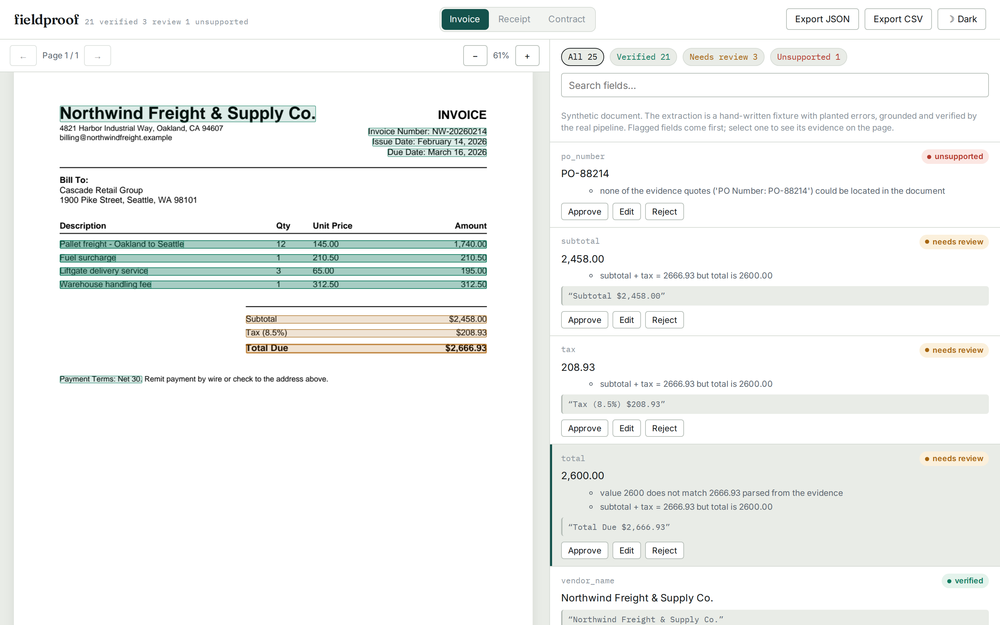
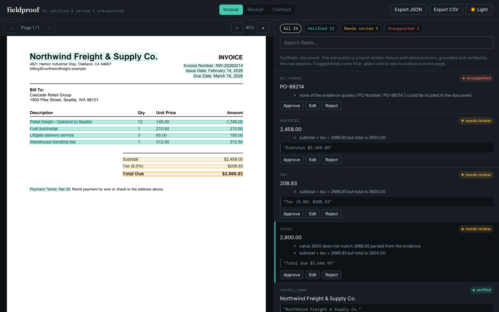
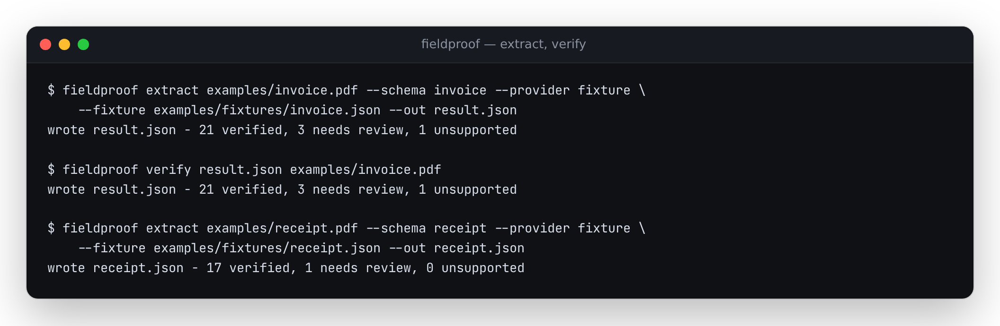
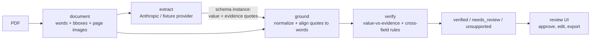

# fieldproof

**Document extraction that shows its work: every field linked to the exact words it came from.**

[](https://pypi.org/project/fieldproof/)
[](LICENSE)
[](https://antonsoo.github.io/fieldproof/)

LLMs are good at pulling structured data out of invoices, contracts, and forms.
In production the question is never "can it extract a total" - it's "can I trust
*this* total, on *this* document, without a human re-reading the whole page."
Most extraction pipelines give you a JSON blob and a confidence number pulled
out of nowhere. fieldproof instead makes the model cite a verbatim quote for
every field, locates that quote on the page with word-level bounding boxes,
checks that the quote actually supports the value it's attached to, runs
cross-field arithmetic and date-ordering checks, and gives a human a review UI
to confirm or fix whatever's left. Every field ends up `verified`,
`needs_review`, or `unsupported` - never a bare number with no way to check it.



<details>
<summary>Dark mode</summary>



</details>

## Live demo

**[antonsoo.github.io/fieldproof](https://antonsoo.github.io/fieldproof/)** - three
synthetic sample documents (invoice, receipt, contract), grounded and
verified ahead of time by the real Python pipeline. It opens on the invoice
with its first flagged field selected; switch documents from the top bar, or
link straight to one (`#receipt`, `#contract`). The candidate extractions
are hand-written fixtures in the shape an LLM returns, with deliberately
planted errors - a hallucinated PO number, a total
that doesn't match its line items, and a misread date - so you can see exactly
what the verifier catches. No backend: the demo runs entirely on precomputed
JSON and static page images.

Review decisions persist in browser storage for the synthetic samples. If that
storage is unavailable, they remain in the current tab and the UI says so;
export before reloading. Progress and the Pending/Reviewed filter help track
human decisions separately from the original automated checks.
On phones, Fields and Document views give each task enough room. Inspecting a
field opens its evidence page; returning to Fields retains the selection and
any correction draft. Filters expand on demand.

## Quickstart

```bash
pip install fieldproof
```

The sample documents used below live in the repo (`examples/`), so clone it
to try them:

```bash
git clone --depth 1 https://github.com/antonsoo/fieldproof && cd fieldproof
fieldproof extract examples/invoice.pdf --schema invoice --provider fixture \
  --fixture examples/fixtures/invoice.json --out result.json
```

`--provider fixture` replays a stored JSON extraction (no API key needed,
useful for CI/offline). To extract with Claude instead, set
`ANTHROPIC_API_KEY` and pass `--provider anthropic` (`--model` picks the
model; `--max-tokens` raises the output limit for a document whose
extraction is cut off at the default 16,000). To review the result in
the browser instead: `fieldproof serve`. The PyPI package includes the built
UI, fonts and all, so the page asks no host but your own server for anything,
and its Content-Security-Policy would not let it: a document you review stays
on your machine. From a source checkout, build the UI first (see
[Development](#development)).

## Features

- **Grounded extraction** - every field is `{value, evidence, page}`, not a
  bare value. Built-in Pydantic templates for invoices, receipts, and
  contract key terms; bring your own schema and it works the same way.
- **Provider-agnostic** - an `Extractor` protocol with an Anthropic
  (Claude) implementation using structured outputs, and a fixture provider
  for tests, CI, and offline demos.
- **Real grounding, not string search** - exact match first, rapidfuzz-based
  fuzzy alignment as a fallback, tolerant of curly quotes, ligatures,
  hyphenated line-wraps, and OCR noise. Exact matches are required to land
  on whole word boundaries (a quote never matches mid-token), and a quote
  that occurs more than once is disambiguated by locality rather than
  silently taking the first hit. Maps back to word bounding boxes and
  merges them into per-line highlight rectangles.
- **Verification, not just a confidence score** - numbers, dates, currency,
  and strings are independently re-derived from the matched evidence and
  compared to the claimed value; line items are checked against subtotal,
  subtotal + tax against total, and due date against issue date.
- **A review UI that shows the reasoning** - flagged fields sort to the top;
  click a field to jump to its evidence on the page; hover a highlight to
  see which field it supports; currency fields display formatted (`312.50`,
  `2,458.00`) while the underlying value and export stay machine numbers;
  approve, edit, or reject; corrections preserve numbers, strings and booleans.
  Reviewed-only JSON/CSV export is the default; an explicit all-fields scope
  includes pending decisions. Both scopes exclude rejected fields.
- **Optional OCR** - scanned PDFs fall back to Tesseract if it's installed;
  documented as a degraded mode, not silently pretended to be as reliable as
  a native text layer.

## Usage

### CLI

```bash
fieldproof extract doc.pdf --schema invoice --provider anthropic --out result.json
fieldproof verify result.json doc.pdf   # re-ground/re-verify an existing extraction
fieldproof serve --port 8000            # API + review UI
```

`--provider anthropic` defaults to `claude-opus-5-5` (Claude Opus 5.5); pass
`--model claude-sonnet-5-5` or any other model id to override it.

Real output, captured from this repo's sample documents:



### As a library

```python
from fieldproof.document import load_pdf
from fieldproof.schemas import Invoice
from fieldproof.extract import FixtureExtractor
from fieldproof.verify import verify

document = load_pdf("examples/invoice.pdf")
result = FixtureExtractor(fixture_path="examples/fixtures/invoice.json").extract(document, Invoice)
report = verify(result.data, document)

for field in report.fields:
    if field.status != "verified":
        print(field.path, field.status, field.reasons)
# po_number unsupported ["none of the evidence quotes (...) could be located in the document"]
# subtotal needs_review ['subtotal + tax = 2666.93 but total is 2600.00']
# tax needs_review ['subtotal + tax = 2666.93 but total is 2600.00']
# total needs_review ['value 2600 does not match 2666.93 parsed from the evidence', ...]
```

### Review decisions and exports

Saving a correction records a human decision; it does not rerun grounding,
arithmetic or date checks. The UI retains the originally extracted value,
its evidence and its verification status. Approve and Reject retain a saved
correction; Reset clears it and restores the original value. A rejected field
is omitted from either export scope.

The UI defaults to **Reviewed only** (approved or edited fields). **All except
rejected** also includes pending fields, with their review status attached.
Exports are disabled during a save and snapshot the displayed decisions when
clicked. The local server's `/api/documents/{id}/export.json` and `.csv` routes
accept `?scope=reviewed`; their default remains `all` for existing API clients.

Both formats include these columns, with `original_value` and `value_source`
added in the current unreleased work:

| Column | Meaning |
| --- | --- |
| `field` | Extraction field path, including nested list indices |
| `value` | Effective value, preserving scalar types in JSON |
| `original_value` | Value from the original extraction |
| `value_source` | `extraction` or `correction` |
| `verification_status` | Automated verdict on the original extracted value |
| `review_status` | Human decision: pending, approved or edited |
| `page` | Original evidence page, or null if no page was grounded |

### Document sessions and limits

The local UI's **Sessions** dialog reopens uploaded PDFs and their saved
decisions, including after a tab reload. **New document** keeps the previous
session on the server. **Remove** requires confirmation and frees its PDF,
text, extraction and decisions; export anything you need first. Sessions
remain in memory until removal or server restart. They are not a durable
archive. An open correction must be saved or cancelled before navigating away.

The server refuses new work when a limit is reached and preserves the previous
document and review. It never evicts a session to make room.

| Resource | Local server limit |
| --- | --- |
| Uploaded PDF | 25 MiB; 64 pages; a text layer is required |
| Rendered page | 16 million pixels at 144 DPI |
| Extracted document text | 100,000 words and 2 million characters |
| Retained sessions | 8 documents; 100 MiB of PDFs; 200,000 words total |
| Fixture / review | 2 MiB fixture JSON; 2,000 fields; 1 MiB of saved corrections per session |
| Pending work | 4 intake requests; 2 PDF uploads; 4 queued/running PDF operations |

PDF loading and page rendering run one at a time in disposable processes.
Each operation has a 30-second execution timeout and a bounded queue wait.
On Linux, each worker also has a 768 MiB address-space limit, 20 seconds of
CPU time, and a 64 MiB output-file limit. Windows receives the timeout and
application limits without the Unix process resource limits. These budgets
contain PDF processing; they do not measure extraction accuracy or guarantee
that every valid PDF will fit. Scanned PDFs can be processed through the
CLI's OCR fallback; the review server currently requires a text layer.

API clients can list sessions with `GET /api/documents`, reopen metadata and
the saved report with the existing document/report routes, and remove one
with `DELETE /api/documents/{id}`. Removal or concurrent extraction is
refused while extraction owns that session.

### Bring your own schema

Any Pydantic model built from `Evidenced[T]` leaves works - `fieldproof.ground`
and `fieldproof.verify` walk it generically (`iter_evidenced_fields`), they
never reference `Invoice`/`Receipt`/`ContractKeyTerms` by name:

```python
from pydantic import BaseModel
from fieldproof.schemas import Evidenced

class PurchaseOrder(BaseModel):
    po_number: Evidenced[str]
    approved: Evidenced[bool]
    amount: Evidenced[float]
```

Cross-field rules (line-item sums, date ordering) are schema-specific and
currently only implemented for the built-in Invoice/Receipt templates - see
[Limitations](#accuracy-and-limitations).

### Bring your own extractor

`Extractor` is a structural protocol (`def extract(self, document, schema) ->
ExtractionResult`) - implement it against any provider and
`fieldproof.ground` / `fieldproof.verify` work unchanged, since they only
depend on the `Evidenced` shape, not on Anthropic.

## How it works



**Trust is established in four steps**, and a field is only `verified` if all
four hold:

1. **Quote.** The model must produce a verbatim substring for every value
   (`fieldproof.extract.anthropic_provider` instructs this explicitly and
   uses structured outputs so it's enforced by the schema, not just asked
   nicely). No quote -> `unsupported` immediately; no need to even look at
   the page.
2. **Alignment.** `fieldproof.ground` normalizes both the quote and the
   page text (NFKC, straight quotes/dashes, collapsed whitespace) and tries
   an exact substring match first, falling back to
   [rapidfuzz](https://github.com/rapidfuzz/RapidFuzz)'s partial-ratio
   alignment (`fuzz.partial_ratio_alignment`) for the best-scoring substring
   of the page. Below a 70/100 score, the quote is treated as not found; a
   match under 92/100 is flagged as weak evidence even if it's found. A
   match has to cover whole words - a quote like `"1"` can never match the
   trailing digit of a street number like `"4821"`, though it may leave out
   punctuation glued to a word (the comma in `"1,"`, the `$` in
   `"$2,458.00"`). When the best fuzzy window cuts a word, the quote is
   scored against the whole words instead, so `"wind"` is not found in
   `"Northwind"` and `"458.00"` is only a weak match for `"$2,458.00"`.
   When a quote genuinely occurs more than once,
   `fieldproof.verify.engine` disambiguates it by preferring whichever
   occurrence is on the same row as another field from the same object
   that's already been grounded (e.g. a line item's `quantity` next to its
   already-grounded `description`); with nothing nearby to disambiguate
   against, the field becomes `needs_review` with an "ambiguous, appears N
   times" reason rather than silently guessing. The matched span is mapped
   back through an index map to the exact words it covers (via each word's
   character offset into the page's flattened text), and those words'
   bounding boxes are merged into per-line highlight rectangles.
3. **Value check.** The claimed value is independently re-derived from the
   *matched* evidence text - not trusted just because a quote was found
   nearby - and compared: numbers are parsed with currency/thousands-
   separator handling and checked against every plain number in the
   evidence, not just the last one (evidence for a row-level field is often
   the whole row, e.g. a quantity of `1` is checked against `"Fuel
   surcharge 1 210.50 210.50"`), excluding percentages so `"Tax (8.5%)
   $208.93"` can't be misread as `8.5`; dates are parsed from either
   ISO-8601 or a handful of common formats and compared as calendar dates,
   and a numeric date whose first two parts are both 12 or under
   (`03/04/2026`) is read in whichever order another date on the same
   document settles (`03/14/2026` means month first) - with no such date it
   goes to review rather than being verified under a guessed convention;
   strings use fuzzy partial-ratio (a short value inside a longer quote
   should still match), except that every run of digits in the value must
   be in the evidence as written - `NW-20260215` is 96% similar to
   `NW-20260214` and a different invoice; booleans look for whole words like
   yes/no/not/confirmed/denied (so "notice" isn't a "no"). Any mismatch ->
   `needs_review`.
4. **Cross-field rules.** For invoices and receipts: line items must sum to
   the subtotal, subtotal + tax must equal the total (both within a $0.02
   tolerance), and the due date must not precede the issue date. A failed
   rule marks every field it involves as `needs_review` and records why.

### Grounding quality, checked against ground truth

`tests/test_ground.py` and `tests/test_e2e.py` don't just assert "no
exception" - they assert exact match scores and exact reasons against
documents with known content: an exact quote must score 100, a quote with a
dropped colon and a curly apostrophe must score ≥85 but not be flagged
`is_exact`, a quote spanning a hyphenated line-wrap must still ground at
≥80, a quote that's genuinely absent must return no match at all rather
than a low-quality one, and - the concrete regression this repo shipped
with - a bare `"1"` on `examples/invoice.pdf` must ground to one of its two
line-item quantities, never to the trailing digit of the "4821" street
address, and must resolve to the *correct* line item by row locality when
both are plausible. `tests/test_e2e.py` runs the full pipeline against the
checked-in sample documents and pins down exactly which field each planted
error is expected to surface as - a regression that stops catching the
hallucinated PO number or the misread date fails a test, not just a manual
look at the demo.

### Performance

Measured on this machine (14 vCPU, 48 GB RAM, WSL2 Linux), 200-iteration
average, on `examples/invoice.pdf` (25 leaf fields across 4 line items):

| Stage | Time |
|---|---|
| PDF text-layer load (pdfplumber) | 22.6 ms |
| Grounding + verification, all 25 fields | 4.3 ms |

Extraction time is dominated by the provider's network round trip, not
anything in this repo.

## Accuracy and limitations

- **OCR is a degraded mode, not equivalent to a text layer.** Scanned PDFs
  are supported only if the optional `ocr` extra (`pytesseract` + a system
  Tesseract install) is present; grounding still fuzzy-matches against
  whatever text Tesseract produced, but OCR accuracy drops sharply on
  skewed scans, low contrast, or unusual fonts, and word boxes are
  per-word pixel boxes with no sub-word offsets. Treat an OCR'd document's
  results as "Tesseract thinks this is what's there," not ground truth.
- **Tables aren't structurally parsed.** Line items are extracted by the
  LLM reading the page text in reading order, not by detecting table
  cells/columns - a table with an unusual layout (merged cells, multi-line
  cells, columns that don't read top-to-bottom-then-left-to-right) can
  confuse the model's reading of which number belongs to which row, even
  though each individual value's grounding is still checked independently.
- **No handwriting support.** Neither the text-layer path nor the OCR
  fallback is designed for handwritten text.
- **Cross-field rules are schema-specific.** They're implemented for the
  built-in Invoice and Receipt templates only
  (`fieldproof.verify.cross_field`); a custom schema gets grounding and
  value-vs-evidence checks but no arithmetic/date-ordering rules unless you
  add your own.
- **String matching is fuzzy by design**, which means a sufficiently short
  or generic value can occasionally find a spurious match inside unrelated
  evidence text. The 92/100 "strong match" threshold and the independent
  value check are there to catch most of this, but neither is a proof.
- **Ambiguous quotes are resolved by row locality, not proven correct.**
  When a short quote occurs more than once, fieldproof prefers the
  occurrence nearest another already-grounded field from the same row
  (see [How it works](#how-it-works)) rather than flagging every such
  field `needs_review` - a reasonable heuristic, not a guarantee. Two
  identical amounts in the same row (a line item where `unit_price` and
  `amount` happen to be equal) can still ground to either one; the *value*
  check still passes either way, but the highlighted box may point at the
  wrong column of an otherwise-correct row.
- **The Anthropic adapter is tested against the real SDK, not a live
  model** - there's no API key configured in this repo's CI. The tests run
  the `anthropic` SDK over a mocked HTTP transport that answers in the
  Messages API's wire format, so the request (the schema as structured-output
  JSON Schema, the prompt, `max_tokens`) and the handling of replies (a
  complete one, one cut off at `max_tokens`, a refusal, an API error, a
  missing key) are the real thing. What no such test can check is whether a
  model follows the evidence-quoting instructions in the system prompt; that
  is what grounding and verification are for.

## Architecture

```
src/fieldproof/
  document/   PDF loading (pdfplumber), page rendering (pypdfium2), optional OCR (pytesseract)
  schemas/    Evidenced[T], the generic field walker, Invoice/Receipt/ContractKeyTerms
  extract/    Extractor protocol, Anthropic provider, fixture provider
  ground/     text normalization, exact/fuzzy quote alignment, bbox merging
  verify/     value-vs-evidence checks, cross-field rules, the verdict engine
  server/     FastAPI app (upload, extract, review, export)
  cli.py      extract / verify / serve
web/          Vite + TypeScript review UI (no framework)
scripts/      synthetic sample-document generator, static-demo data precomputation
examples/     synthetic sample PDFs + fixture extractions (planted errors, for the demo/tests)
```

Python ≥3.11, [uv](https://docs.astral.sh/uv/) for dependency management,
src layout, fully typed (`mypy --strict`-adjacent; see `pyproject.toml`).

## Development

See the [2026-10-04 review verification report](docs/verification-review-2026-10-04.md)
for production-browser, clean-install, and installed-package results.
Use Node 24 or newer for the web toolchain.

```bash
uv sync --extra dev --extra ocr
uv run pytest
uv run ruff check src tests
uv run mypy src

cd web
npm ci
npm run typecheck
npm run lint
npm run format:check
npm test
npx playwright install chromium firefox   # once per machine
npm run test:browser                       # builds demo + local UI, tests both
```

`fieldproof serve` from a checkout serves `web/dist`. For a release,
`uv run python scripts/bundle_ui.py && uv build` builds the UI into the
package first, so the wheel carries it.

The production browser suite runs the bundled synthetic samples and the real
local PDF/fixture API in Chromium and Firefox. It covers typed corrections,
JSON/CSV downloads, stale replies, cancellation, storage failures, malformed
data, retries, keyboard focus and desktop/phone layouts in both themes. Every
workflow checks for page errors, CSP violations and off-origin requests; the
accessibility workflows use axe. No live model call is required. Local preview
and API servers use fixed loopback ports 4290 and 4289 and stop after the suite.
Cancellation stops waiting in the UI; work already accepted by the local server
can continue.

To measure the disposable PDF workers on Linux with the bundled samples, a
generated 64-page native PDF and an image-only scan:

```bash
uv run --extra dev --extra ocr python scripts/measure_server_resources.py --out measurements.json
```

The output records single-run timings and cumulative process RSS high-water
marks. It is a local measurement, not an accuracy or worst-case performance claim.

Regenerate the sample documents and demo data after changing them - the
output (`web/public/demo-data/`) is committed, since the Pages deploy is a
plain `npm ci && npm run build:demo` with no Python step:

```bash
uv run python scripts/generate_samples.py
uv run python scripts/build_demo_data.py   # writes + commit web/public/demo-data/
```

## Contributing

See [CONTRIBUTING.md](CONTRIBUTING.md). Issues and pull requests welcome.

## License

[MIT](LICENSE) © 2026 Anton Soloviev

---

<sub>Part of [Officina](https://antonsoo.github.io/officina/), a set of small open-source tools by [Anton Soloviev](https://github.com/antonsoo).</sub>
