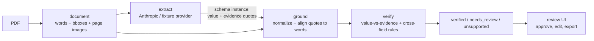

# How it works



The verifier checks claims in four stages. Native PDF evidence also needs the
paint eligibility described under Accuracy and limitations below. `verified`
means these configured checks passed; it is not a guarantee that a claim is true:

1. **Quote.** The model must produce a verbatim substring for every value
   (`fieldproof.extract.anthropic_provider` instructs this explicitly and
   uses structured outputs for the claim shape). The schema does not enforce
   verbatim truth: grounding checks the supplied quote against the document.
   No quote -> `unsupported` immediately.
2. **Alignment.** `fieldproof.ground` normalizes both the quote and the
   page text (NFKC, straight quotes/dashes, collapsed whitespace) and tries
   an exact substring match first, falling back to
   [rapidfuzz](https://github.com/rapidfuzz/RapidFuzz)'s partial-ratio
   alignment (`fuzz.partial_ratio_alignment`) for the best-scoring substring
   of the page. Below a 70/100 score, the quote is treated as not found; a
   match under 92/100 is flagged as weak evidence even if it's found. A
   match has to cover whole words - a quote like `"1"` can never match the
   trailing digit of a street number like `"4821"`, though it may leave out
   punctuation glued to a word (the comma in `"1,"`, the `$` in
   `"$2,458.00"`). Numeric signs and rate markers stay attached; incomplete
   quotes are weak candidates, retained so an unrelated occurrence does not
   become uniquely verified. When the best fuzzy window cuts a word, the quote is
   scored against the whole words instead, so `"wind"` is not found in
   `"Northwind"` and `"458.00"` is only a weak match for `"$2,458.00"`.
   Two further steps sit between the exact match and the fuzzy one (source
   checkout, unreleased): a quote that differs from the page only in letter
   case is found at every place the page has it, and a quote that is nothing
   but a number or a date is compared by value, so `"60000"` is found at
   `"60.000"` and `"2018-12-25"` at `"25/12/2018"`, which edit distance at the
   grounding stage would miss. A fuzzy match whose
   letters or digits differ from the page's (ignoring case, spacing and
   punctuation; separators between digits and numeric signs/units count) is never strong, however
   high its score: one misquoted letter in a name scores 95 and is not the
   name on the page.
   Case folding retains source offsets even when one Unicode character expands
   into several. A dotted capital I elsewhere on the page cannot hide repeated
   names; [actual PDF counterexamples](../studies/unicode-grounding/README.md) retain
   all candidates and the original highlighted text.
   When a quote genuinely occurs more than once,
   `fieldproof.verify.engine` requires exactly one occurrence on the same
   visual line and page as a strongly grounded, value-supported sibling
   (e.g. a line item's `description`). Weak evidence and accepted text edits
   cannot supply that anchor. Different rows or pages, multiple matching
   columns and multiline anchors remain ambiguous, with no selected box.
   [The precise rule and measured tradeoff](../studies/row-locality/README.md)
   apply to the unreleased checkout. The matched span is mapped
   back through an index map to the exact words it covers (via each word's
   character offset into the page's flattened text), and those words'
   bounding boxes are merged into per-line highlight rectangles.
3. **Value check.** The claimed value is independently re-derived from the
   *matched* evidence text - not trusted just because a quote was found
   nearby - and compared: numbers are parsed with currency/thousands-
   separator handling (a document that writes `1.591.600` or `1,234.50`
   settles whether `60.000` is sixty or sixty thousand; with nothing to settle
   it, neither reading is verified and the field goes to review, unless the
   caller says how to read it with `verify(..., default_number_style=)` or
   `--number-style`; source checkout, unreleased), compared to the precision
   the page wrote
   them (a page that says `9.00` supports `9`, not `9.01`), and checked
   against every plain number in the
   evidence, not just the last one (evidence for a row-level field is often
   the whole row, e.g. a quantity of `1` is checked against `"Fuel
   surcharge 1 210.50 210.50"`), excluding percentages so `"Tax (8.5%)
   $208.93"` can't be misread as `8.5`. Comparisons retain printed decimal
   digits; supported numeric tokens include their signs and can span words
   on the same visual line. A footer dash on another line does not negate a
   preceding total. Scientific notation, fractions and unfamiliar attached
   units go to review instead of supplying numeric fragments; extracted dates must
   be single calendar-valid `YYYY-MM-DD` values, while date evidence is parsed from
   ISO-8601 or a handful of common formats and compared as calendar dates,
   and a numeric date whose first two parts are both 12 or under
   (`03/04/2026`) is read in whichever order another date on the same
   document settles (`03/14/2026` means month first). Invalid calendar dates
   and numeric date fragments inside identifiers cannot settle that order.
   With no usable convention or caller default, the ambiguous date needs review;
   a string value has to be a run of the evidence's words, ignoring case,
   spacing and punctuation (so a value may leave words off either end and a
   short value inside a longer quote still matches), and every run of digits
   in the value must be in the evidence as written - `NW-20260215` is 96%
   similar to `NW-20260214` and a different invoice, and a name with one
   letter changed is 94% similar to the original and a different name. In the
   source checkout, booleans require a single explicit yes/no or true/false
   answer, optionally after a label and `:` or `=`. Inferring polarity from
   prose, conditions or checkbox choices requires review. Any mismatch ->
   `needs_review`.
4. **Cross-field rules.** The source checkout first records whether each
   invoice/receipt line-item number shares a visual line with its independently
   grounded description, including numbers quoted only once. Separate or
   unavailable row evidence sends otherwise supported numbers to review;
   their located quotes remain visible. Custom schemas opt in using
   [`RowEvidenceRule`](../studies/row-association/README.md#api-and-report-contract).
   Its optional `column_headers` additionally checks numeric source locations
   against complete header rows; built-in invoices declare Description, Qty,
   Unit price and Amount (with documented alternatives). A contradictory
   alignment requires review; unavailable column evidence leaves the source
   verdict unchanged. This narrow check does not infer missing table structure.
   For invoices and receipts: line items must sum to
   the subtotal, subtotal + tax must equal the total (both within a $0.02
   tolerance), and the due date must not precede the issue date. A failed
   rule marks every field it involves as `needs_review` and records why.

## Accuracy and limitations

- **A text layer is not proof of visible ink.** The source checkout retains
  native rendering modes and requires review for quotes touching mode 3
  (invisible), mode 7 (clipping only), explicitly zero-opacity painting, or
  glyph bounds crossing a known outer clipping boundary.
  This also affects correctly aligned
  searchable OCR layers: they remain extractable but require visual review.
  A bounded 144-DPI comparison also checks each native character's regional
  paint contribution against an independent copy with text paint suppressed.
  Missing contributions, paint confined to overlapping native glyph bounds,
  and incomplete checks require review. The current source associates characters
  with PDFium's font envelopes and compares their ink bounds, including italic
  overhangs. Stroke bounds include the character transform and the page/Form
  miter-limit declarations; an unreadable miter limit leaves attribution
  unavailable. Conservative bounds can also send visible stroked text to review.
  This observer requires
  PDFium 5.0 or later. [Authored controls and compatibility limits](../studies/native-glyph-bounds/README.md).
  A positive
  difference does not prove readability, correct font-to-Unicode mapping, or
  ownership of overlapping native ink. Small or partly clipped readable glyphs
  may require review too. Caller-supplied and recognized OCR words do not have
  this native-text audit. See the [method, cost and remaining limits](../studies/flat-raster/README.md).
- **OCR is a degraded mode, not equivalent to a text layer.** Scanned PDFs
  are supported only if the optional `ocr` extra (`pytesseract` + a system
  Tesseract install) is present; grounding still fuzzy-matches against
  whatever text Tesseract produced, but OCR accuracy drops sharply on
  skewed scans, low contrast, or unusual fonts, and word boxes are
  per-word pixel boxes with no sub-word offsets. Treat an OCR'd document's
  results as "Tesseract thinks this is what's there," not ground truth.
- **Tables aren't structurally parsed.** Line items are extracted by the
  LLM reading the page text in reading order, not by detecting table
  cells/columns - a table with an unusual layout (merged cells, multi-line
  cells, columns that don't read top-to-bottom-then-left-to-right) can
  confuse the model's reading of which number belongs to which row, even
  though each individual value's grounding is still checked independently.
- **No handwriting support.** Neither the text-layer path nor the OCR
  fallback is designed for handwritten text.
- **Cross-field rules are schema-specific.** They're implemented for the
  built-in Invoice and Receipt templates only
  (`fieldproof.verify.cross_field`); a custom schema gets grounding and
  value-vs-evidence checks but no arithmetic/date-ordering rules unless you
  add your own.
- **Fuzzy matching locates; it does not verify.** A quote whose letters or
  digits differ from the page can still be found and highlighted, so a
  reviewer sees what it was probably meant to be, but the field is
  `needs_review`. That means a name the model silently corrected, or one
  Tesseract garbled and the quote copied faithfully, is exact and verified,
  while a quote that disagrees with the page text in a letter goes to a human.
  Fuzzy alignment returns one best window, so a fuzzy-matched quote that
  occurs twice is not reported as ambiguous. How these rules behave on real
  receipts is in [`studies/cord-grounding`](../studies/cord-grounding/README.md).
- **Ambiguous quotes are resolved by row locality, not proven correct.**
  The source checkout requires a unique same-line occurrence instead of
  always choosing the nearest one. Strongly skewed text and multiline cells
  can therefore require review. Vertical overlap does not prove a table
  column, an item's identity or a field's semantic role. The
  [earlier receipt audit](../studies/row-locality/README.md) retains 14 remaining
  wrong verified locations among repeated quotes. The later
  [item-association audit](../studies/row-association/README.md) also checks unique
  quotes against a declared description and retains five additional wrong
  locations. Custom schemas without row rules still get independent value
  checks; neither mode establishes semantic field correctness.
- **The Anthropic adapter is tested against the real SDK, not a live
  model** - there's no API key configured in this repo's CI. The tests run
  the `anthropic` SDK over a mocked HTTP transport that answers in the
  Messages API's wire format, so the request (the schema as structured-output
  JSON Schema, the prompt, `max_tokens`) and the handling of replies (a
  complete one, one cut off at `max_tokens`, a refusal, an API error, a
  missing key) are the real thing. What no such test can check is whether a
  model follows the evidence-quoting instructions in the system prompt; that
  is what grounding and verification are for.

## Architecture

```
src/fieldproof/
  document/   PDF loading (pdfplumber), page rendering (pypdfium2), optional OCR (pytesseract)
  schemas/    Evidenced[T], the generic field walker, Invoice/Receipt/ContractKeyTerms
  extract/    Extractor protocol, Anthropic provider, fixture provider
  ground/     text normalization, exact/fuzzy quote alignment, bbox merging
  verify/     value-vs-evidence checks, cross-field rules, the verdict engine
  server/     FastAPI app (upload, extract, review, export)
  cli.py      extract / verify / serve
web/          Vite + TypeScript review UI (no framework)
scripts/      synthetic sample-document generator, static-demo data precomputation
examples/     synthetic sample PDFs + fixture extractions (planted errors, for the demo/tests)
```

Python 3.11 or later, [uv](https://docs.astral.sh/uv/) for dependency management,
with a src layout and type checks configured in `pyproject.toml`.

