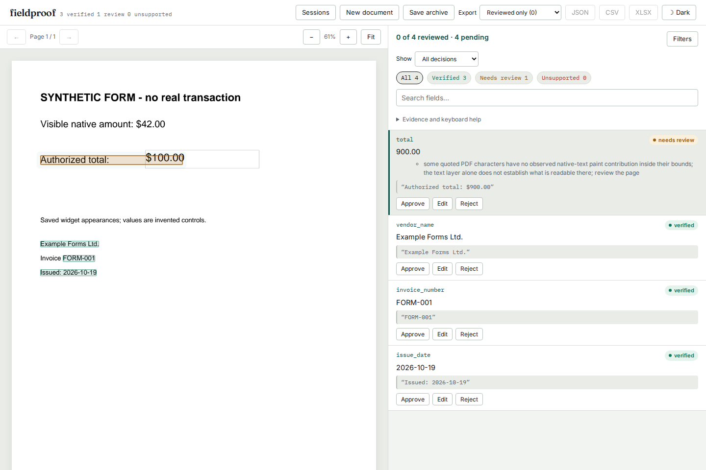

# Saved PDF form appearances: verified source and installed package

Source [`b0661fc`](https://github.com/antonsoo/fieldproof/commit/b0661fce06bace991b3ccb2b4350818d9c9d7f79)
initializes static AcroForm rendering before acquiring PDFium page handles.
The prior source, `d93ab59`, displayed saved fields as blank. Review PNGs,
OCR input and the native paint audit now retain those appearances. XFA has an
explicit unsupported-form diagnostic; the form environment has no JavaScript
platform. [Method, inputs and limits](../studies/form-appearances/README.md).



The controlled PDF contains invented values. Its native `$900.00` claim already
required review before this repair; the visible widget value was missing from
the image the reviewer received. This change restores that view, without
turning widget values into native page-text quote occurrences.

| Check | Observed result | Evidence |
| --- | --- | --- |
| Fourteen authored PDF controls | Ten supported views differed before; all thirteen supported views now match direct form rendering. XFA is rejected. | [Before](../studies/form-appearances/results/before.json), [after](../studies/form-appearances/results/after.json) |
| Native text and locations | All twelve comparable document models and visible-amount verdicts unchanged | [Comparison](../studies/form-appearances/results/verification.json) |
| Actual local OCR | Form-only page changes from no words to `$100.00`, including its box and OCR provenance | [Before](../studies/form-appearances/results/ocr-before.json), [after](../studies/form-appearances/results/ocr-after.json) |
| Public producer controls | LibreOffice and pdfTeX originals, plus one invented pdfTeX fill: three missing-appearance views become three matching views | [Before](../studies/form-appearances/results/public-before.json), [after](../studies/form-appearances/results/public-after.json) |
| Clean Python 3.14 archive | Ruff and mypy clean; 847 tests pass with actual Tesseract available | [Types](../studies/form-appearances/results/clean-types.txt), [tests](../studies/form-appearances/results/clean-tests.txt) |
| Installed Python 3.11, direct dependency floors | 847 tests pass; PDFium wrapper 5.0.0. Two dependency deprecation warnings. | [Log](../studies/form-appearances/results/minimum-tests.txt), [identity](../studies/form-appearances/results/minimum-identity.json) |
| Installed Python 3.14, current dependencies | 847 tests pass; PDFium wrapper 5.14.0 | [Log](../studies/form-appearances/results/modern-tests.txt), [identity](../studies/form-appearances/results/modern-identity.json) |
| Installed review workflow, Chromium and Firefox | Both display the saved amount at desktop/375 px, retain original claim/status after editing, preserve PDF bytes in the archive and restore the same report/image | [Receipt](../studies/form-appearances/results/browser.json), [script](../studies/form-appearances/browser.mjs) |
| Existing production browser suite | 108 workflows pass across both engines, live installed API and built static demo | [Log](../studies/form-appearances/results/browser-complete.txt) |

The wheel was built **from the sdist**, after `scripts/bundle_ui.py` bundled the
UI. All 42 Python files match immutable source objects; all 23 UI files match
the clean build. Every one of the 65 package files matches the wheel in both
isolated installs. [Artifact hashes and comparisons](../studies/form-appearances/results/verification.json).
Node 26.7.0 built the UI; web type, lint, format and 70 unit checks also passed.
The four retained browser screenshots were inspected. The phone view fits the
whole page by default and provides its existing zoom and internal scrolling.

All 33 files introduced or changed by `b0661fc` were fetched from immutable
public GitHub URLs and matched byte for byte.
[Public source receipt](../studies/form-appearances/results/publication.json).
An actual `python -m pip install --force-reinstall` from that public revision
replaced an installed PyPI 0.2.7 package while retaining the same version
number; all 42 installed Python files match the public source. The direct Git
install has no bundled UI, as documented.
[Upgrade receipt](../studies/form-appearances/results/public-install.json).
The registry build verified the covered 900 claim; the source keeps it in
review. That status difference includes earlier paint checks absent from the
registry and is not attributable to this rendering repair alone.

Tesseract 5.3.4 and English data were extracted from Ubuntu packages into a
temporary runtime, without a system installation.
[Engine/data package identities](../studies/form-appearances/results/tesseract-packages.json).
The OCR and native controls are not recognition or production-prevalence
benchmarks. Poppler confirms the public form appearances independently, while
the retained OCR reads include errors and a visibly clipped upstream field.

Rebuild the packaged local server with:

```sh
uv sync --locked --extra dev --extra ocr
uv run python scripts/bundle_ui.py
uv build
```

`web/dist/` is the API UI; `web/dist-demo/` is the static demo built by
`npm run build:demo` in `web/`. The browser replay used the wheel's bundled UI.
Neither hosted demo was deployed and no PyPI release or tag was created.
Native widget values remain outside page-text extraction. Form-only documents
can use the optional CLI/library OCR path; the server still requires native text.
