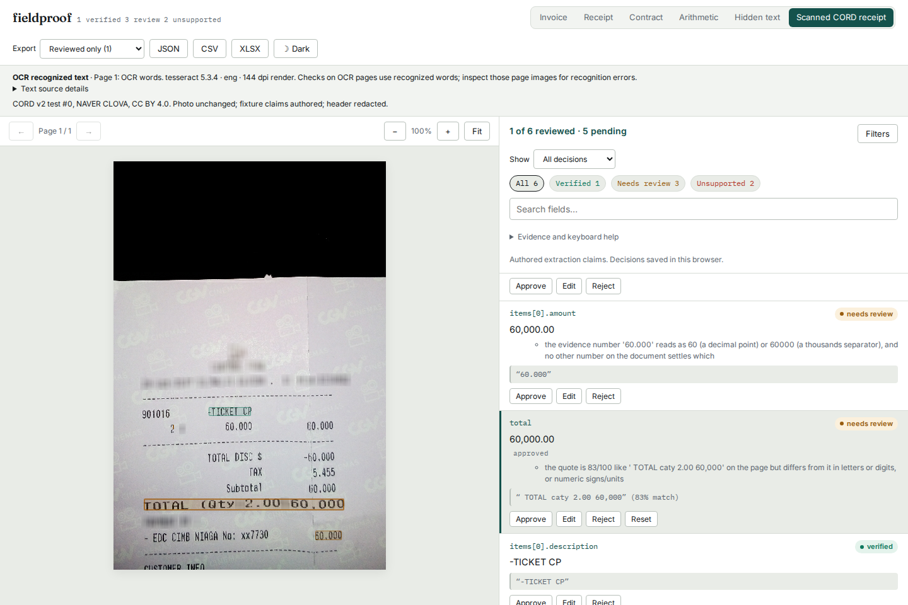
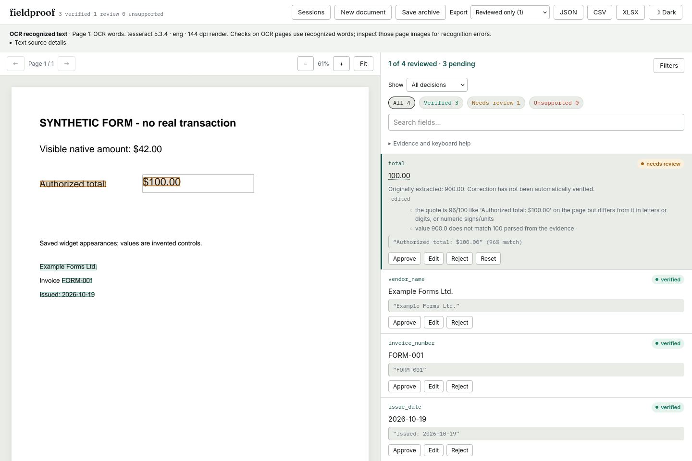

# Local scanned-PDF review: source, installed package and static example

An image-only CORD receipt that returned HTTP 422 from the previous review
server now opens through explicit local OCR. A mixed two-page control keeps
native header words and OCRs its scanned total. All-page OCR reads the visible
100 on a saved form while keeping its original 900 claim in review.

The executable source is frozen at
[`24ad5c3502b9c6bbcfe63ac55034690fa5712bfc`](https://github.com/antonsoo/fieldproof/tree/24ad5c3502b9c6bbcfe63ac55034690fa5712bfc).
Later evidence/documentation commits do not change its runtime. The
[replay and reproduction commands](../studies/server-ocr/README.md) identify
the real receipt, its license, the authored controls and exact inputs.

## What was checked

| Boundary | Evidence |
| --- | --- |
| Before | Isolated source `37084b8b399b183f6bc4a66f32573f319f0737a6`: the exact image-only receipt is rejected with 422. |
| Source API | 12 cases; 8 archives restored into an empty store with exact reports and decisions. |
| Recognizer transfer | Direct native Tesseract TSV matches 106 words and coordinates across 6 OCR pages, bypassing pytesseract and API conversion. The renderer is shared. |
| Native compatibility | Previous/current report, both JSON/CSV/XLSX scopes and version-1 archive are byte-identical for the existing invoice/correction workflow. Browser exports also match their previous bytes. |
| Source UI | 20 scenarios across Chromium/Firefox at 1440/375: 120 actual offline downloads, typed workbook cells, source notices and 20 empty-store archive restores. |
| Installed UI | The same 20 scenarios on the clean installed Python 3.14 wheel; the live workflow is unchanged by the final demo-label copy correction. A final-wheel saved-form smoke also retains original 900, recognized 100 and needs-review. |
| Clean build | All 1,565 tracked files match the frozen Git archive. Node 24.22.0 clean install/build; wheel built from its source distribution, with 23 bundled UI files. |
| Installed artifacts | Wheel, sdist, clean source and installed runtime files match in both environments. All 23 UI files fetched from the final installed server match the final wheel. |
| Python compatibility | Installed wheel on Python 3.11.13 with declared dependency floors and Python 3.14.7 with current dependencies; each repeats the 12 API cases, 8 restores and direct recognizer comparison. Exact versions are in the artifact receipt. |
| Actual restart | Eight source archives restored before and after terminating/restarting the installed Python 3.11 server, with an empty store at each start. Claims, decisions and exported values survive. |
| Static example | Four actual Chromium/Firefox desktop/phone scenarios; 24 downloads. The photograph is credited, claims are authored, merchant/date remain empty, and the automated total remains in review after approval. |

[Artifact hashes, dependency versions and runtime-file comparison](../studies/server-ocr/results/artifact.json),
[served installed UI bytes](../studies/server-ocr/results/installed-ui.json),
[source browser receipt](../studies/server-ocr/results/browser-source.json),
[installed browser receipt](../studies/server-ocr/results/browser-installed.json),
[static example receipt](../studies/server-ocr/results/browser-demo-local.json), and
[actual restart receipt](../studies/server-ocr/results/restart.json).

The installed 20-case run uses the preceding UI build
`bbc4e86db09d17adbbd7e2033affc2c37dabf0f3`. The final frozen source changes only
two demo-mode copy strings from “synthetic fixture” to “authored extraction
claims.” All Python and live UI behavior remain the same; the final package
has its own repeated API replay, served-byte check and installed smoke.

The source checks pass 858 Python tests, Ruff, mypy on 43 source files, and 71
web unit checks, typecheck, ESLint and Prettier. Existing browser checks exposed
and drove the small-phone selector fix. The source and installed OCR workflow
receipts report no Axe violations, horizontal overflow, runtime errors, CSP
violations or off-origin requests in their checked states. Transient toast
animations settle before contrast sampling; no elements are excluded.

## Reports are recomputed, not cached authority

The floor runtime reproduces its own reference report exactly. One source
report's saved-form invoice-number word box changes from bottom 336.5 to 336.0 points
when re-recognized with PDFium 5.0 rather than 5.13. Its words, verdict, claims,
decisions and exported values agree. The other seven reports match the source.
This is why an archive stores the PDF, claims, decisions and processing choice,
and reruns recognition and verification when opened. It cannot promise the
same report across recognizer, renderer or verifier versions.

## Visual review and limits

The photograph is CORD / NAVER CLOVA, CC BY 4.0. Its source header was already
redacted. The screenshot adds Fieldproof's review overlay; the PDF wrapper
preserves the source RGB pixels. [Attribution and changes](../examples/recorded/cord/NOTICE.md).

The form is a labelled authored control, not a transaction. A
[375-pixel receipt view](assets/server-ocr/cord-receipt-phone.png) and all other
captured screenshots were opened for visual inspection. The sixth example
uses a native sample selector on phones, preserving field-list height and
keyboard access; existing 320/375-pixel checks and both-theme layouts pass.

Both OCR choices impose an 8-page document budget, English at 144 dpi and a
10-second per-page recognizer limit within the existing 30-second worker
budget. Other memory, pixel, text and queue limits can refuse smaller files.
Missing-page mode retains any existing native page text. All-page mode can
introduce recognition errors. Verification of OCR words is not proof of what
was printed or an extraction-accuracy measurement. The POSIX descendant cleanup
is exercised; Windows process-tree cleanup is not verified on Windows.

The PyPI version remained 0.2.7 at the publication check; no registry release
was created. The new local source, built/installed wheel and hosted static
example are separate artifacts. The static site cannot OCR a new upload.
