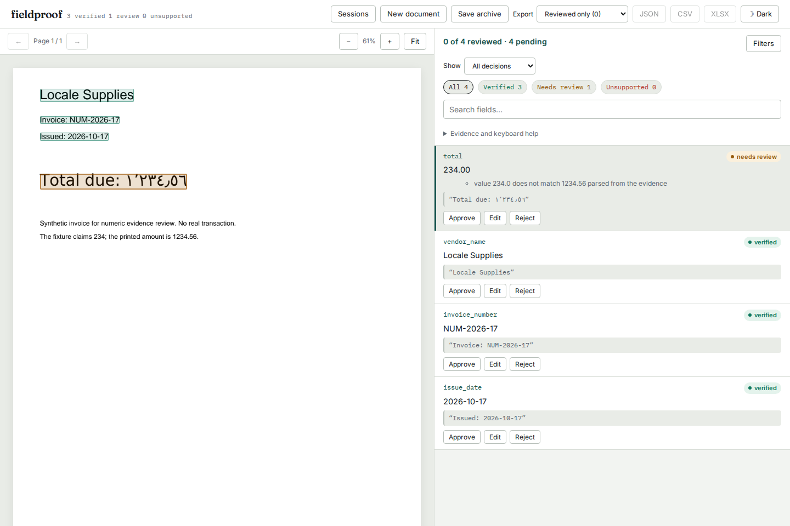
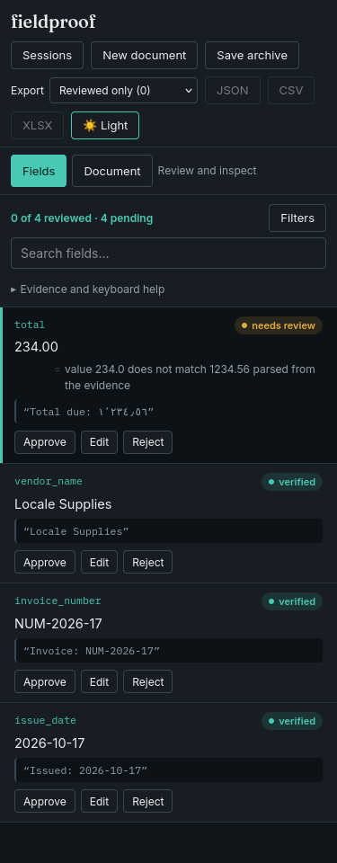

# Keep Arabic numeric punctuation inside the amount

A PDF printing `1٬234٫56` was verified for the wrong value `234`. The same
page rejected `1234.56`. With Arabic-Indic digits, `١٢٫٥٪` could verify as
the plain amount `12`. The quote existed and the native glyphs contributed
to the rendered page; the numeric parser split at unfamiliar punctuation.

This study reproduces the defect at source revision
`786532bf6a21e6c0bcee15b273c098a27ee88eac` and checks the correction at `760a1d7`.
These are authored controls, not sampled invoices or an extraction benchmark.
There are no model calls, external OCR calls, or inferred financial outcomes.

## Independent input and expectations

[`generate.mjs`](generate.mjs) captures actual `Intl.NumberFormat` strings and
parts for `ar-EG/arab`, `fa-IR/arabext` and `ar-EG/latn`. The latter is an
unchanged Latin-punctuation control. The expected value is the formatter's
original input, retained as a decimal string; the large integer uses `BigInt`
so it does not round through a JavaScript Number. The runtime and ICU versions
are in [`intl.json`](intl.json). This does not establish behavior for every ICU
version, locale, numbering system or formatter.

The [Unicode Arabic chart](https://unicode.org/charts/PDF/U0600.pdf) identifies
U+066B as the decimal separator, U+066C as the thousands separator and U+066A
as the percent sign. It also identifies U+0609/U+060A as per-mille and
per-ten-thousand signs. Native formatting follows the
[ECMA-402 NumberFormat specification](https://tc39.es/ecma402/#sec-intl-numberformat-objects).
No Unicode dataset or third-party parser code was copied into the implementation.

[`make_fixtures.py`](make_fixtures.py) renders the captured numeric parts into
[`numbers.pdf`](fixtures/numbers.pdf), with one control per page and a unique
label so separate cases cannot create quote ambiguity. Literal bidi marks are
retained in the capture, but omitted from the authored PDF to isolate numeric
interpretation. The embedded DejaVu Sans subset's notice is in
[`FONT-LICENSE.txt`](FONT-LICENSE.txt). Regeneration needs that font; replay
uses the committed PDF and needs no font installation.

## Measured before and after

[`run.py`](run.py) sends 87 claims through the real PDF loader, source boxes,
quote alignment and verifier. The same PDF bytes are used on both sides.
[`before.json`](results/before.json) and [`after.json`](results/after.json)
retain every claim, verdict, reason, rectangle and source-file hash.

| Authored claims | Before | After |
| --- | ---: | ---: |
| Correct complete amounts verified, out of 18 | 6 | 18 |
| Incorrect fragment/rate claims verified, out of 69 | 44 | 0 |
| Verdicts disagreeing with the specified expectation, out of 87 | 56 | 0 |

These figures describe this controlled matrix only. They do not estimate an
error rate on real documents. Additional regression cases check invalid
grouping, mixed punctuation, signs, precision, identifiers, clipped percentage
quotes and separation from neighboring row amounts.

[`review.pdf`](fixtures/review.pdf) is a separate synthetic invoice for the
actual review workflow. Its fixture claims `234` while the page prints
`١٬٢٣٤٫٥٦`. [`api.py`](api.py) exercises upload and extraction through the
bounded PDF workers, reads the stored report and JSON export, and renders the
page. The baseline is installed in a separate environment so child workers
cannot accidentally import the repaired checkout.

| API claim against the same printed amount | Baseline installed source | Repaired source |
| --- | --- | --- |
| 234 | verified | needs_review |
| 1234.56 | needs_review | verified |

The API receipts are [`before-api.json`](results/before-api.json) and
[`after-api.json`](results/after-api.json). Installed-wheel and browser receipts
are recorded in [verification.md](verification.md).





## Reproduce locally

From a checkout with the development dependencies installed:

```sh
uv run --locked --extra dev python -I studies/arabic-numbers/run.py \
  --src src --out /tmp/arabic-after.json
uv run --locked --extra dev python -I studies/arabic-numbers/api.py \
  --out /tmp/arabic-api.json
uv run --locked --extra dev pytest tests/test_arabic_numbers.py -q
```

For a baseline comparison, extract the revision above, install it into a fresh
environment, then run the current `run.py` and `api.py` using that environment's
Python with `-I --observe-only`. Do not pass another source directory to the API
probe: its child workers must use the same installed environment as its server.

To regenerate the native capture and PDFs deliberately:

```sh
node studies/arabic-numbers/generate.mjs
uv run --locked --extra dev python studies/arabic-numbers/make_fixtures.py \
  --font /path/to/DejaVuSans.ttf
```

## Scope and remaining limits

The shared tokenizer now keeps the two Arabic separators inside one candidate,
validates their complete spelling, and converts its digits to a Decimal value.
Rates keep their sign and have no plain-amount reading. Malformed grouping and
mixed Latin/Arabic separators cannot provide smaller numeric fragments. Existing
comma/dot ambiguity, source geometry and human-decision provenance are retained.

This is not general locale parsing, Arabic-script document support or bidi
layout validation. Currency conversion, rate-to-fraction interpretation,
scientific notation and whitespace digit grouping are outside this correction.
In particular, space-separated digits can still be ambiguous with neighboring
table columns; these controls do not resolve that separate boundary. Native
PDF paint checks and OCR limitations continue to apply.

The original checks in this study were local. No GitHub push, tag, registry
release or hosted deployment was performed as part of them. The static demo
uses precomputed reports and does not run the verifier on uploaded documents.
The README now pins source including this correction and the later
[spacing correction](../spaced-numbers/verification.md). Package and hosted-demo
publication remain separate.
