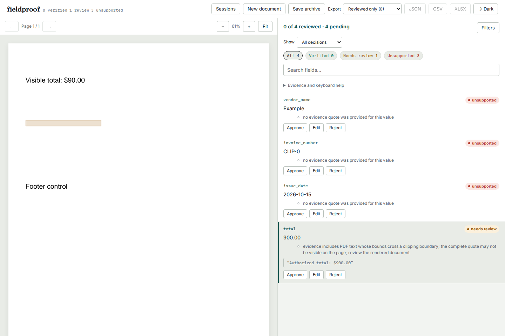

# Clipped PDF text must not verify a hidden total

On baseline `0669eefded67e09be47b53855a2ffa76dd4b6512`, a PDF displaying
`Visible total: $90.00` also contained `Authorized total: $900.00` outside its
clipping path. Fieldproof verified the hidden `$900` claim and highlighted blank
pixels. A Form XObject's bounding box produced the same result without an
explicit clipping operator.

These are deliberately authored PDFs and fixture extractions. The study checks
a bounded verification policy, not model accuracy or real-world prevalence.



## Behavior

Native words now retain `clip_risk` when a glyph's layout box crosses a known
outer clipping bound. Quotes touching those words require review and keep their
original text and locations. The flag survives worker JSON transport and word
assembly. Affected words cannot settle number/date conventions, disambiguate a
repeated row value, or supply a table's column headings. Text-edit tolerance
cannot remove the clipping reason.

The parser intersects conservative path bounds in device coordinates, following
graphics-state save/restore, path completion, coordinate transforms and nested
Forms. A Form also clips to its own transformed bounding box. Bezier control
points give conservative curve bounds; both winding rules share those outer
bounds. These semantics follow ISO 32000-1:2008, sections 8.5.4 and 8.10.2:
[PDF specification](https://opensource.adobe.com/dc-acrobat-sdk-docs/pdfstandards/PDF32000_2008.pdf).

## Captured evidence

The [46 PDFs](fixtures/) have declared expectations in [cases.json](cases.json).
They include every path-ending operator, both clipping operators, zero-area
and negative-size rectangles, intersections, curves, compound paths, graphics
state restoration, transforms applied before and after clipping, nested Forms,
Form dictionary matrices, content rotation, page rotation and partial clipping.
Visible claims before and after every clipped object check for state leakage.

| Check | Baseline | Repaired source |
|---|---:|---:|
| Affected claims incorrectly verified | 31 | 0 |
| Claims matching their declared verdict | 107 / 138 | 138 / 138 |
| Visible control claims verified | 107 / 107 | 107 / 107 |

[Before](results/before.json) and [after](results/after.json) retain input hashes,
actual verdicts, matched quotes, reasons and geometry. Each replay round-trips
the loaded document through JSON before verification, as the server does.

[Pixel checks](results/pixels.json) compare every fixture to a PDF omitting only
the alternate total in both PDFium and Poppler. All 92 comparisons agree with
the declared full-hidden/visible state. The partially clipped control also
differs from the fully painted version in each renderer. Renderers are compared
to their own reference, not to each other's antialiasing.

All ten existing example PDFs keep identical extracted text, word geometry and
verification report hashes:
[before](results/compatibility-before.json), [after](results/compatibility-after.json).
Those checks are compatibility evidence for the included examples, not a
representative corpus of arbitrary PDFs.

The [verification receipt](results/verification.json) records the clean archive
installation, Python and web checks, and **92 passing production browser
checks**. The source and separately installed Python 3.14 wheel each pass 680
Python tests; five real-Tesseract tests are skipped because the engine is
unavailable. The Python 3.11 installation with the oldest declared direct
dependencies passes all 138 study claims and 37 clipping/opacity/geometry
regressions. Both installations reproduce every source verdict, reason and
rectangle exactly.

[Artifact hashes and module comparisons](results/artifacts.json) identify the
wheel and sdist. All 39 Python modules match the clean source in both wheel
installations, and all 62 source/bundled-UI files in the sdist match the clean
build. All [56 served live/demo files](results/served-bytes.json) match the
tested builds byte for byte.

Chromium and Firefox exercise upload, fixture extraction through actual worker
processes, inspection at 1440 px and 375 px, correction from 900 to the displayed
90, export, archive save, session deletion and restoration. The export retains
original 900 and automated `needs_review`; restoration recomputes the original
report. Observations: [Chromium](results/chromium-browser.json),
[Firefox](results/firefox-browser.json). All four screenshots were inspected;
the [phone view](../../docs/assets/clipped-text/firefox-375.png) keeps the reason
readable without horizontal overflow. The full suite separately checks offline
exports in the static demo; live intake and restoration require the local server.

The baseline browser capture is also retained:
[report](results/before-browser.json),
[desktop](../../docs/assets/clipped-text/before-chromium-1440.png).
An interrupted browser attempt left a stale test session, and a static test
server was terminated during an early full attempt. The final run used fresh
isolated services with redirected logs and passed all 92 checks without retries.

## Reproduce

```sh
uv sync --locked --extra dev --extra ocr
uv run python studies/clipped-text/replay.py /tmp/clipping-after.json --check
uv run python studies/clipped-text/pixels.py
```

The pixel check also requires Poppler's `pdftoppm`. Committed PDFs are sufficient
for the replay; `generate.py` recreates them with ReportLab. To reproduce the
baseline, invoke the same replay with `PYTHONPATH` pointing to that revision's
`src/`, using the same interpreter and dependencies.

The ordinary CLI needs no model or OCR engine:

```sh
uv run fieldproof verify studies/clipped-text/extraction.json \
  studies/clipped-text/fixtures/end-n.pdf --out /tmp/clipping-result.json
```

Build the bundled review UI and wheel using
`uv run python scripts/bundle_ui.py && uv build`. Run the installed server on
port 4300 and serve the static demo from `web/dist-demo` on port 4301, then:

```sh
cd web
UPDATE_CLIPPING_SCREENSHOTS=1 npx playwright test \
  --config ../studies/clipped-text/browser.config.mjs
```

Set `FIELDPROOF_BROWSER_FULL=1` to exercise the complete production browser
suite against those servers.

## Limits

This is an outer-bound check. It cannot detect text hidden in holes, outside
the interior of a curved path but inside its bounding rectangle, by a text
clipping mask, by optional-content state, or by later overpainting. White ink,
general soft-mask transparency and incorrect font/Unicode mappings remain
outside its scope. Passing it does not establish pixel visibility.

Glyph layout boxes can cross a bound while their remaining ink is readable.
That is why the metadata identifies a review risk rather than declaring the
whole word invisible. A one-millionth-point tolerance avoids flags caused only
by arithmetic at a shared boundary. A malformed/unrepresentable path does not
supply a tighter bound. An isolated `W n` without a constructed path is ignored,
matching the two renderer controls; a constructed zero-area rectangle is not.

Old caller-supplied/OCR documents remain compatible when they omit `clip_risk`;
the default does not establish visibility. Native parsing still depends on
pdfminer/pdfplumber internals, so dependency updates need the actual PDF controls.
The check adds no dependency, rasterization or model call to PDF intake.

This work is local source verification. It has not been pushed, deployed or
published to a package registry.
