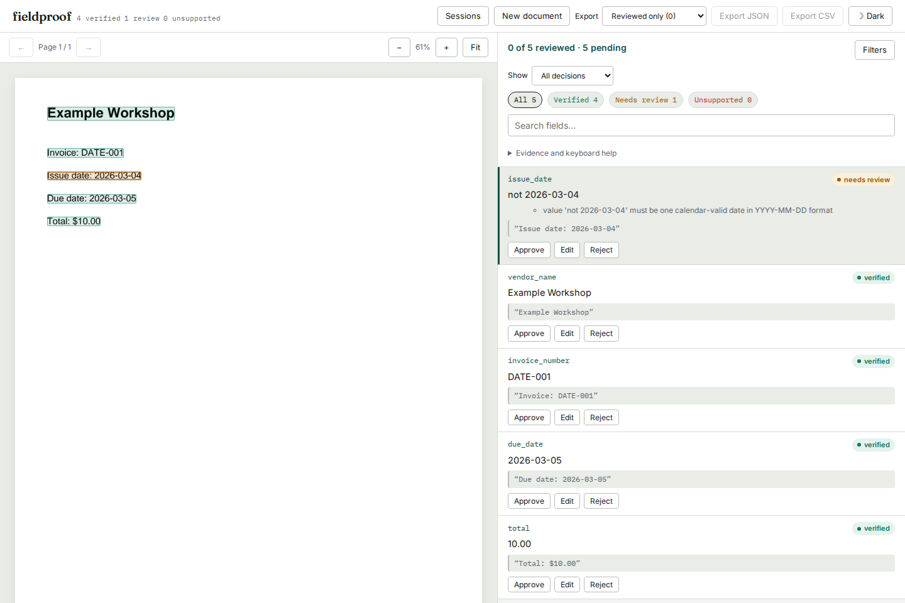

# An extracted date must actually be a date

The built-in schemas request dates as `YYYY-MM-DD` strings. The verifier used
the same permissive parser for extracted claims and evidence. That parser is
useful for finding a date inside a quoted label, but it also made these claims
appear verified against a page saying `Issue date: 2026-03-04`:

| Extracted value | Before | Corrected |
| --- | --- | --- |
| `2026-03-04` | Verified | Verified |
| `not 2026-03-04` | Verified | Needs review |
| `2026-03-04 or 2026-04-03` | Verified | Needs review |
| `03/04/2026` | Verified, including with a day-first default | Needs review |
| `March 4, 2026` | Verified | Needs review: extraction must provide the requested ISO date |

The correction separates strict **claim** parsing from flexible **evidence**
parsing. It does not reinterpret or overwrite the extracted value. Invoice
due-date ordering becomes `not_checked` if either claim is not a single valid
`YYYY-MM-DD` date. A canonical but incorrect claim still participates in the
ordinary claimed-date comparison; arithmetic/date consistency is not proof of
grounding.

These are synthetic fixture extractions, not observed model failures or an
accuracy benchmark. [date-claims.pdf](date-claims.pdf) was generated with ReportLab
and read through the actual PDF loader. Twelve claim pairs are checked with no
date-order default, a month-first default and a day-first default. All 72 field
observations retain the original claim, located quote, page and bounding boxes.

| Replay | Before (`0330e8a`) | Corrected |
| --- | --- | --- |
| 36 PDF scenarios | 27 disagree with expected verdict/chronology | 0 disagreements |
| 12 real CLI invocations | 9 disagree | 0 disagreements |

The complete reports are in [before.json](results/before.json),
[after.json](results/after.json), [cli-before.json](results/cli-before.json) and
[cli-after.json](results/cli-after.json). The canonical, impossible-calendar and
wrong-canonical-date cases are controls. The right ISO date remains verifiable
against written-month and localized numeric evidence; existing evidence ambiguity
rules still apply.

```sh
uv sync --locked --extra dev
uv run python studies/date-claims/run.py --src src --out /tmp/date-claims.json
uv run python studies/date-claims/cli.py --src src --out /tmp/date-claims-cli.json --scratch /tmp/date-claims-cli
```

For an installed wheel, use its Python and omit `--src`. The PDF is generated
deterministically and byte-checked when rerun. To inspect the example in the UI,
upload the PDF and [negated-claim.json](negated-claim.json) as its fixture, then
run extraction. The incorrect value remains visible beside the page evidence.
An edit records a reviewer decision and does not retroactively verify it.

This intentionally makes noncanonical extracted date values reviewable, even
when a human can interpret a written month unambiguously. Callers should supply
the format requested by the schema. `parse_date` remains the permissive public
evidence utility; `parse_iso_date` exposes the strict claim parser. The date-field
selection rules are unchanged. This correction does not establish that a cited
date semantically belongs to the field, perform OCR or validate a real model.
It is not yet in a PyPI release.

## Compatibility and installed review

The existing receipt replay was run on both revisions, checking the hashes of
all four cached annotation files. All **7,600 scripted date claims** and the
date-convention records of **1,052 documents** are identical. The existing
annotations, adapter assumptions and two unparseable annotated dates are
unchanged; this is compatibility evidence, not a new accuracy measurement.
[receipts.json](results/receipts.json) retains the input and result hashes.

A clean archive of `639ef2d` passed lint, mypy and all **357 Python tests** on
Python 3.14.7. The UI passed lint, typecheck, 50 tests and both production builds.
The bundled wheel, built from its source distribution, was separately installed
on Python 3.11.13. All 36 PDF scenarios, 12 CLI scenarios and 39 targeted tests
passed there. All 23 installed UI files match the clean build.

Chromium and Firefox exercised that installed server at 1440 and 375 pixels:
the false claim needs review, the original PDF highlight remains available,
date ordering is unchecked, and edited JSON/CSV exports retain the original
claim and verification status. Accessibility checks found no violations. The
screenshots were visually inspected. [verification.json](results/verification.json)
records the wheel hash, dependency versions and exact scope; the installed
[PDF](results/installed-pdf.json) and [CLI](results/installed-cli.json) receipts
retain each case.


