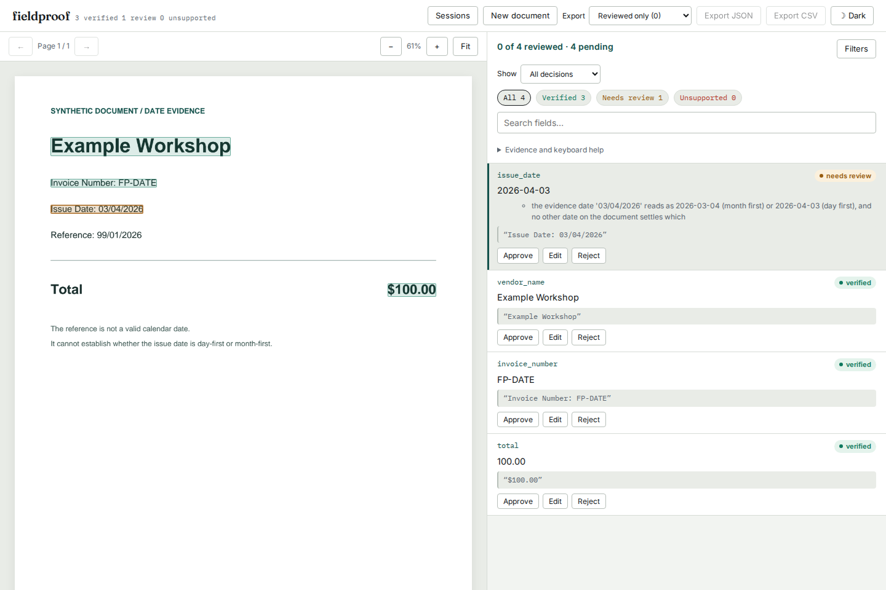

# An impossible reference cannot decide the issue date

Source change, unreleased on PyPI. Baseline: `7be880a`.

A PDF says `Issue Date: 03/04/2026` and `Reference: 99/01/2026`. The previous
verifier treated the reference as evidence of day-first order, even when the
caller explicitly supplied `default_date_order="mdy"`. It verified April 3
and rejected March 4. The reference is not a possible calendar date.

The verifier now requires a complete numeric token with exactly one valid
calendar reading to settle the document convention. Both readings valid means
ambiguous; neither valid means unusable. Conflicting valid conventions still
return no inferred order. A caller's default remains a fallback; a valid,
unambiguous date in the document still takes precedence.

Numeric token boundaries are shared by grounding, convention discovery and the
free-text parser. This last part matters: otherwise an identifier rejected by
the ambiguity check could fall through to a permissive parser and verify as
month-first. Sentence punctuation and labels such as `Date:14/03/2026` remain
supported; attached letters, underscores and continuing separators do not.

## Try the actual PDF

From an installed build of this source checkout:

```bash
fieldproof extract examples/date-convention.pdf --schema invoice \
  --fixture examples/fixtures/date-convention.json --date-order mdy \
  --out /tmp/date-convention.json
fieldproof serve --port 8000
```

Upload [the constructed PDF](../../examples/date-convention.pdf) and
[its handwritten fixture](../../examples/fixtures/date-convention.json) in the
review UI. The CLI reports three verified, one needing review. The browser,
which supplies no default, explains both possible readings. A reviewer may
edit the date and export it; that correction does not replace the original
automated verdict or pretend to reverify the new date.



## Before and after through the PDF loader

`run.py` generates 35 deterministic PDFs and runs both claimed readings with
no default, `mdy` and `dmy`: 210 checks. The expected interpretation is specified
in the scenario, independently of the parser. Controls cover actual day/month
conventions, labels, sentence punctuation, equal day/month, leap years and
Gregorian century exceptions. Failure cases include impossible dates, long
years, attached identifiers and a date-shaped prefix of a longer token.
Seven PDFs cite the identifier itself, exercising the fallback parser.

| Outcome on these constructed claims | Before | After |
| --- | ---: | ---: |
| Wrong or unsupported claims verified | 43 | 0 |
| Supported claims sent to review | 17 | 0 |
| All verdict mismatches | 60 | 0 |

These are deliberate reproductions, not an estimate of real-world error rates.
The independent unit oracle additionally checks numeric components 0 through
32 in years 1900, 2000, 2024 and 2025 against `datetime.date` construction.
The committed [results](results.json) retain every PDF claim, expected verdict,
both observed verdicts and PDF hash. The generator reproduces the PDFs.

## Cost on the existing receipt annotations

`receipts.py` reads the four pinned files from the existing
[CORD/SROIE manifest](../cord-grounding/manifest.json), checks their hashes,
and uses that study's annotation adapter and stated day-first interpretation.
It sees 1,052 documents, 565 parseable annotated dates and two unparseable date
annotations, which are explicitly skipped. Correct, previous-day, next-day
and applicable swapped-day/month claims, with printed or ISO quotes and with
no default or `dmy`, give 7,600 checks. Images, OCR and model extraction are
not rerun; input data is not redistributed here.

**No claim verdict, candidate count or gold-location outcome changed.** Four
document conventions changed. Inspection of their local annotated text found:

| Document | Before | After | Evidence behind the change |
| --- | --- | --- | --- |
| `sroie-241` | unresolved | dmy | A dotted phone number's prefix no longer conflicts with a real day-first date |
| `sroie-251` | unresolved | dmy | A date-shaped substring inside a product identifier no longer conflicts with a real date |
| `sroie-434` | dmy | unresolved | A real date is fused directly to `TIME` in OCR text; the strict boundary rejects it |
| `sroie-436` | dmy | unresolved | An impossible day inside a version-like token no longer establishes a convention |

The fused-date document has no eligible annotated date claim in this adapter,
so unchanged claim totals **do not demonstrate zero recall cost**. Fieldproof
will need separate layout or OCR-boundary evidence to recover such text safely.
A standalone valid date used as a reference number can also still establish a
convention; calendar validity does not prove the semantic role of a token.

The remaining claim outcomes are retained, including an existing ISO-quote
match on `sroie-312` outside the annotated location, with and without a default.
It is not counted as a correct verification:

| Caller default / quote | Correct at annotated location | Correct value at another location | Correct claim needing review | Wrong values verified |
| --- | ---: | ---: | ---: | ---: |
| None / printed | 279 / 565 | 0 | 286 | 0 / 1,335 |
| None / ISO | 276 / 565 | 1 | 288 | 0 / 1,335 |
| dmy / printed | 447 / 565 | 0 | 118 | 0 / 1,335 |
| dmy / ISO | 442 / 565 | 1 | 122 | 0 / 1,335 |

## Reproduce

Run from the repository root with Python 3.11 or newer. `pyarrow` is needed only
for the receipt replay; the normal package does not gain a dependency.

```bash
uv sync --locked --extra dev
mkdir -p /tmp/fieldproof-date-baseline
 git archive 7be880a | tar -x -C /tmp/fieldproof-date-baseline
uv run --locked python -I studies/date-conventions/run.py \
  --src /tmp/fieldproof-date-baseline/src --out /tmp/date-before --observe-only
uv run --locked python -I studies/date-conventions/run.py \
  --src src --out /tmp/date-after

# Downloads approximately 1.2 GB only if the pinned cache is absent.
uv run --locked python studies/cord-grounding/fetch.py
uv run --locked --with pyarrow python -I studies/date-conventions/receipts.py \
  --src /tmp/fieldproof-date-baseline/src --out /tmp/receipts-before.json
uv run --locked --with pyarrow python -I studies/date-conventions/receipts.py \
  --src src --out /tmp/receipts-after.json
uv run --locked python studies/date-conventions/compare.py \
  --pdf-before /tmp/date-before/results.json --pdf-after /tmp/date-after/results.json \
  --receipts-before /tmp/receipts-before.json --receipts-after /tmp/receipts-after.json \
  --out /tmp/date-comparison.json
```

`compare.py` asserts matching claim identities and input hashes before pairing
results. Raw receipt replay hashes are retained with the compact comparison.
ReportLab versions can change PDF bytes; use the locked environment to reproduce
the committed hashes. No timing benchmark or production accuracy claim is made.

The [installed-package replay](installed.json) checks all 210 full field results
and six real CLI invocations outside the source tree. The focused browser run
uses a separately installed server on port 4300:

```bash
web/node_modules/.bin/playwright test --config studies/date-conventions/browser.config.mjs
```

It inspects the rendered PDF, checks accessibility and overflow at 1440 and 375
pixels, edits the date, compares browser/API exports and reopens the session.
[Browser observations](../../docs/assets/date-conventions/) retain the original
evidence and exported correction. See the [verification record](../../docs/verification-date-conventions-2026-10-09.md)
for the clean build and complete suite.
