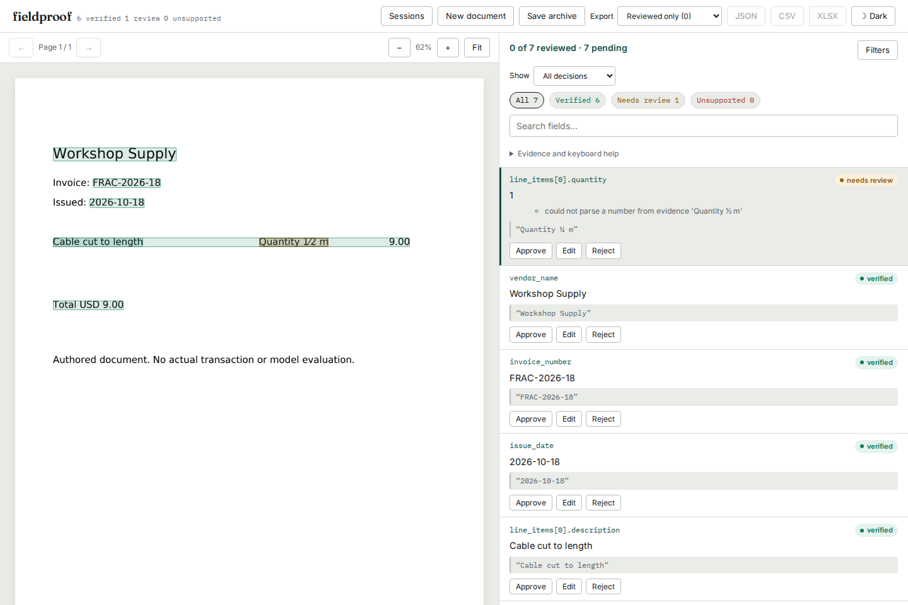

# A fraction is not evidence for either of its components

At baseline `5bfa604`, a native PDF printing **Quantity 1⁄2 m** verified both
1 and 2 as the extracted quantity. U+2044 fraction slash and U+2215 division
slash were treated as punctuation between separate numbers. Spaces around an
ordinary slash exposed the same problem: `1 / 2` supplied 1 and 2.

These are authored, visible native-text PDF controls, not real transactions or
a measurement of model/OCR accuracy. Six pages use `/`, `⁄`, and `∕`, each with
and without spaces. A separate one-page invoice keeps quantity on its item's
visual line so row-association checks do not mask the numeric failure.

| Input/workflow | Baseline | Corrected source |
|---|---|---|
| 36 component claims on six PDF pages | 26 false approvals | No false approvals |
| Invoice quantity 1, quoting `Quantity 1⁄2 m` | Verified | Needs review |
| Six other invoice fields | Verified | Same |
| Actual CLI extraction followed by re-verification | Wrong quantity verified | Original value retained, quantity needs review |
| Existing 1,052 CORD/SROIE receipts, 133,722 claims | Retained baseline | Every verdict, candidate count and location classification unchanged |

[Before](results/before.json) and [after](results/after.json) retain every PDF
claim, source span, reason and both actual CLI commands. The
[existing-receipt receipt](results/receipts.json) records 133,720 completely
unchanged observations. Two already-reviewed mutated quantity claims on one
receipt now retain the wider slash-containing source context. Their verdicts
remain needs review. The replay used supplied OCR annotations and the existing
fixed mutations, with no new recognition or model calls.

## Behavior



The amount lexer retains the entire unsupported fraction, including spaces,
signs and original character offsets. Its numeric reader does not evaluate
fractions. Grounding a clipped numerator or denominator keeps the whole source
context and cannot turn the component into independently supported evidence.
Slash dates remain under the existing date lexer rather than borrowing a
neighboring receipt dash.

A correct claim of 0.5 with a fraction quote still requires review. A reviewer
can enter 0.5 after reading the document, but that decision does not make the
original automated check pass. JSON, CSV, numeric XLSX cells and saved archives
retain the extracted value 1, the correction, the quote and the automated status.
The UI/API browser workflow exercises this distinction, including disconnected
value downloads and restoration after removing the original session.

This is a bounded lexical correction. It does not interpret mathematical
expressions, stacked fractions, unit conversions or arbitrary slash-separated
prose. Whole-row quotes can contain other valid numbers; locating a number alone
does not establish its semantic role. Existing row/column and cross-field checks
retain their separate scope.

## Reproduce

Install this checkout with the development dependencies:

```sh
uv sync --locked --extra dev --extra ocr
uv run python studies/fraction-evidence/replay.py --src src \
  --out /tmp/fraction-evidence.json --artifacts /tmp/fraction-cli
```

`--src` can point to the baseline export; add `--observe-only` to retain its
false approvals. Omit `--src` to exercise a separately installed wheel. The
script reads the actual PDF, runs verification and invokes `fieldproof extract`
and `fieldproof verify`, checking that original claims and all report data agree.

`make_fixtures.py --font /path/to/DejaVuSans.ttf` regenerates the PDFs. They embed
a subset of that font, whose [license](FONT-LICENSE.txt) is retained. The
[Unicode punctuation chart](https://www.unicode.org/charts/PDF/U2000.pdf) identifies
U+2044; the [mathematical-operators chart](https://www.unicode.org/charts/PDF/U2200.pdf)
identifies U+2215. Numeric normalization preserves the original evidence text.

The real-receipt comparison uses the unchanged adapter and corpus from
[the CORD/SROIE study](../cord-grounding/README.md). With its pinned downloads
present, run its `run.py` against both source directories, then compare records
as an unordered multiset. The two retained changed records explain the complete
difference; it is not a fresh extraction benchmark.

The production browser regression is selected by
`studies/fraction-evidence/browser.config.mjs`. Start an installed package's
server separately and set `FIELDPROOF_BROWSER_URL` and a unique
`FIELDPROOF_BROWSER_OUTPUT`. `FIELDPROOF_CAPTURE_FRACTIONS_DIR` retains actual
screenshots, JSON/CSV/XLSX and archive downloads. The explicit study-only
`FIELDPROOF_FRACTION_BASELINE=1` mode replays the old server's wrong verdict;
the default regression requires review. No registry release or hosted static
demo update is implied by the source correction.

## Installed and public verification

[Verification](results/verification.json) uses a fresh archive at
`c600517c2f53b4ee00ef065395bfd12fd73ac8b1`. Python 3.14.7 and the dependency-floor
environment on 3.11.13 each passed 839 checks, with five real-Tesseract cases
explicitly skipped because that executable is absent. The receipt audit uses
supplied OCR annotations; it does not claim recognition was run.

The production suite passed 108 browser workflows after fresh Node 24 checks
and builds. The built wheel and sdist include 41 matching Python modules and
23 matching UI files. Independently installed wheels at both tested Python
versions passed the 36 native claims and both actual CLI commands. The
[artifact identity receipt](results/artifact-identity.json) distinguishes these
local bundled distributions from a registry release.

[Four baseline](results/browser-before.json) and
[four installed corrected](results/browser-installed.json) browser contexts
in Chromium/Firefox at 1440/375 pixels exercised 20 actual JSON/CSV/XLSX,
archive and restored-JSON downloads per phase. Numeric XLSX cells match the JSON ledger.
Value downloads worked offline without requests; archives were saved/restored
online. Every delivered original PDF matches its archive member, and original
claims remain distinct from edited values and automated verdicts. Both servers'
23 served UI files match the fresh bundled build. All eight screenshots were
inspected, along with both archive-upgrade screenshots.

The retained [baseline archive](fixtures/before-review.zip) was actually saved
through the old server's UI. Four additional fresh corrected-browser workflows
[reopened it](results/archive-upgrade.json): the saved 0.5 decision survives,
the original 1 remains, and automated verification is recomputed as needs review.
Run `restore_upgrade.mjs URL OUTPUT` against an installed corrected server to
repeat those four actual JSON downloads.

The source correction is pushed. [All 58 checked public files](results/public-source.json),
including the 18 changed files and 41 Python modules, match the pinned revision.
A fresh pip upgrade from registry 0.2.7 installed that exact source; its
[41 module identities](results/public-identity.json) and
[actual native/CLI replay](results/public-replay.json) match. That direct Git
install has no bundled UI, as documented in the main README. The hosted static
demo and registry package were not updated.
