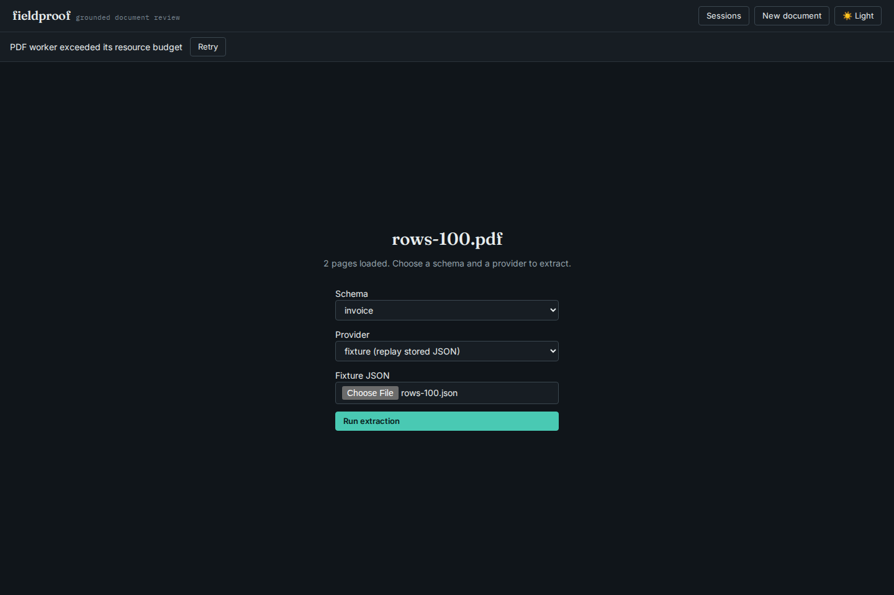

# Repeated invoice evidence within the worker budget

A small, two-page PDF with 100 line items uploaded successfully but failed
verification with HTTP 413: `PDF worker exceeded its resource budget`. The same
report took about a minute in the unrestricted library. Repeated quantities and
prices caused grounding to normalize and tokenize a whole page for each quote
occurrence, then repeat that work for later fields.

The repair prepares each page's text, numeric tokens and offset indexes once
per verification. Candidate lists are reused by quote and page hint, with limits
of 256 quotes and 8,192 candidate/word references. Oversized lists are computed
without caching or truncation. Value checks, row association and arithmetic
still run independently. No cache survives a verification call; edits and other
documents receive fresh source geometry. Worker limits have not changed.

## Measured behavior

Baseline: `df1eef444d16b8ba7da47f787eabc54bf1fb3266`. Results record SHA-256
of the implementation files, input PDFs, extraction fixtures and complete
reports. Measurements used Python 3.12.12 on shared 14-vCPU, 48-GB WSL2 Linux
hardware on 2026-10-11, with other checks running. They are local observations,
not isolated benchmark guarantees.

| Synthetic line items | Pages | Fields | Before library median | After library median |
| ---: | ---: | ---: | ---: | ---: |
| 25 | 1 | 104 | 1.977 s | 0.011 s |
| 50 | 1 | 204 | 14.532 s | 0.033 s |
| 100 | 2 | 404 | 59.109 s | 0.076 s |
| 400 | 8 | 1,604 | Not measured | 0.365 s |

Library medians use three runs and exclude PDF parsing. API measurements use
one request, include the actual disposable verification worker and fixture
loading, and exclude upload:

| Rows | Before API | After API |
| ---: | --- | --- |
| 100 | HTTP 413 in 20.031 s | HTTP 200 in 0.332 s |
| 400 | HTTP 413 in 20.047 s | HTTP 200 in 0.666 s |

[Before](results/before.json) and [after](results/after.json) retain each timing.
The complete library reports for 25, 50 and 100 rows are byte-identical across
the repair. The API and library reports also match after the repair. The
[100-row report](results/report-100.json) retains all 404 fields, positions,
reasons, row checks and arithmetic. It contains **201 verified, 203 needs-review,
zero unsupported** fields. Equal unit price and amount in the same row remain
ambiguous; repeated page headers also need review. Speed is not new evidence
that a claim is correct.



## Reproduction

The checked-in PDFs and fixture extractions are entirely synthetic, generated
by `generate.py` using ReportLab's deterministic PDF mode. No model or private
document was used. Generation is optional; the retained fixtures are sufficient:

```bash
uv sync --locked --extra dev --extra ocr
uv run python studies/grounding-reuse/generate.py
uv run python studies/grounding-reuse/measure.py --rows 25 50 100 400 \
  --work /tmp/fieldproof-grounding-after --out /tmp/fieldproof-grounding-after.json
```

To replay the baseline, archive the baseline commit into a separate directory,
and run the same `measure.py` with `PYTHONPATH` set to that archive's `src`.
Use `--rows 25 50 100` for the retained baseline measurement. The script records
the imported implementation's hashes; verify those against `results/before.json`.
Do not leave the override enabled for installed-package checks.

`check_browser.mjs URL accepted|rejected OUT_DIR` uploads the 100-row PDF and
fixture through the actual UI. The accepted flow inspects a quantity on page 2,
waits for the rendered PDF, approves and downloads that field, and checks that
an ambiguous amount remains under review. It checks Chromium and Firefox at
1440px dark and 375px light, including overflow, accessibility, script errors,
CSP and unexpected external requests. The rejected flow captures the baseline
worker error. The UI requires its local API; this is not an offline-server test.

## Compatibility on retained receipts

Fresh before/after runs of the unchanged
[CORD/SROIE adapter](../cord-grounding/README.md) compared **133,722 complete
case records from 1,052 receipts**. All keys and all recorded values match:
verdict, reason, candidate count, matched text and location judgment included.
This checks compatibility with the existing adapter and its limitations; it is
not a new extraction accuracy estimate or an independent location oracle.

[The comparison](results/receipt-compatibility.json) records zero changed rows,
input/output hashes and the canonical full-row hash. Raw output ordering differs
between runs, so matching is by unique case key. The four cached dataset files
were rehashed against the study's pinned manifest; see
[input verification](results/corpus-inputs.json). No raw receipt data is added here.

```bash
uv run --with pyarrow python -I studies/cord-grounding/run.py \
  --src /path/to/baseline/src --out /tmp/receipts-before.jsonl --workers 2
uv run --with pyarrow python -I studies/cord-grounding/run.py \
  --src src --out /tmp/receipts-after.jsonl --workers 2
uv run python studies/grounding-reuse/compare_receipts.py \
  /tmp/receipts-before.jsonl /tmp/receipts-after.jsonl /tmp/receipt-compatibility.json
```

Regressions also cover signed/percent evidence, page-hint ordering, duplicate
quotes with different claimed values, cache eviction, changed geometry between
verifications, and nonmonotonic word lists supplied by library callers.
