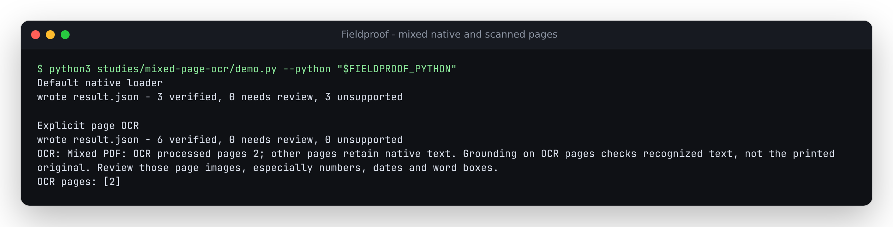

# Archived source and independently installed verification

Verified on 2026-10-14 from source archive `c30ab15`, baseline `d2ed381` and a
wheel built from the generated source distribution. The feature is opt-in CLI
and library functionality. No package publication or hosted update is included.

| Workflow | Result |
|---|---|
| Real mixed-page CLI | Three mixed layouts recover all six fields; default mode supports three and leaves three unsupported |
| Default compatibility | All ten default JSON results byte-identical to baseline, including native and whole-document scanned controls |
| Fresh Python 3.12.12 archive | Configured Ruff lint, mypy over 37 source files, 656 tests without skips, and 24 CLI workflows pass |
| Installed Python 3.14.7 | 24 CLI workflows, direct TSV/native-page checks and 44 focused regressions pass |
| Installed Python 3.11.13, explicit lowest direct dependencies | 24 CLI workflows, direct TSV/native-page checks and all 656 tests pass; two dependency deprecation warnings |
| Installed minimum OCR bridge | pytesseract 0.3.10 / pdfplumber 0.11.9 / pypdfium2 4.30.0 / Pydantic 2.12.0 |
| Installed current OCR bridge | pytesseract 0.3.13 / pdfplumber 0.11.10 / pypdfium2 5.14.0 / Pydantic 2.14.1 |
| Successful reports across installed environments | All 20 JSON results byte-identical |
| Direct engine comparison | All three native pages unchanged; 18 recognized words over four attempted pages match direct TSV text and boxes |
| Combined word/character limits | Actual native plus OCR population exceeds each controlled budget and rejects |
| Recognition timeout | Actual one-microsecond limit raises a page-2 timeout |
| Plain Python 3.11 installation, pytesseract absent | Native-only opt-in use succeeds; mixed input explains missing extra and preserves prior output |
| Fresh web | Clean install, lint/types/format, 50 unit checks, live/demo builds and 86 production Chromium/Firefox workflows pass |
| Runtime artifact identity | All 37 tracked runtime files match source, archive, sdist, wheel and three installations |
| UI artifact identity | All 23 bundled files match the sdist, wheel and three installations; all 34 live build files match the Node 26 tested and Node 24 bundled builds |
| Actual installed server | All 23 served UI files match installed bytes; native and mixed API controls retain the existing native-only server path |

The engine was Tesseract 5.3.4 with Leptonica 1.82.0, using English data. Five
fixed Ubuntu noble packages were downloaded and extracted into a temporary
runtime; no system package installation was performed.
[Package hashes](results/tesseract-packages.json) record the exact binary/data
inputs. [Installed versions](results/installed-dependencies.json) retain every
Python distribution rather than assuming a version from the environment name.

The current/floor interpreters were independently created and installed with
the wheel built from the sdist. The floor installation supplied all 20 declared
core/dev/OCR requirements explicitly with `--resolution lowest-direct`, so the
test exercised their floors rather than only resolving the local wheel. The
core installation omitted OCR extras. Runtime source hashes are captured by
the invoked interpreter, not the replay driver's interpreter.

The first replay prototype resolved the virtualenv executable's symlink and
lost its dependencies. It now retains the executable path. That failed log is
kept locally; it is not a product installation failure. An extra whole-tree
Ruff formatting check found five pre-existing unformatted files, exactly as
in the baseline. Formatting passes for every changed source/test/study file;
configured lint/type/test checks pass. No unrelated formatting repair is claimed.

Fresh commands were `uv sync --locked --extra dev --extra ocr --python 3.12`,
`ruff check src tests`, `mypy src` and `pytest -q`. The web used `npm ci`, lint,
types, format checking, unit tests, both builds and `npx playwright test`.
`python scripts/bundle_ui.py` bundles `web/dist/` into the package, then `uv build`
emits the wheel and sdist. A further `uv build --wheel` from that sdist emitted
a byte-identical wheel. These are local artifacts of version 0.2.7.

| Artifact | Bytes | SHA-256 |
|---|---:|---|
| Wheel, including wheel from sdist | 598,060 | `58e809dfc6eb584346b198b2e5fbf602f1dcc6dc6dbaf0fa1e8a228dbc4659d9` |
| Source distribution | 624,704 | `d49732588a9f9845ec26438b91b36d4873b34eb1da05d55da2503f298626c802` |

[Artifact receipt](results/artifact-verification.json),
[current CLI](results/installed-current/results.json),
[floor CLI](results/installed-floor/results.json),
[current TSV/native-page comparison](results/oracle-current/results.json),
[floor comparison](results/oracle-floor/results.json),
[plain install](results/core-only.json) and
[installed server](results/installed-server.json) retain the results.
The actual documented console-entry commands also completed extraction and
in-place re-verification successfully.

The image is rendered from [unedited demo stdout](../../docs/assets/mixed-page-ocr.ansi)
captured from the installed Python 3.14 interpreter. It and the authored totals
raster were visually inspected. No product UI source changed. The source native
and mixed server behavior was checked separately; it does not expose this new
CLI/library option. The controlled typefaces/layouts do not establish OCR
accuracy on photographs, handwriting, skewed scans or arbitrary documents.
