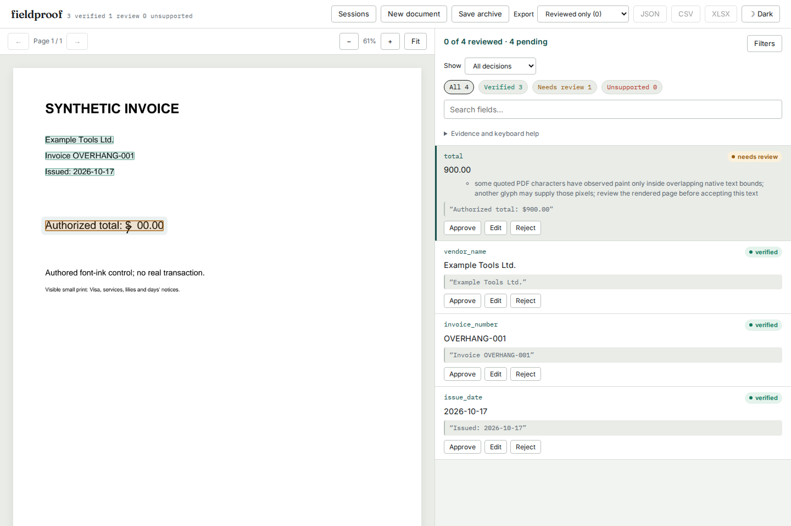

# Italic ink can escape a text layout rectangle

On baseline `61e47c3c19e2112a2885af6e7c0b27268c52063d`, Fieldproof verifies
`Authorized total: $900.00` even after the author covers the nine. A small italic
seven ends **before** the nine's layout rectangle, but its outline extends into
that rectangle. The previous overlapping-text repair used advance rectangles
and missed the borrowed ink. This page does not establish a replacement amount;
the browser reproduction rejects the extraction rather than inventing one.

These are authored synthetic invoices, not customer documents or a measurement
of real-world error prevalence. The generator, fixture extraction and PDFs are
retained so the failure is usable without an extraction provider or OCR.



The [retained baseline screenshot](../../docs/assets/native-glyph-bounds/before-chromium-1440.png)
shows the same page and extraction marked verified. Four corrected desktop/phone
captures and two original desktop captures were inspected in both engines.

| Authored controls | Baseline | Current source |
| --- | --- | --- |
| 25 covered nines: italic fonts, rotations, crop, Forms and strokes | 25 incorrectly verified | 25 require review |
| Nine visible controls with attributable ink | Nine verified | Nine verified |
| Visible amount near a possible miter footprint | Verified | Conservative overlap review |
| Visible amount with an unreadable stroke miter declaration | Verified | Attribution unavailable; review |

[Before](results/before.json), [after](results/after.json) and
[minimum-SDK replay](results/minimum-source.json) retain actual verdicts and
quoted words. All 36 inputs preserve source bytes, full extracted text, word
offsets and geometry across the before/after replay. Worker JSON round-trips
preserve the loaded documents.

## An omission experiment independent of the verifier

[pixels.py](pixels.py) renders each PDF and a separately authored version that
never paints the original nine. It uses PDFium and Poppler at 144 DPI. In all
25 covered controls the original and omitted-nine versions have byte-identical
RGB pixels within each renderer. Each of the 11 visible controls changes pixels
when the nine is omitted, including the two conservative reviews above. All
[72 comparisons](results/pixels.json) agree with that authored visibility. The
engines need not antialias fonts identically to one another.

The corpus includes Helvetica-Oblique, Helvetica-BoldOblique and Times-Italic;
90/180/270-degree pages; a crop; nested and scaled Forms; miter, round and bevel
joins; anisotropic scaling; an ExtGState `/ML 30` inside a Form; small visible
type; and invisible, transparent, nearby and distant possible lenders. The Form
fixture explicitly declares its ExtGState resource. An unresolved resource name
would not test the larger miter limit.

## Correction and tradeoffs

The observer associates a source character with a unique native PDFium font
envelope of the same Unicode value. A failed API call, absent character object,
ambiguous association or mismatched Unicode leaves support unavailable. Native
tight character bounds provide possible ink footprints; layout/font envelopes
only associate the two parsers' records. A half-raster-pixel margin and a bounded
float-precision allowance retain antialiased edge support. Inflating every
advance rectangle by a whole pixel incorrectly removes narrow visible i/l stems.

Stroke bounds include line width and the character's transformation. A miter
corner can extend beyond half the width. The parser retains an upper bound over
the default limit and every `M` or ExtGState `ML` encountered on the page and in
invoked Forms. Unknown limits make painting miter attribution unavailable.
Using a page-wide upper bound can overestimate particular strokes, but cannot
silently assume a narrower limit. Round and bevel joins use half-width reach.
Page-to-device calibration follows the renderer's CropBox and rotation.

The existing suppression reference still establishes native-text contribution.
Shared possible ink footprints cannot certify which glyph supplied those
pixels. Traversal remains limited to 50,000 native characters and 64 million
accumulated raster/association pixels; incomplete observations remain unknown.
This is not outline-level ownership, readability, or font-to-Unicode proof.

Conservative reviews are retained as costs, not relabelled hidden text: the older
[rendering-mode](../unpainted-text/README.md) and
[opacity](../zero-opacity/README.md) corpora now send four and 13 visible stroked
claims to review. Their other filled amounts remain usable. Ordinary filled
example documents retain their complete reports. The original
[14 overlap controls](../overlapping-text/README.md) retain their outcomes.

The native character-to-object API is absent from the former PDFium 4.30
minimum. The source now requires `pypdfium2>=5.0`; the actual 5.0 wheel is exercised
alongside the newer SDK. The APIs used are documented in PDFium's
[text header](https://pdfium.googlesource.com/pdfium/+/refs/heads/main/public/fpdf_text.h)
and [editing header](https://pdfium.googlesource.com/pdfium/+/refs/heads/main/public/fpdf_edit.h).

## Reproduce

```sh
uv sync --locked --extra dev --extra ocr
uv run python studies/native-glyph-bounds/replay.py /tmp/native-bounds.json --check
uv run python studies/native-glyph-bounds/pixels.py /tmp/native-bounds-pixels.json
```

The pixel check requires Poppler's `pdftoppm`. `generate.py` regenerates the
authored PDFs. Historical before receipts are from the baseline runtime, not a
simulation of its verdict. Package and browser evidence is recorded separately
after building and installing the distributions; package version `0.2.7` alone
does not identify this unreleased source correction.

## Installed review and processing cost

The wheel and source distribution both contain 41 runtime files and 23 bundled
UI files. The [artifact receipt](results/artifacts.json) compares every one with
the tested archive and actual installations. Python 3.14 with the current SDK
and Python 3.11 with PDFium 5.0 both replay all 36 cases with identical verdicts,
reasons and geometry. Ordinary examples retain all 11 complete report hashes.

All 100 production browser scenarios pass against the installed wheel and built
static demo, with no retries. The new workflow also runs separately in both
engines: a pending amount exports with original 900 and `needs_review` while
offline; rejecting it removes it from row exports. Saving/restoring the archive
retains the original claim, automated report and rejection. No replacement value
is inferred. [Chromium](results/chromium-browser.json) and
[Firefox](results/firefox-browser.json) receipts retain the actual observations.

The [worker driver](worker.py) authors a 64-page, 29,056-word ledger once and
then replays its bytes using only the installed runtime dependencies. Both
environments report every word as contributing, render a real PNG and retain
the existing 30-second wall, 20-second CPU and 768 MiB address-space budgets.

| Installed runtime | Native load | Largest child peak RSS |
| --- | ---: | ---: |
| Python 3.14, current PDFium | 11.35 s | 148,635,648 bytes |
| Python 3.11, PDFium 5.0 | 14.05 s | 141,533,184 bytes |

These are single observations on a 14-vCPU WSL2 Linux machine with 48 GB RAM,
not speed comparisons or worst-case guarantees. The
[current](results/worker-installed.json) and [minimum-SDK](results/worker-minimum-sdk.json)
receipts share the input SHA-256 and record the actual worker limits.

## Public source and installation

The correction is public at `b1ddeee4ef21ef73b94dfef4c234ddd62de3b740`.
The [publication receipt](results/public-source.json) matches 121 pinned public
files, including all runtime code, authored controls and verification records,
against Git bytes. It also retains an actual pip upgrade from PyPI 0.2.7 with
PDFium 4.30: the covered 900 claim changes from verified to needs review, the SDK
updates to 5.14, and all 41 installed runtime files match the corrected source.
All 36 cases downloaded from the public revision pass the installed replay.

The pinned CLI/library command in the main README installs source revision
`05ac81a33215bc858d125f291d1467244fb56dde`, whose runtime matches the verified
archive. It deliberately has no bundled UI. A fresh clone of the public main
revision also completed the source quickstart's dependency install, UI bundling,
fixture extraction and verification: both commands report 21 verified, three
needing review and one unsupported field on the ordinary invoice.

No PyPI release or tag was created. The static demo uses precomputed examples;
publishing native-loader source does not deploy a live PDF processor there.
