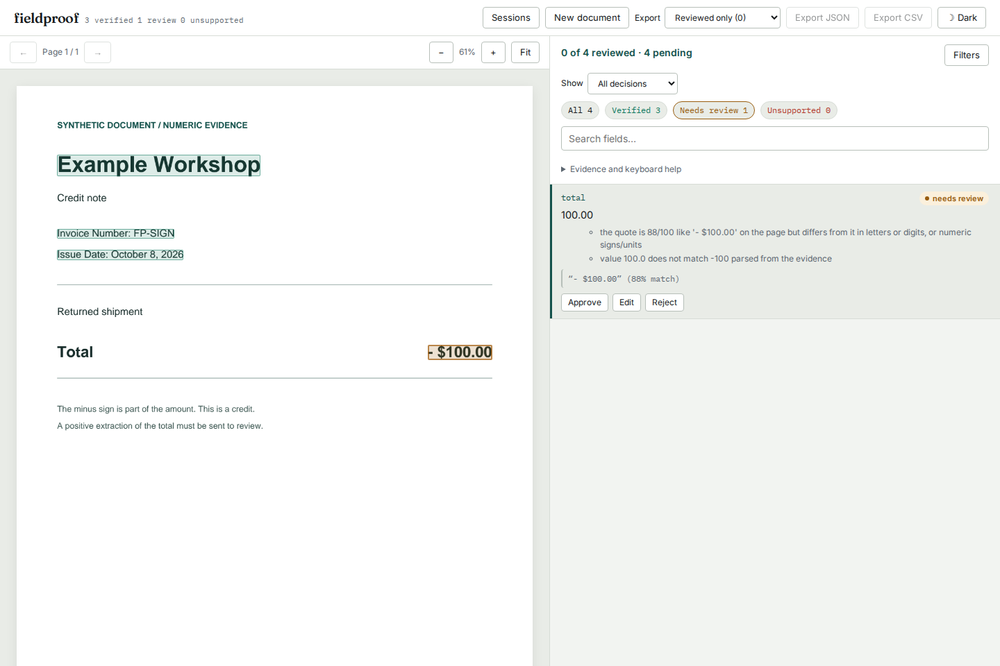

# Numeric evidence must keep its sign

This change is local and unreleased. It compares the previous checkout (`49dcbd3`)
with the numeric fix (`0dd8529`); `73386f1` also fixes the review score's contrast.
It does not compare against a freshly installed public release.

A positive `100` was **verified** against a PDF saying `Total - $100.00` when the
extraction quoted only `$100.00`. The same happened with Unicode minus, accounting
parentheses and trailing minus signs. An exponent or identifier could supply an
unrelated fragment: `1e6` supported both `1` and `6`, and `AB123CD` supported `123`.
The page could be quoted exactly and the numeric check still accept the wrong value.

[The synthetic credit note](../../examples/signed-amount.pdf) and its
[deliberately wrong extraction](../../examples/fixtures/signed-amount.json) reproduce
the sign omission. The old checkout verifies all four fields. The fixed checkout
verifies the three descriptive fields and sends the total to review. No model is
called, and this is not a real transaction.



The evidence highlight includes the minus sign. Correcting the value to `-100` and
approving it yields an actual downloaded row with `original_value: 100`,
`value: -100`, `value_source: "correction"`, and
`verification_status: "needs_review"`. The human correction does not rewrite the
original automated verdict.

## What changed

- Grounding and numeric checks share a whole-token lexer. Signed amounts preserve
  leading, trailing, Unicode and accounting signs, including a sign separated from
  the currency symbol. `.50` means one half, and valid Indian grouping is recognized.
  Malformed grouping, exponents, times, fractions and digits embedded in identifiers
  cannot supply smaller numeric fragments. Unsupported numeric notation goes to review.
- Percent and permille tokens are excluded even when they are the only numbers in
  a quote. Common `2x`/`x2` quantity notation remains supported as a whole token.
  Other attached units are not guessed. Currency omission is allowed when the value
  is unchanged; omitting a sign or rate marker produces weak evidence.
- A clipped numeric occurrence remains a candidate. Dropping `6%` entirely from a
  search for `6` could make an unrelated `6` uniquely verified elsewhere on the page.
  Both occurrences now remain available to ambiguity checking.
- Neighboring word boxes restore line boundaries for numeric parsing. A footer dash
  must not negate the total on the previous line. Half-height vertical overlap is
  the row heuristic; the original evidence strings and coordinates are retained.
- Verification compares decimals before rounding can erase a printed digit. It
  retains the existing half-unit-at-printed-precision tolerance, capped at `0.005`,
  without an additional `1e-9` allowance. A float cannot claim a lost integer digit
  above `2**53`; a caller supplying an exact integer is no longer coerced to float.
- The match-score label uses the evidence text's contrast. Its previous opacity
  failed axe at 2.79:1 in the real weak-match review.

## Controlled PDFs

[`cases.json`](cases.json) specifies 44 cases by hand, including expected verdicts.
[`run.py`](run.py) writes deterministic PDFs, checks that their extracted text is
exactly the supplied source, and passes the extraction through the real loader,
grounding and verification code. Each result retains its reasons and page boxes.

| Measure | Before | After |
|---|---:|---:|
| Incorrect or unsupported claims verified | 21 / 23 | 0 / 23 |
| Correct, supported claims verified | 13 / 21 | 21 / 21 |

All 44 PDF inputs are byte-identical before and after. The reports record PDF,
font, case-file and Python source hashes:
[before](pdf-before.json), [after](pdf-after.json),
[input checks](../../docs/verification-numeric-inputs.json).

These are designed regressions, not an estimate of real extraction accuracy. They
exercise native PDF text, not OCR. Additional regressions cover ambiguous locations,
footer geometry, malformed syntax and Unicode normalization of superscripts/fractions.

## Fresh receipt audit and its costs

Both checkouts ran the unchanged CORD/SROIE adapter and case generator on all
**133,722 cases from 1,052 receipts**. The four cached files match the pinned
[corpus manifest](../cord-grounding/manifest.json). Pairing asserts identical inputs
and the complete expected case/document counts. [Results](receipt-results.json)
contain every verdict/location change and counts over every case.

For the annotated value quoted as written, with the generator's available context:

| Field type | Cases | Verified at annotated place before | After |
|---|---:|---:|---:|
| Amount | 2,360 | 1,864 | 1,860 |
| Quantity | 853 | 355 | 354 |
| Date | 565 | 356 | 356 |
| Text | 2,253 | 2,171 | 2,171 |

Five previously verified fields now need review. The numeric ground truth itself
needs care: it uses the first digit run and does not preserve every sign.

| Receipt | Quote | Why review is appropriate or conservative |
|---|---|---|
| `cord-test-59` | `2 pcs 25,000` | Source has `- 2 pcs`; the description's dash looks like a numeric sign. Additional review cost. |
| `cord-test-59` | `3 pcs 37,500` | Same dash/quantity ambiguity. Additional review cost. |
| `cord-valid-25` | `1Gls` | Attached unit is not one of the supported spellings. Additional review cost. |
| `cord-train-153` | `TL Rp 57,0000` | Malformed grouping was previously repaired by deleting commas. |
| `cord-valid-21` | `BCA 15% -Rp 34,363` | The generator claims positive `34363`; the source says negative. |

Across all variants, six normalized currency quotes newly verify at their annotated
locations. **No newly verified case is at a wrong location.** All 32,016 generated
absent-number cases remain unverified in both versions. This corpus therefore does
not establish a reduction in false accepts from the numeric fix; the controlled PDFs
establish the specific failures. One existing wrong-location text result and three
accepted absent-text cases remain in their respective measurements.

The corpus was inspected while refining the rules, including its historically named
held-out split. This audit is **in-sample**. It checks a deterministic verifier against
pre-extracted dataset words and boxes; it measures neither a model nor fresh OCR.

## Limits

A numeric match is membership in the cited text, not a proof of the field's semantic
role. A quoted row may contain several amounts or quantities. Currency symbols are
not converted or checked against a claimed currency. Spaces can separate columns or
thousands groups; this parser treats space-separated numbers as separate tokens and
does not infer space-grouped amounts. Scientific notation, rates, arbitrary units and
fractions are not supported amounts. Parentheses around a number are accounting
notation here, even where prose might intend a positive quantity. Line grouping is a
geometry heuristic and can be uncertain on skewed or irregular OCR boxes. Ambiguous
locale punctuation retains the existing review/default-convention behavior.

The correction UI uses JavaScript numbers. Exact large integer handling in the Python
verifier does not make the browser an arbitrary-precision editor; use string fields
for large identifiers. No remote model behavior, OCR accuracy, publishing or deployment
is part of this change.

## Repeat locally

From a source checkout with the locked development dependencies installed:

```sh
uv run --locked python -I studies/numeric-evidence/run.py --src src --out /tmp/numeric-after
uv run --locked fieldproof extract examples/signed-amount.pdf --schema invoice \
  --fixture examples/fixtures/signed-amount.json --out /tmp/signed-amount.json
```

For the baseline, add a detached worktree at `49dcbd3` and pass its `src` directory
to `run.py` with `--observe-only`. The PDFs can be regenerated with
`uv run --locked python studies/numeric-evidence/review_example.py`.

After collecting the receipt corpus as described in
[the receipt study](../cord-grounding/README.md):

```sh
uv run --locked --with pyarrow python -I studies/cord-grounding/run.py \
  --src /tmp/fieldproof-before/src --out /tmp/receipts-before.jsonl --workers 4
uv run --locked --with pyarrow python -I studies/cord-grounding/run.py \
  --src src --out /tmp/receipts-after.jsonl --workers 4
python3 studies/numeric-evidence/compare_receipts.py \
  /tmp/receipts-before.jsonl /tmp/receipts-after.jsonl /tmp/receipt-comparison.json \
  --before-ref 49dcbd3 --after-ref 0dd8529
```

The changed Python sources are in `0dd8529`; the later review-only change is in
`73386f1`. For an installed-package browser check, build the UI and wheel using
`scripts/bundle_ui.py` and `uv build`, install that wheel in a fresh environment,
and serve it on loopback port 4294. Then, from `web/`, run:

```sh
node scripts/verify-numeric-evidence.mjs
```

The script uses real uploads, fixture extraction, PDF rendering, keyboard correction,
downloads and API exports in Chromium and Firefox at desktop and 375px widths.
It checks evidence, export provenance, page errors, off-origin requests and axe
findings. [Browser evidence](../../docs/verification-numeric-browser.json).

The final run passed all four installed-wheel workflows with six axe scans, no page
errors and no off-origin requests. Screenshots were opened and inspected:
[Chromium phone fields](../../docs/assets/numeric-chromium-375.png),
[phone document](../../docs/assets/numeric-mobile-document.png),
[Firefox desktop](../../docs/assets/numeric-firefox-1440.png),
[Firefox phone](../../docs/assets/numeric-firefox-375.png). The phone document fits the
whole page; its zoom controls are available for reading small source text.

A clean detached checkout passed Ruff, mypy, all 290 Python tests on Python 3.12.12,
the 50 web unit tests, typechecking, lint and formatting under Node 24.21.0, and all
58 production Chromium/Firefox scenarios. The final browser suite includes the weak
numeric match in both themes at desktop and phone widths. The wheel was built from
the source distribution and installed outside the checkout on Python 3.11.13. Its
32 Python files match the source and all 23 bundled UI files are installed.
[Package, dependency and asset hashes](../../docs/verification-numeric-package.json).
