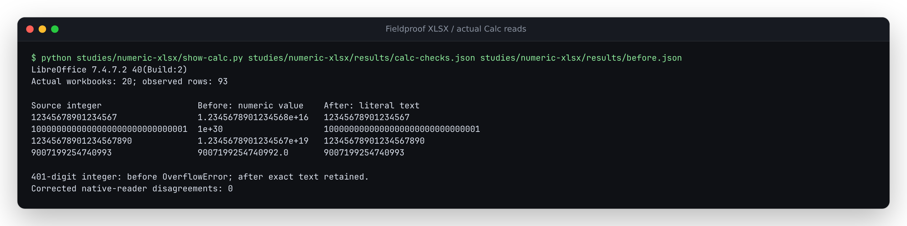

# Numeric evidence must survive spreadsheet import

At source `91736cf`, the Python writer serializes every finite scalar number as
a numeric XLSX cell. Actual LibreOffice Calc 7.4.7.2 reads integer
`9007199254740993` as `9007199254740992`; three other constructed integers also
change. A direct writer call with `10**400 + 1` raises `OverflowError` while
checking finiteness through float conversion. The review API already rejects
that last correction within its existing bounds; this is a writer failure,
not an observed API 500.

The source correction uses literal text cells outside a conservative numeric
range shared by both writers. Numeric cells require absolute value below
`10**15`, at most 15 significant decimal digits in the current float spelling,
and zero or at least the smallest normal binary64 magnitude. Large Python
integers are inspected without conversion to float. Numbers outside that
range retain their canonical current spelling as inline text; booleans and
blank cells keep their types. This deliberately includes some numbers Calc
can store exactly, so the workbook does not depend on one application's wider
numeric range. Non-finite values still refuse export.

[Microsoft documents Excel's 15-digit precision limit](https://support.microsoft.com/en-us/excel/keeping-leading-zeros-and-large-numbers)
and its [numeric range](https://support.microsoft.com/en-us/excel/excel-specifications-and-limits).
The browser's input is already a JavaScript Number: text fallback cannot undo
earlier rounding. Python-only integer cases therefore do not pretend to test
exact browser values. Python and JavaScript can also spell equal float values
differently (for example exponent padding); each writer retains its current
canonical scalar spelling. JSON/CSV serialization and review validation are
unchanged. Text cells are intentionally no longer directly usable as numeric
spreadsheet operands without an explicit conversion.

## Real Python writer and API

```sh
uv run --locked --extra dev python studies/numeric-xlsx/generate.py \
  --out /tmp/numeric-xlsx --label source
```

[`cases.json`](cases.json) contains 22 constructed scalar cases, five of them
Python-only integers. The driver exercises the actual writer, then uploads the
bundled synthetic PDF, runs its fixture extraction, edits `total`, and downloads
both reviewed/all export scopes. It checks the original automated report is
unchanged and every row retains correction provenance. No model or external
extraction service is used.

The actual baseline disagrees with the preservation policy in **34 of 58
writer/API workflows**; the corrected writer disagrees in none. These are
policy/type comparisons, not 34 observed rounding events in Calc. Its four
changed integer values and the separate writer exception are the independent
consumer counterexamples. Ordinary numbers, boolean and blank controls retain
their types. The existing oversized API correction remains a 422.

For the baseline, use a separately archived `91736cf` checkout on `PYTHONPATH`
and add `--observe-only`. The driver needs the package's server/dev dependencies.
An installed wheel can run the same driver with `--fixture-root` pointing to
the repository's examples; its runtime module digest is recorded.

## Browser writer

```sh
# Node 24, after npm ci --prefix web:
node studies/numeric-xlsx/generate-browser.mjs . /tmp/numeric-browser source
```

This directly imports the same TypeScript writer shipped in the app, using
17 Number/text/boolean/blank cases. The baseline has seven policy disagreements;
the correction has none. The shared ordinary scalar controls are unchanged.
Actual browser downloads and native-reader verification are recorded with the
completed verification artifacts below.

## Native spreadsheet and installed production app

| Actual verification | Result |
|---|---|
| Python writer and real API | [Before](results/before.json): 34 of 58 policy disagreements; [after](results/after.json): zero; 24 ordinary controls byte-identical |
| Direct browser writer | [Before](results/writer-before-browser.json): seven of 17 disagreements; [after](results/writer-after-browser.json): zero; ten ordinary controls byte-identical |
| Offline Calc 7.4.7.2 | Twenty actual workbooks, 93 observed rows: 26 baseline policy disagreements, zero corrected; the four changed integer spellings now survive exactly |
| Actual demo/live browser edits and downloads | [128 workflows](results/browser.json), Chromium/Firefox at 1440/375 px: 48 baseline disagreements, zero corrected; sixteen ordinary-control workbooks byte-identical |
| Fresh wheel from bundled-UI sdist | [Python 3.12](results/installed-current.json) and [minimum Python 3.11](results/installed-floor.json): 58 workflows each, complete captures match source |
| Actual installed bundled UI | [Python 3.12](results/installed-browser-current.json) and [Python 3.11](results/installed-browser-floor.json): 32 browser workflows each, no source import or static-asset override |
| Fresh locked Python 3.12 and 3.14; lowest direct dependencies on 3.11 | Ruff/mypy pass; 660 tests pass on each interpreter, five optional native Tesseract cases skip because the system binary is unavailable; minimum dependencies emit two deprecation warnings |
| Fresh Node 24.21.0 | Lint, strict types, formatting, 70 web tests, both production builds and 86 existing browser workflows pass |
| Artifact identity | All 846 baseline and 850 implementation archived files match source; all 34 files in each Node 24/26 build match; all 37 Python and 23 bundled-UI files match the final wheel and both installs |
| Actual loaded bytes and visual review | Demo: 26 files per view; live/installed: 23; all browser-loaded asset bytes match the tested build; 24 views have no script/CSP errors, external/late requests, axe findings or page overflow; three screenshots inspected |

The [artifact receipt](results/verification.json) records source, input,
production-build, final wheel/sdist, check-log and screenshot hashes.
[Raw Calc reads](results/calc-raw.json),
[independent scalar comparisons](results/calc-checks.json), and
[retained workbook mapping](results/files.json) accompany the captures. All 34
distinct retained workbooks are actual writer/API/browser outputs; identical
downloads share a file. Per-workflow scratch files can be regenerated by the
drivers. The 401-digit writer exception is a separate baseline observation,
so Calc reads 46 baseline and 47 corrected rows in the selected workbooks.

```sh
# Read generated exports with the existing native-reader container:
cp studies/spreadsheet-export/inspect_calc.py /tmp/numeric-xlsx/
docker run --rm --network none -v /tmp/numeric-xlsx:/work:ro \
  fieldproof-spreadsheet-check:local python3 /work/inspect_calc.py \
  /work/before-native/writer-all.xlsx /work/clean-native/writer-all.xlsx \
  /work/before-web-writer/writer-all.xlsx /work/after-web-writer/writer-all.xlsx
# Inspect the retained full native comparison:
python3 studies/numeric-xlsx/show-calc.py \
  studies/numeric-xlsx/results/calc-checks.json studies/numeric-xlsx/results/before.json
# Both separately built source roots and their Python interpreters:
node studies/numeric-xlsx/browser.mjs BEFORE_ROOT AFTER_ROOT \
  BEFORE_PYTHON AFTER_PYTHON /tmp/numeric-browser-workflows
```

The container recipe and reader are in the
[earlier spreadsheet study](../spreadsheet-export/README.md). The retained
20-workbook run additionally reads both export scopes for the four large
integer API cases in each phase. `check-calc.py` checks raw native reads against
the generated capture rows; its `--help` lists the four capture inputs.
`NUMERIC_XLSX_INSTALLED_AFTER=1` selects just the installed live UI in the browser
driver, clearing source and static-directory overrides before server startup.
The package is built with `scripts/bundle_ui.py`, then sdist, then wheel; the
unchanged `0.2.7` version does not identify a published correction.

The first browser observation timed out during a burst of download clicks.
The final replay paces separate export actions. The server driver also initially
passed an unopened log stream as child-process stdio; piping the child output
corrects that startup failure. The complete final phases were rerun. Neither
observation required a product change.



[Desktop](../../docs/assets/numeric-xlsx/live-chromium-1440.png) and
[phone](../../docs/assets/numeric-xlsx/live-chromium-375.png) screenshots show the
actual production review flow after the deliberately extreme
numeric correction. The original extraction, evidence and review status remain
visible. This invented amount tests transport; it is not verified invoice data.
No styling was changed. Excel interactive verification, extraction accuracy,
a registry release and a hosted update are not claimed.
