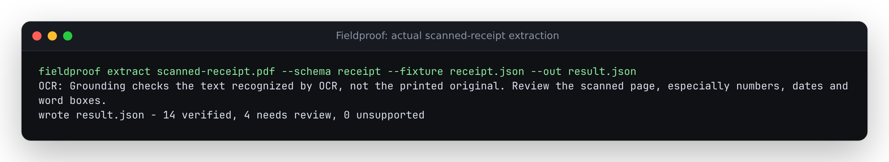
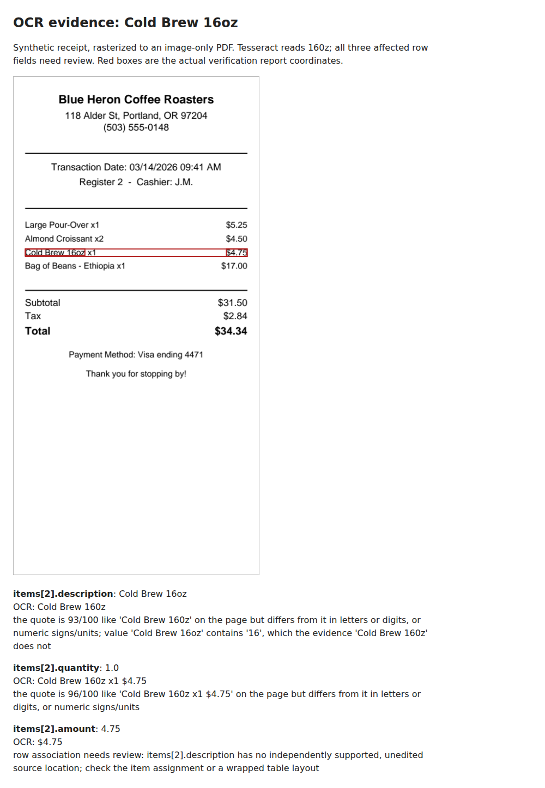

# Scanned PDFs reach the CLI's OCR loader

At baseline `b6158f654986099945b563ca7a32bfc51558fb74`, the README and
review-server error directed users to CLI OCR, but `_load_document` stopped
on `EmptyDocumentError`. With the OCR extra and a working Tesseract present,
the library read 92 words from the rasterized invoice while both CLI commands
failed. The repair is source-only; package metadata remains 0.2.7.

`extract` and `verify` now use local OCR when **all** pages lack extractable
text. They preserve the original page numbers, text offsets and word boxes,
and include `report.ocr` with engine/version, requested language, rendering
resolution, page count, pages with no recognized words, and an explicit limit:
verification checks recognized text, not the printed original. Native report
JSON omits this optional member.



## Actual engine results

These inputs are the repository's **synthetic** invoice, receipt and contract,
rasterized at 144 DPI and embedded into new PDFs with no text layer. They are
not camera scans or a recognition benchmark. The stored extraction fixtures
are replayed; no model is called. A fourth document inserts a blank page before
the invoice. All five constructed PDFs and their hashes are retained in
[`inputs/`](inputs/) and [`inputs.json`](inputs.json).

| Input | Baseline extract/verify | Fixed extract/verify | Fixed field counts: verified / review / unsupported |
| --- | --- | --- | --- |
| Scanned invoice | Exit 1, no result | Exit 0 | 21 / 3 / 1 |
| Scanned receipt | Exit 1, no result | Exit 0 | 14 / 4 / 0 |
| Scanned contract | Exit 1, no result | Exit 0 | 10 / 0 / 0 |
| Blank page, then invoice | Exit 1, no result | Exit 0; evidence on page 2 | 21 / 3 / 1 |
| Completely blank PDF | Exit 1 | Exit 1: no words recognized | No report |
| Missing engine or language data | Exit 1 | Exit 1 with installation/engine diagnostic | No report |

The native receipt has 17 verified fields and one review. Tesseract actually
read `Cold Brew 16oz` as `Cold Brew 160z`; its description and quantity quotes
need review, and its amount cannot establish row association from the damaged
description. The original mismatch and coordinates remain visible. Matching
the invoice's native counts does not establish OCR accuracy on other documents.



[`replay.py`](replay.py) runs 22 actual commands per environment, including
native controls with the engine unavailable. All failed commands preserve a
pre-existing destination. The eight native outputs match baseline bytes.
[`oracle.py`](oracle.py) separately calls the Tesseract executable for TSV and
compares every returned word and pixel box with the loader's PDF-point boxes
and text offsets. This checks conversion and record retention using the same
recognizer; it is not independent evidence that the text was read correctly.

## Reproduce

Install Tesseract and its English data using the system package manager. From
a source checkout:

```sh
uv sync --locked --extra dev --extra ocr
uv run --locked --extra dev --extra ocr python studies/ocr-fallback/make_inputs.py
uv run --locked --extra dev --extra ocr python studies/ocr-fallback/replay.py \
  --python "$PWD/.venv/bin/python" --out /tmp/ocr-replay --expect after
uv run --locked --extra dev --extra ocr python studies/ocr-fallback/oracle.py \
  --out /tmp/ocr-oracle
```

The replay takes an absolute `--python` pointing to an isolated installed wheel
too; `--source /path/to/baseline/src --expect before` selects a baseline checkout.
Generation uses PDFium and ReportLab, not an image-generation model.

## Boundaries

- The CLI uses English (`eng`), the default Tesseract segmentation mode and
  144 DPI. Install other language data and use the library's `language` argument
  for another language; this change does not promise multilingual recognition.
- OCR renders at most 64 pages and 16,000,000 pixels per page, retaining at most
  100,000 words and 2,000,000 text characters by default. Each recognition
  process has a 30-second timeout. A library caller can set positive `timeout`
  and explicit `DocumentLimits`. These limits do not sandbox the PDF parser or
  bound rendering wall time, and the per-page timeout is not a whole-job timeout.
- A supplied legacy `page_count` must match the PDF; it cannot truncate it.
  Blank recognized pages remain in place; wholly empty recognition is an error.
- A PDF with any native text keeps the native loader. Image-only pages inside a
  mixed document are not newly recognized. The review server still rejects PDFs
  without text. This change does not add OCR upload/review to that server.
- OCR can produce a plausible wrong word or number. `verified` means agreement
  with recognized evidence under the existing checks, not agreement with pixels.
  No handwriting, skew correction, or physical-scanner validation is claimed.

The [pytesseract 0.3.10 interface](https://github.com/madmaze/pytesseract/blob/v0.3.10/README.rst)
documents the language, TSV and timeout calls supported at the dependency floor.
[Tesseract's command-line documentation](https://tesseract-ocr.github.io/tessdoc/Command-Line-Usage.html)
describes the direct TSV output used for the coordinate comparison.

## Retained verification, 12 October 2026

Production code and tests are in `4d63128bef4432f5157044c53571c66d21ec4251`.
A clean archive of that commit was installed from the lock, checked, and built
with the review UI bundled. The wheel was built from the generated sdist.

| Environment/check | Result | Record |
| --- | --- | --- |
| Clean Python 3.12.12, locked dependencies | Ruff and mypy clean; 426 tests pass, including real OCR | [log](results/clean-python.txt) |
| Isolated wheel, Python 3.11.13, direct dependency floors | 426 tests pass; two dependency deprecation warnings | [log](results/installed311.txt) |
| Isolated wheel, Python 3.14.7, current dependencies | 426 tests pass | [log](results/installed314.txt) |
| Plain wheel, no OCR extra | Native PDF succeeds; scanned PDF explains missing optional dependency | [receipt](results/core311.json) |
| Web typecheck/lint/format and unit checks | Pass; 50 tests | [log](results/clean-web.txt) |
| Production Chromium/Firefox demo and live server | 74 workflows pass, including desktop/phone, keyboard, accessibility and exports | [log](results/clean-browser.txt) |
| Baseline CLI, actual engine available | 22 expected outcomes; scanned inputs fail | [receipt](results/before/replay.json) |
| Installed Python 3.11 and 3.14 CLI | 22 expected outcomes each; 16 successful JSON results exactly agree | [minimum](results/minimum/replay.json), [modern](results/after/replay.json), [comparison](results/compatibility.json) |
| Direct Tesseract TSV | All 425 words over six pages match text and boxes; offsets and page bounds checked | [receipt](results/oracle/oracle.json) |
| Actual recognition timeout | One-microsecond library timeout terminates Tesseract and raises a page-specific error | [receipt](results/oracle/oracle.json) |

The direct-floor installation explicitly supplied every declared core, dev and
OCR dependency to `uv pip install --resolution lowest-direct`, alongside the
wheel. This exercised pytesseract 0.3.10, Pillow 12.3.0, Pydantic 2.10.0 and
pdfplumber 0.11.9; installing only a local wheel with `lowest-direct` would not
select its dependency floors. The two warnings concern Starlette's deprecated
httpx test-client path and anyio alias; no tests failed or were skipped.

Browser checks and the bundled build used Node 24.21.0. Web unit/lint/type/format
commands used the host Node 26.7.0 after the Node 24 install. No production UI
source changed. The browser checks establish existing native review compatibility,
not a new OCR review interface. Both newly retained screenshots were inspected;
the receipt figure comes from the actual raster and report rectangles.

[`artifacts.json`](results/artifacts.json) retains wheel/sdist sizes and hashes,
all installed dependency versions, and byte comparisons for 74 source/build
inputs and all 56 package files in each of three isolated installs. Wheel SHA-256:
`c9009f85a107e5f34a81f6fb2df5e51fd4a41dba7b8293824f9bf6cb7ac06d30`.
The [build log](results/build.txt) records `scripts/bundle_ui.py` and `uv build`.
The wheel carries the compiled review UI; these artifacts were not uploaded.

Tesseract 5.3.4 and English data came from Ubuntu archive packages, extracted
into a temporary runtime without system installation; [package hashes](results/tesseract-packages.json)
identify the engine/data used. These measurements are Linux/WSL2 observations,
not Windows/macOS or physical-scanner validation. Per-document elapsed times
in the oracle receipt were captured under concurrent verification work and are
not performance benchmarks. No package release, tag or hosted deployment was made.
