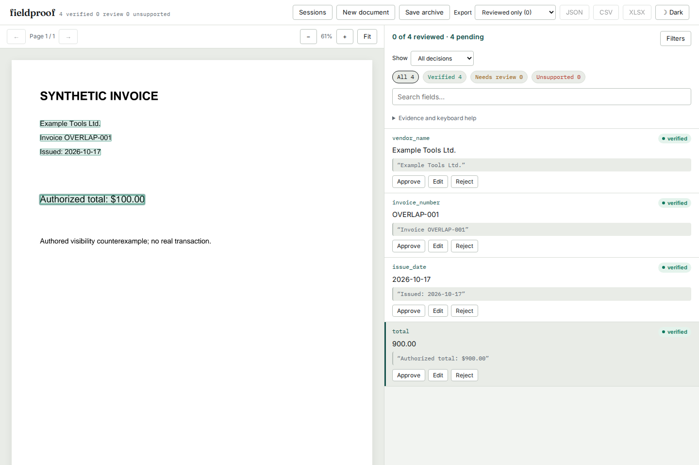

# A replacement glyph cannot verify the covered original

On source baseline `621e738`, the PDF below visibly says `$100.00`, while
Fieldproof verifies the extraction's `$900.00` claim. The author drew native
`Authorized total: $900.00`, covered the nine with an opaque white rectangle,
and drew a smaller native one in its place. Extracting the original quote is
still possible. The old raster check found native-text pixels in every
character's rectangle, including the replacement one's ink inside the old
nine's bounds.



These invoices are authored synthetic counterexamples, with no real payment or
measured production prevalence. [generate.py](generate.py) retains their source;
the PDFs and extraction are usable without a provider or OCR engine.

| Authored cases | Before | After |
| --- | --- | --- |
| Four replacement sizes, three rotations, crop, nested Form | 9 falsely verified | 9 need review |
| Original, nonpainting/transparent/nearby lender, tight tracking | 5 verified | 5 verified |

[Before](results/before.json) and [after](results/after.json) retain every verdict,
reason, word and rectangle. Source bytes, extracted text, word boundaries,
offsets and geometry match across the replay. The original browser reproduction
is retained separately in [before-browser.json](results/before-browser.json).

The independent [pixel check](pixels.py) renders each original and an authored
control in which the old nine was never painted. For the nine affected pages,
each renderer produces byte-identical RGB pixels for the pair. The five visible
controls change when the nine is omitted. All [28 checks](results/pixels.json)
pass across PDFium and Poppler at 144 DPI. The comparison is within each engine;
the engines need not rasterize fonts identically to one another.

## Correction and boundaries

Fieldproof retains the original-versus-text-suppressed raster comparison. It
also records the union and overlaps of potentially painting native characters'
layout bounds in two one-bit masks. Bounds round outward for the overlap mask;
the character's observation still rounds inward to complete pixels. A character
needs some observed contribution outside the overlapping regions. If all its
observed paint lies inside another character's bounds, the word records
`raster_state: "ambiguous_overlap"` and requires review with a specific reason.

This is a conservative attribution check. It does **not** identify which glyph
painted a pixel or read the rendered amount. Legitimate duplicate overprinting,
stacked marks, tiny glyphs and unusual font metrics can require review too.
Ink extending outside reported character bounds can also remain unattributed.
Visible text elsewhere is retained. Unpainted and explicitly transparent glyphs
cannot supply paint, while partially cropped and clipping-risk glyphs can;
the audit includes those even when word extraction discards them.

Overlap work is bounded to 50,000 potentially painting characters and 64 million
accumulated rectangle pixels per page, in addition to the existing raster/object
limits. Exhaustion or invalid geometry leaves attribution **unavailable**. The
two masks are disposed per page. Words requiring review cannot establish number
or date conventions, row anchors or column headings; edit tolerance does not
remove the paint reason. Recognized OCR and manually supplied words retain their
existing policy.

The [compatibility replay](compatibility.py) checks all eleven existing example
PDFs against the original source. Their source hashes, text, geometry and complete
verification report hashes are identical:
[before](results/examples-before.json), [after](results/examples-after.json).

## Observed processing cost

The retained [baseline](results/scaling-before.json) and
[corrected](results/scaling-after.json) runs use the existing deterministic
ledger generator, one warmup and three timed loads per size. Source hashes,
geometry and all 22,700 contribution observations in the 50-page case match.

| Pages | Words | Before median, s | After median, s |
| --- | --- | --- | --- |
| 1 | 454 | 0.364 | 0.165 |
| 10 | 4,540 | 4.909 | 2.306 |
| 50 | 22,700 | 10.146 | 14.319 |

These sequential measurements ran under changing external load on the same
14-vCPU, 48-GiB WSL2 machine. They do not establish a speedup at small sizes or
a controlled overhead ratio. The additional mask work is bounded; this is not
a latency guarantee.

The actual [installed Python 3.14 worker](results/installed-worker.json) loaded
64 pages and 29,056 words in 14.62 seconds, rendered page one in 0.47 seconds,
and observed a largest-child peak RSS of 139 MiB. All words retained a positive
contribution. This is within the unchanged 30-second wall, 20-second CPU and
768-MiB address-space limits for that input; arbitrary 64-page PDFs need not fit.

## Reproduce

```sh
uv sync --locked --extra dev --extra ocr
uv run python studies/overlapping-text/replay.py /tmp/overlap-after.json --check
uv run python studies/overlapping-text/pixels.py
```

`pixels.py` additionally needs Poppler's `pdftoppm`; the application does not.
`generate.py` recreates the retained inputs. To replay the old behavior with the
same dependencies, archive baseline `621e738` and set `PYTHONPATH` to its `src`.

```sh
uv run fieldproof verify studies/overlapping-text/fixture.json \
  studies/overlapping-text/fixtures/replacement-15.pdf --out /tmp/overlap-report.json
```

The CLI keeps the covered 900 in review. In the local review server, upload the
same PDF and `fixture.json`, inspect the amount, correct it to 100, export and save
a review archive. The correction keeps the original automated verdict and quote.
The existing static demo does not execute this native loader; this correction
needs the updated package. Initial validation was local. Source publication
subsequently proceeded with the owner's explicit authorization, as recorded below.

## Packaged and browser behavior

The [artifact comparison](results/artifacts.json) checks all 40 runtime files
and 23 bundled UI files in both the wheel and sdist against fresh source archive
`205b1e006eacb5cbe34e6b93734877a2550e818d`. Both separately installed wheels match
all 63 files. Their complete 14-case observations also match the clean replay:
[Python 3.14](results/installed-current.json) and
[Python 3.11 with the oldest direct dependencies](results/installed-floor.json).
The latter uses PDFium 4.30, pdfplumber 0.11.9 and pdfminer 20251230; its 61
native-paint/geometry checks pass. This does not publish a new 0.2.7 release.

The final [verification receipt](results/verification.json) retains command
results, artifact identities, screenshot hashes, installed CLI observations and
the publication boundary. In the fresh locked Python 3.14 archive:

| Check | Command | Result |
| --- | --- | --- |
| Python lint | `uv run ruff check src tests` | Pass |
| Python types | `uv run mypy src` | 40 files, pass |
| Python suite | `uv run pytest -q` | 698 pass, 5 existing actual-OCR skips |
| Web checks, from `web/` | `npm run lint`, `npm run typecheck`, `npm run format:check`, `npm test` | Pass, 70 tests |
| Full production browsers | `FIELDPROOF_BROWSER_FULL=1 npx playwright test --config ../studies/overlapping-text/browser.config.mjs` | 98 pass |
| Extended offline workflow | Same config without `FIELDPROOF_BROWSER_FULL` | 2 pass |

Browser runs supply `FIELDPROOF_BROWSER_URL` for the separately installed live
server and `FIELDPROOF_DEMO_URL` for the preview of `web/dist-demo/`; the config
does not start either server. `UPDATE_OVERLAP_SCREENSHOTS=1` saves the four
corrected screenshots and browser receipts. The full suite ran on the archived
harness; the later two-case extension additionally verifies offline behavior.
Node [24.22.0](results/node24.json) separately passes the web checks and produces
the same 35 served files in each build as Node 26.7.0, excluding source maps.

Actual [Chromium](results/chromium-browser.json) and
[Firefox](results/firefox-browser.json) sessions upload the PDF and extraction
to the installed wheel's real server and retain the worker-produced review
reason and rectangle. Both correct 900 to 100, disconnect, inspect the cached
page and export JSON/CSV at phone width in dark mode without network requests.
After reconnecting, both save an archive, delete the session, restore it and
check the complete automated report for equality. The corrected value remains a
human correction; the original automated verdict stays `needs_review`.

| Actual review UI | Before | Corrected source |
| --- | --- | --- |
| Chromium, desktop | [Capture](../../docs/assets/overlapping-text/before-chromium-1440.png) | [Capture](../../docs/assets/overlapping-text/chromium-1440.png) |
| Chromium, phone | Not captured | [Capture](../../docs/assets/overlapping-text/chromium-375.png) |
| Firefox, desktop | Not captured | [Capture](../../docs/assets/overlapping-text/firefox-1440.png) |
| Firefox, phone | [Capture](../../docs/assets/overlapping-text/before-firefox-375.png) | [Capture](../../docs/assets/overlapping-text/firefox-375.png) |

All six captures were inspected: the amount and review reason remain readable,
the selected field is clear, and phone layouts have no horizontal overflow.
The browser extension uses the existing product UI; no new UI code was needed.

Rebuild the bundled server and distributions with:

```sh
uv run python scripts/bundle_ui.py
uv build
```

The server bundle is `src/fieldproof/server/static/`; distributions are in
`dist/`. The existing static demo builds with `npm run build:demo` from `web/`
to `web/dist-demo/`. That demo still uses precomputed sample reports and does
not run the updated native loader. No hosted-byte or deployment claim is made.

Suggested repository description: "Ground PDF extractions in source evidence,
with reviewable visibility and value checks."
Suggested topics: `document-ai`, `pdf`, `grounding`, `structured-extraction`,
`ocr`, `python`, `pydantic`, `data-validation`.

## Public source and an actual upgrade

The [public-source receipt](results/public-source.json) verifies remote `main`
at `7857c03e846a7c3b88e64485ca168513f759b8d5` and compares all **91 selected public
files** against the checkout, including all runtime files, study inputs and
receipts, the new regression and all six screenshots. This is source publication;
the earlier `verification.json` remains a snapshot of the local validation stage.

A fresh Python 3.12 environment first installed PyPI `fieldproof==0.2.7` and
actually verified the covered 900. The README's force-reinstall command then
installed the pinned public Git source, which requires review for that same PDF.
All 40 installed runtime files match source bytes; all 14 replay cases pass with
the newly resolved dependencies, including PDFium 5.14 and Pillow 13. The direct
source install has no bundled UI, matching the README's build requirement.

No tag, new PyPI release or hosted-demo deployment was made for this correction.
The previously verified local wheel remains separately identified in the artifact
receipt; it includes the 23-file bundled UI.
