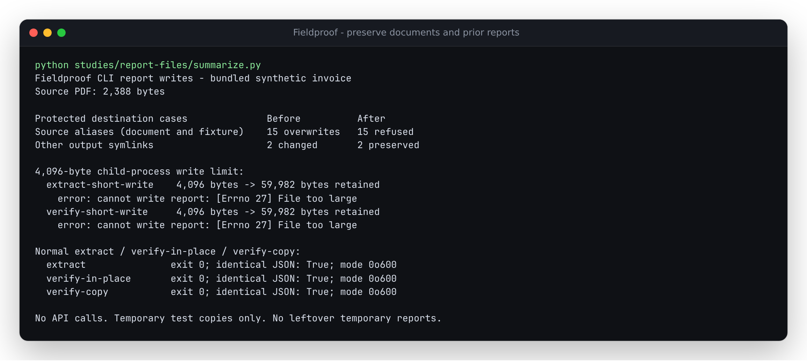

# A report must not destroy its source PDF

The source CLI accepted `extract invoice.pdf --fixture fixture.json --out invoice.pdf`:
it replaced the 2,388-byte bundled PDF with 59,982 bytes of JSON and exited 0.
Writing to the fixture, a hard link, a symlink or an equivalent path also destroyed
the input. Separately, an interrupted report write could truncate the previous
report, including during `verify`'s default in-place update.

The correction refuses source aliases before loading the PDF or invoking a
provider. It checks again before writing, writes to a private temporary sibling,
flushes it, and replaces the destination only after the complete write succeeds.
Output errors are one-line messages with exit 2. Normal report JSON is unchanged.



## Recorded before and after

The [before](before.json) and [after](after.json) captures use disposable copies of
the repository's **synthetic** invoice PDF and extraction fixture. They call real
CLI subprocesses; no remote extraction provider is called.

| Case | Previous result | Corrected result |
|---|---|---|
| `extract` output identifies its PDF | Exit 0, source replaced | Exit 2, inputs unchanged |
| `extract` output identifies its consumed fixture | Exit 0, fixture replaced | Exit 2, inputs unchanged |
| `verify --out` identifies its PDF | Exit 0, source replaced | Exit 2, inputs unchanged |
| Existing or dangling output symlink | Target written or created | Exit 2, link and target state preserved |
| Report write exceeds 4,096-byte child limit | Exit 1, prior 59,982-byte report truncated to 4,096 bytes | Exit 2, full prior report preserved |
| Ordinary extraction, in-place verification, verification to another file | Successful report | Identical JSON bytes, private permissions |

Each source-collision case runs through five path forms: the direct path,
`sub/../source`, a parent-directory symlink, an output symlink and a hard link.
That supplies 15 source-alias cases, plus two other output symlinks and two short
writes. All three normal controls retain the original 21 verified, 3 needs-review
and 1 unsupported fields. All three report hashes match before and after.

For short writes, the child ignores `SIGXFSZ` and uses POSIX `RLIMIT_FSIZE=4096`.
The kernel then produces a real `EFBIG` failure. The bound applies only to the
child, not the parent process, filesystem or host. Both failed write paths leave
no temporary report behind.

## Reproduce

From a checkout with its dependencies installed:

```sh
uv run python studies/report-files/replay.py /tmp/fieldproof-report-files-after after --source .
uv run python studies/report-files/summarize.py
```

Choose a new output directory; the replay deliberately refuses to reuse one.
The first command emits a fresh JSON capture. The second summarizes the committed
before/after captures used for the terminal image. To check an installed wheel,
run the first script with that environment's Python and omit `--source`.
For the baseline, use `before` and point `--source` at a separate checkout of
`55de5482e4cab71c01aaa0a341859d5e8af88cc7`.

Regression checks also verify that a protected destination is rejected before
PDF/provider work, a replacement failure preserves the previous file and removes
its temporary sibling, and a source alias introduced after preflight is caught
by the check immediately before writing.

## Supported replacement and limits

`verify result.json document.pdf` still replaces `result.json`; specifying that
same result as `--out` is supported too. A source PDF is never an intended report
destination. Output symlinks are refused even when they point to an ordinary
report; name the real report path or choose a separate destination. Parent
directories must already exist. Successful reports are mode 0600 on POSIX,
including when replacing a previously more permissive report.

Atomic replacement applies to the named destination; other hard links to an old
report keep the old inode. This is not locking against concurrent writers,
protection against hostile directory changes, or a whole-machine power-loss
guarantee. The short-write and permissions captures were taken on Linux/WSL2.
No package release or hosted deployment is part of this source change.
