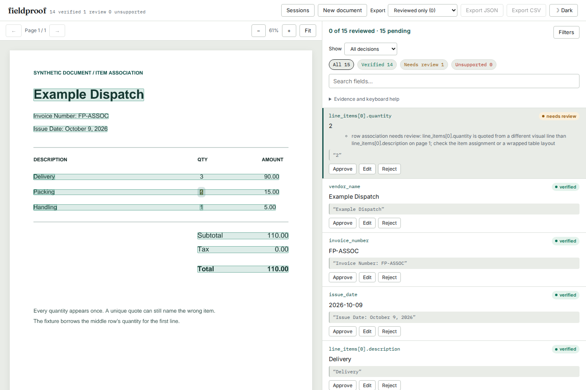

# A unique quote can still belong to another item

The earlier repeated-quote repair left a more basic gap: a number appearing
only once was verified even when its quote belonged to another item. In the
[synthetic invoice](../../examples/row-association.pdf), the document says
`Delivery 3`, `Packing 2`, `Handling 1`. Its [fixture](../../examples/fixtures/row-association.json)
assigns the unique `2` to Delivery. The previous checkout verified all 15
fields. This checkout verifies 14 and sends that quantity to review, retaining
the actual quote on the Packing line.



The example is constructed, not a transaction or a model's output. It has no
unit prices, so line arithmetic cannot detect the misplaced quantity.
The [generator](review_example.py), [baseline CLI result](results/cli-before.json)
and [current result](results/cli-after.json) are retained.

## API and report contract

Invoice `line_items` and Receipt `items` now declare their descriptions as row
anchors. All their quantity, unit-price and amount fields that exist in the
schema are checked, including optional values that were not extracted.
Custom models do not silently acquire this constraint from being lists:

```python
from fieldproof.verify import RowEvidenceRule, verify

# data.items contains objects with Evidenced description and number fields.
report = verify(
    data,
    document,
    row_rules=[RowEvidenceRule("items", "description", ("number",))],
)
```

Rules name a list by dotted model path, such as `invoice.line_items`, plus
direct field names within each item. Invalid paths, non-model items, missing
field names and duplicate rules raise `ValueError`. The named anchor is
grounded independently before members, even if declared later in the schema.
A weak, rejected or text-edited anchor cannot lend support to other fields.
No arbitrary numeric sibling replaces a rejected description.

`row_rules=None` selects built-in defaults; a supplied sequence replaces them.
`row_rules=[]` requests independent source checks without row constraints.
This can be appropriate for known wrapped layouts, but also permits misplaced
unique quotes to verify. Reported row evidence is then empty, not a passing
association audit.

The additive `report.row_checks` array records each declared member:

| Field | Meaning |
| --- | --- |
| `field`, `anchor` | Exact dotted paths being compared |
| `status: same_line` | Strong, value-supported quotes share the anchor's visual line and page |
| `status: separate` | Supported quotes occur on different lines or pages |
| `status: unavailable` | Missing/weak/ambiguous evidence, an untrusted anchor, multiline quote, or unusable geometry |
| `field_source_status`, `anchor_source_status` | Source-support verdicts before row and arithmetic checks; null for an absent field |
| `field_location`, `anchor_location` | Selected text, page, character span and word rectangles; null if no quote was selected |
| `reason` | Explanation of the observation and its limits |

The original same-line geometry remains unchanged: all anchor/member word
boxes must share a vertical band at least half the shortest word's height.
Coordinates must be finite and boxes nonempty. An otherwise verified member
becomes `needs_review` when its row evidence is separate or unavailable.
Existing unsupported fields remain unsupported. Absent optional fields do
not create invented extracted values or additional field counts.

```text
Quote found + value supported --> source verdict retained
                                      |
                                declared row check
                                      |
                 +--------------------+--------------------+
                 |                    |                    |
             same_line             separate           unavailable
                 |                    |                    |
          arithmetic checks    review with source    review if extracted
```

The CLI result JSON and server `/report` include this ledger. The current UI
shows the reason and actual source highlight through its existing field view.
Its reviewed-value exports contain corrections; the complete ledger remains
in the original report. Human edits do not silently recalculate the original
row or arithmetic evidence.

## Measured change and cost

Baseline is `c16cd40`, immediately after the repeated-quote repair.
Implementation is `4ef12a4`. The same [CORD source files and annotation adapter](../cord-grounding/manifest.json)
produce the same 2,853 scripted claims on 400 receipts. The new run explicitly
declares the custom replay schema's item/description relationship, matching the
built-in schemas' new default. No OCR or model was run and no threshold was
tuned after inspecting these results. This is an in-sample audit, not an
estimate of production extraction accuracy.

| Claims | Cases | Outcome | Before | Current |
| --- | ---: | --- | ---: | ---: |
| Correct, unique quote | 732 | Verified at annotated location | 727 | 535 |
| Correct, unique quote | 732 | Needs review | 5 | 197 |
| Swapped, unique quote | 749 | Wrongly verified | 746 | 5 |
| Swapped, unique quote | 749 | Needs review | 3 | 744 |
| Repeated quotes, both kinds | 1,372 | Verified at annotated location | 629 | 629 |
| Repeated quotes, both kinds | 1,372 | Wrongly verified | 14 | 14 |
| Repeated quotes, both kinds | 1,372 | Needs review | 729 | 729 |

741 wrong unique-quote assignments now require review. The cost is 192
previously correct locations requiring review. No correct location becomes
wrongly verified. The [paired results](results/receipts.json) contain source
hashes, identical-input checks, every changed case and all **19 remaining
verified errors**, with both annotated and selected locations. Complete-run
JSONL hashes allow checking a regenerated run. The original annotations,
reading-order adapter and numeric reference parser retain their existing limits.

The [nine PDF controls](run.py) run through native PDF text extraction and the
built-in schemas. Five wrong assignments now require review; two supported
controls remain verified. A correct wrapped row now requires review. A
wrong-column claim on the same line **still verifies** and is deliberately
retained as a known limitation, not counted as a solved case.
[Before](results/pdf-before.json), [after](results/pdf-after.json).

## Boundaries

This rule checks a declared spatial relationship. It does not parse table
columns, infer semantic field roles, identify a complete item, or establish
that the model extracted every item. Strong skew can make different rows
overlap vertically. Correct multiline receipts can incur extra review. The
five remaining unique-quote errors in this corpus illustrate geometry's limits;
the repeated-quote errors include column ambiguity as well.

The rule is deliberately explicit for custom schemas: unrelated properties
of a nested object need not be printed on one line. Rules support dotted
model paths to lists, not wildcard paths through nested lists. Matching still
uses the document's extracted words, which can contain OCR errors.

## Reproduce

From an installed source checkout at the repository root:

```bash
fieldproof extract examples/row-association.pdf --schema invoice --provider fixture \
  --fixture examples/fixtures/row-association.json --out row-result.json
fieldproof verify row-result.json examples/row-association.pdf --out row-verified.json
```

Run the controlled PDFs and annotated replay:

```bash
uv run --locked --extra dev python -I studies/row-association/run.py \
  --src src --out /tmp/fieldproof-association-pdfs
uv run --locked --with pyarrow python -I studies/row-locality/receipts.py \
  --src src --row-checks --out /tmp/fieldproof-association-receipts
```

Extract baseline source with `git archive c16cd40 src`. Run the PDF script
against it with `--observe-only`; run the receipt script without `--row-checks`.
Then use `studies/row-locality/compare.py BEFORE AFTER OUTPUT --before-ref c16cd40`
to pair all claims. Source data is downloaded by the earlier study's `fetch.py`
and checked against its pinned SHA-256 manifest.

For an installed wheel's browser flow, start its server on port 4300, then run
`web/node_modules/.bin/playwright test --config studies/row-association/browser.config.mjs`.
Setting `FIELDPROOF_BROWSER_FULL=1` runs the whole suite, also expecting the
production static demo on port 4301. Both URLs can be overridden in that config.
Use `UPDATE_ASSOCIATION_SCREENSHOTS=1` to retain real screenshots and exports.

CORD annotation excerpts are attributed to the [CORD authors](https://github.com/clovaai/cord)
under [CC BY 4.0](https://github.com/clovaai/cord/blob/master/LICENSE-CC-BY).
This study constructs claims and changes their representation; no source
images or real customer documents are redistributed. The example PDFs are synthetic.
