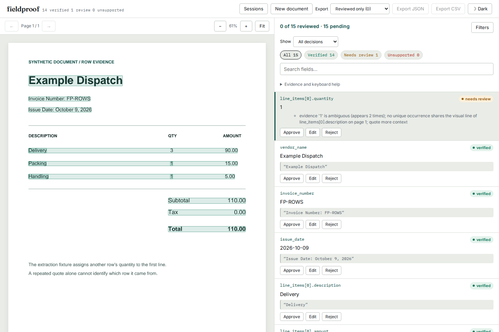

# When a quoted number belongs to another row

An extraction can quote a number that is on the page and still assign it to
the wrong invoice line. Before this change, `Delivery 3`, `Packing 1` and
`Handling 1` supported an extracted delivery quantity of `1`: the verifier
chose the nearest occurrence, even on a different page. A description whose
value failed verification could also become the anchor for that choice.

The source checkout now leaves those repeated quotes unresolved. This is
unreleased work, compared with local baseline `c7f7cbc`; the implementation is
`4d1b24b`. Nothing was pushed, published or deployed for this study.



## Inspect the failure

The [PDF](../../examples/row-locality.pdf) and [fixture](../../examples/fixtures/row-locality.json)
are deliberately constructed, not a transaction or a model's output.
The document has three line items and consistent totals, but no unit prices.
Arithmetic alone cannot catch the wrongly assigned quantity.

From an installed source checkout:

```bash
fieldproof extract examples/row-locality.pdf --schema invoice --provider fixture \
  --fixture examples/fixtures/row-locality.json --out row-result.json
fieldproof verify row-result.json examples/row-locality.pdf --out row-verified.json
fieldproof serve --host 127.0.0.1 --port 4298
```

In the server, upload the PDF and select its fixture. The result is **14
verified, one needs review**. Baseline verified all 15. The flagged quantity
has no chosen page or rectangle; the two correctly quoted quantities still
point to their own rows. Editing the first quantity to three exports the
correction with its original value of one. Reopening the session retains it;
the original automated report remains unchanged. The installed-wheel browser
test exercises this in Chromium and Firefox, including phone layouts.

Actual outputs: [baseline CLI](results/cli-before.json),
[current CLI](results/cli-after.json), and
[browser observations](../../docs/assets/row-locality/chromium-observations.json).
The [generator](review_example.py) rebuilds both example files.

## The selection rule

```text
Repeated quote
  |
  +-- Strong, supported sibling anchor? -- no --> review, no selected box
  |
  +-- Exactly one same-page, same-line occurrence?
         |
         +-- no  --> review, no selected box
         +-- yes --> check value; record anchor in JSON notes
```

The existing schema-order walk uses the first sibling whose match is strong
and whose value agrees without accepted text edits. Arithmetic is checked
afterwards and cannot establish a location. The anchor and candidate's word
boxes must share a vertical band at least half the shortest word's height.
Boxes must be finite and have positive dimensions. The rule uses relative
heights, so scaling between PDF points and OCR pixels does not change it.

This permits modest skew. It refuses distant rows, different pages, an average
position between two lines, and competing columns on a line. The old exported
`nearest_candidate` helper remains available for callers needing a ranking;
verification uses `unique_row_candidate`, which can decline to choose.

The [14 real-PDF controls](cases.py) cover nine unsafe choices and five valid
same-line locations. Baseline wrongly verifies the nine unsafe choices; the
current source and installed wheel produce all expected statuses and locations.
[Before](results/pdf-before.json), [after](results/pdf-after.json),
[installed](results/pdf-installed.json). These cases informed the implementation.

## What happened on annotated receipts

[CORD](https://github.com/clovaai/cord) supplies text, word boxes and menu-group
labels. This replay uses the three pinned files already collected by the
[earlier study](../cord-grounding/manifest.json): 200 training, 100 validation
and 100 test receipts. It verifies each SHA-256 before reading. These are not
400 independent held-out examples; the corpus was used in earlier development
and includes repeated receipts across splits.

The [runner](receipts.py) uses the earlier reading-order adapter unchanged.
It forms one description/number pair for each group with exactly one name
and exactly one quantity or price annotation. It then either supplies the
annotated value and quote, or deliberately substitutes the first different
value from another eligible group in the same receipt. Missing or multiply
annotated groups are counted as skipped. Numeric values use the existing
study parser and `default_number_style="thousands"`.

Each selected highlight is checked against the annotated **word identities**,
not against the matcher's score or vertical-overlap rule. The result is 2,853
paired scripted claims, including 1,372 with repeated quotes:

| Claim and quote | Cases | Outcome | Before | Current |
| --- | ---: | --- | ---: | ---: |
| Correct, repeated | 1,060 | Verified at annotated location | 825 | 629 |
| Correct, repeated | 1,060 | Verified at wrong location | 146 | 8 |
| Correct, repeated | 1,060 | Needs review | 89 | 423 |
| Swapped, repeated | 312 | Wrongly verified | 285 | 6 |
| Swapped, repeated | 312 | Needs review | 27 | 306 |
| Correct, unique | 732 | Verified at annotated location | 727 | 727 |
| Correct, unique | 732 | Needs review | 5 | 5 |
| Swapped, unique | 749 | Wrongly verified | 746 | 746 |
| Swapped, unique | 749 | Needs review | 3 | 3 |

Across repeated quotes, 416 wrong verified locations become reviews and one
becomes correctly located. The cost is 197 previously correct locations now
requiring review. No previously correct location becomes wrongly verified.
The [paired results](results/receipts.json) retain every changed decision,
expected and actual boxes, the 14 remaining repeated-quote errors, skipped
counts, source hashes and complete-run output hashes.

The remaining errors include incorrect columns, skewed rows and labels that
cannot be inferred from vertical overlap. **Unique quotes remain independent
value checks:** the 746 swapped unique quotes still verify. This repair is
not a table parser or a semantic assignment validator. Giving richer quotes
can help locate evidence; it does not prove which business field it supports.
This replay does not measure model extraction accuracy or production error rates.

The audit took 7.6 seconds before and 7.0 seconds after in the retained
run on a 14-vCPU WSL2 Linux / 48-GB machine. It includes file hashing, annotation
loading and duplicate diagnostic lookups; concurrent work affects timings.
These are replay costs, not evidence of a speed improvement.

## Reproduce

Run from the repository root; output directories are disposable. The baseline
source can be extracted from `git archive c7f7cbc src` into a separate directory.

```bash
uv run --locked --extra dev python -I studies/row-locality/run.py \
  --src src --out /tmp/fieldproof-row-pdfs
uv run --locked --with pyarrow python -I studies/row-locality/receipts.py \
  --src src --out /tmp/fieldproof-row-receipts
```

Run both scripts against the baseline's `src` too; add `--observe-only` for
its PDF run. `compare.py BEFORE_DIR AFTER_DIR OUT.json` pairs receipt results,
requires identical inputs and retains every changed decision. The earlier
study's `fetch.py` downloads the pinned cache if it is absent. No credentials,
provider calls or new runtime dependencies are needed.

The receipt annotations and excerpts are derived from CORD v2, by the CORD
authors, under [CC BY 4.0](https://github.com/clovaai/cord/blob/master/LICENSE-CC-BY).
This study changes their representation and constructs claims from the labels;
images are not redistributed here. Generated example PDFs are synthetic.
