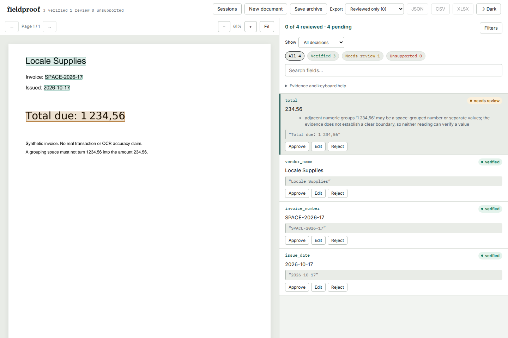

# Spaced amounts: verification and review costs

The spacing/location correction below is at
`b283e1beea9e1b748370b16ab419ed974c312be0`. A subsequent
[punctuation-convention correction](conventions-verification.md) at `79c85ad`
fixes a regression in that revision; the README install pin includes it.
The receipts below retain their original revision-specific scope.

The Python sources measured below are in `b283e1beea9e1b748370b16ab419ed974c312be0`.
The baseline is `d94f2f4`; its Python files are identical to the independently
installed baseline wheel built from `760a1d7`. The source hashes in both
native ledgers were compared with those Git revisions. Package versions remain
0.2.7; that version alone does not identify the corrected code.

[`verification.json`](results/verification.json) records the checks and input
hashes. These are source, installed-artifact and loopback-browser checks. They
do not establish a registry release or public hosted deployment.

After the source push, [public-source.json](results/public-source.json) checked
GitHub's unauthenticated `main` ref and byte-compared nine pinned Python/test/PDF
files. The README's exact Git install command then ran in a new Python 3.12
environment. Its [provenance receipt](results/public-install-provenance.json),
[native replay](results/public-install.json) and [API replay](results/public-api.json)
confirm the same 41 modules and full 134-claim ledger. The direct Git install has
no bundled UI, as documented; the separately built wheel/browser checks below
cover that UI. These are source-publication checks, not a registry release.

## What the correction changes

The actual loader, grounding and verification pipeline processes 134 claims on
23 authored PDF pages. The inputs are byte-identical across revisions. There
are 39 unwanted approvals before the correction and none after it; all seven
supported ungrouped/clear-cell controls still verify. Fifteen whole grouped
amount claims remain in review in both versions. The verifier does not infer
their combined value from uncertain spacing.

The normalized-quote controls retain an important guard: rejecting one spaced
occurrence must not make an unrelated amount uniquely supported elsewhere.
An intermediate implementation introduced three wrong-location approvals in
the receipt replay. The final implementation keeps these occurrences weak
rather than deleting them. The final replay has **no newly verified claims**.

## A real receipt and the reference parser's limits

The supplied annotation and original image for `cord-valid-78` print:

| Printed amount | Historical adapter's claim | Baseline verdict | Final verdict |
| --- | ---: | --- | --- |
| `18 000` | 18 | verified | needs_review |
| `154 000` | 154 | verified | needs_review |
| `16 170` | 16 | verified | needs_review |

The historical adapter reads the first digit run, so its numeric reference is
itself incomplete for these fields. I inspected the original image. Reading
the complete groups gives an item amount of 18000, subtotal 154000 and tax
16170. The menu amounts sum to 154000; adding the printed service charge of
7700 and tax gives the printed total 177870. These three changes must not be
counted as lost correct approvals.

[`receipt-78.json`](results/receipt-78.json) retains the paired claims, manual
readings, arithmetic control, image digest and pinned dataset/shard identity.
The image is not redistributed. It is available in the existing
[CORD corpus manifest](../cord-grounding/manifest.json). This is one manually
reviewed receipt using supplied text/boxes, not a fresh OCR or model experiment.

## Cost on the complete receipt replay

Both source revisions ran the unchanged CORD/SROIE adapter and generator on all
133722 cases from 1052 documents. All four cached shards were checked against
the pinned manifest by size and SHA-256. Pairing requires identical inputs,
keys and complete case/document counts. All 383 verdict/location changes are
retained in [`receipts.json`](results/receipts.json).

For annotated claims quoted with the generator's available page context:

| Field type | Cases | Verified at annotated location before | After |
| --- | ---: | ---: | ---: |
| Amount | 2360 | 1860 | 1852 |
| Quantity | 853 | 354 | 313 |
| Date | 565 | 356 | 356 |
| Text | 2253 | 2171 | 2167 |

The 53 additional contextual reviews include the three erroneous numeric
references above. Others are conservative costs: narrow quantity/price cells,
repeated amounts, or item descriptions ending in digits beside a price. The
1.5-word-height gap rule cannot establish every true column boundary. Two
normalized date variants also retain ambiguity at repeated locations; the
contextual date count is unchanged. The existing one wrong-location text
approval and three accepted absent-text cases remain in their own measurements.

There are no newly verified claims anywhere in the paired replay. All 32016
absent-number cases whose values are not present elsewhere remain unverified.
The corpus was inspected while refining the correction, including its
historically named held-out splits: this is **in-sample** compatibility and
cost evidence, not a general extraction-accuracy benchmark.

Reproduce after obtaining the pinned corpus as described in its study:

```sh
uv run --locked --with pyarrow python -I studies/cord-grounding/run.py \
  --src src --out /tmp/spaced-receipts-after.jsonl --workers 2
python3 studies/numeric-evidence/compare_receipts.py \
  /tmp/spaced-receipts-before.jsonl /tmp/spaced-receipts-after.jsonl /tmp/spaced-receipts.json \
  --before-ref d94f2f4 --after-ref b283e1b
```

Generate the before file with the same command and a detached baseline source
tree. The adapter and its numeric-reference limitations deliberately remain
unchanged so the comparison uses identical inputs.

## Clean source and installed distributions

A fresh archive of `b283e1b`, Python 3.12.12 and locked development/OCR extras
passed Ruff, mypy on 41 source files, and 807 Python checks. Five actual-engine
OCR cases were skipped because Tesseract was unavailable. No OCR accuracy is
claimed here. The unchanged web sources passed types, lint, formatting and 70
unit checks; both production builds succeeded.

```sh
uv sync --locked --extra dev --extra ocr
uv run ruff check src tests studies/spaced-numbers
uv run mypy src
uv run pytest -q -rs
uv run python scripts/bundle_ui.py
uv build
```

The wheel and sdist were built after bundling the production UI. A new
non-editable Python 3.14.7 installation and Python 3.11.13 with the lowest
allowed direct dependencies both replay all 134 claims with the **same complete
ledger digest**, including reasons and rectangles. Both pass the 59 new
regressions. The minimum installation actually uses PDFium 5.0.0,
pdfplumber 0.11.9 and Pydantic 2.12.0. Every runtime/dev/OCR dependency was
supplied directly to `uv pip install --resolution lowest-direct`; treating only
a wheel as the direct requirement would not establish those floors.

The actual API uploads through bounded PDF workers, extracts the fixture,
exports its verdicts, renders a page and round-trips the worker document format.
The baseline verifies the fragment 234.56; final source and both installed
environments review it. A claim of 1234.56 also remains in review because the
spacing is unresolved. The three descriptive fields still verify.

The [artifact receipt](results/artifacts.json) compares all 41 Python modules
in wheel, sdist and installation, and all 23 bundled UI files against locally
served bytes. Distribution hashes and sizes are retained. This is not a
registry or public-host byte comparison.

## Actual browser review

The final installed `b283e1b` package passed the focused workflow in Chromium
and Firefox: upload/extract, whole-amount highlight, correction to 1234.56,
actual offline JSON and CSV downloads, reconnect, save/delete/restore archive,
and equality of the original report after restoration. Offline downloads make
zero requests; the correction does not rewrite the automated verdict.

Both engines pass accessibility/overflow checks at 1440px and 375px in light
and dark themes. All eight final screenshots were opened and inspected; the
theme header pixels and dimensions were independently checked. The longer
review reason wraps on phones and keeps the action buttons usable.



[Firefox desktop](../../docs/assets/spaced-numbers/firefox-1440-dark.png),
[Chromium phone](../../docs/assets/spaced-numbers/chromium-375-light.png),
[Firefox phone](../../docs/assets/spaced-numbers/firefox-375-dark.png).

An earlier broad sweep at `616894a` covers the same production UI sources:
99/104 initially passed; five static-demo cases failed because the preview
was launched without `--mode demo`. Restarting it in demo mode and rerunning
exactly those five produced five passes, exit 0. That initial run is not called
a clean pass. It predates the final normalized-location guard; the focused
final-package check above is recorded separately. The complete scenario ledger
is [`browser-sweep.json`](results/browser-sweep.json).

Run the final workflow against a separately launched installed wheel:

```sh
cd web
FIELDPROOF_BROWSER_URL=http://127.0.0.1:8000/ npx playwright test \
  --config ../studies/spaced-numbers/browser.config.mjs
```

The browser suite leaves the application's worker deadline unchanged. There
are no provider/model calls in these fixture workflows.
