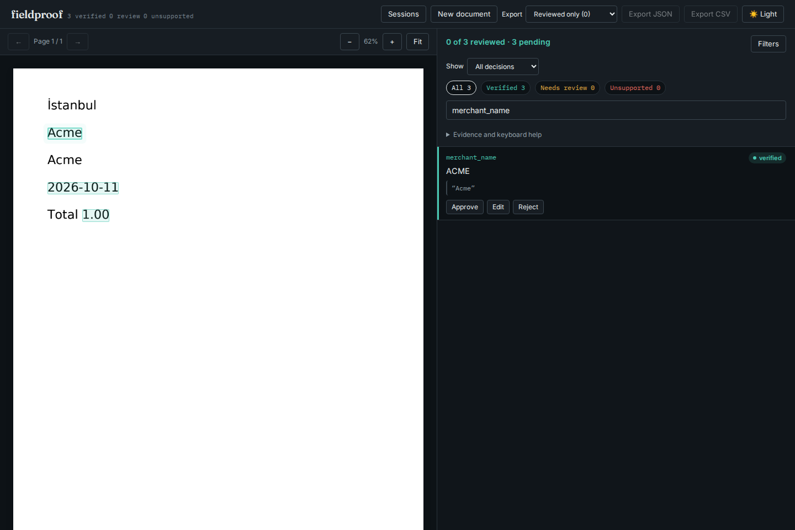
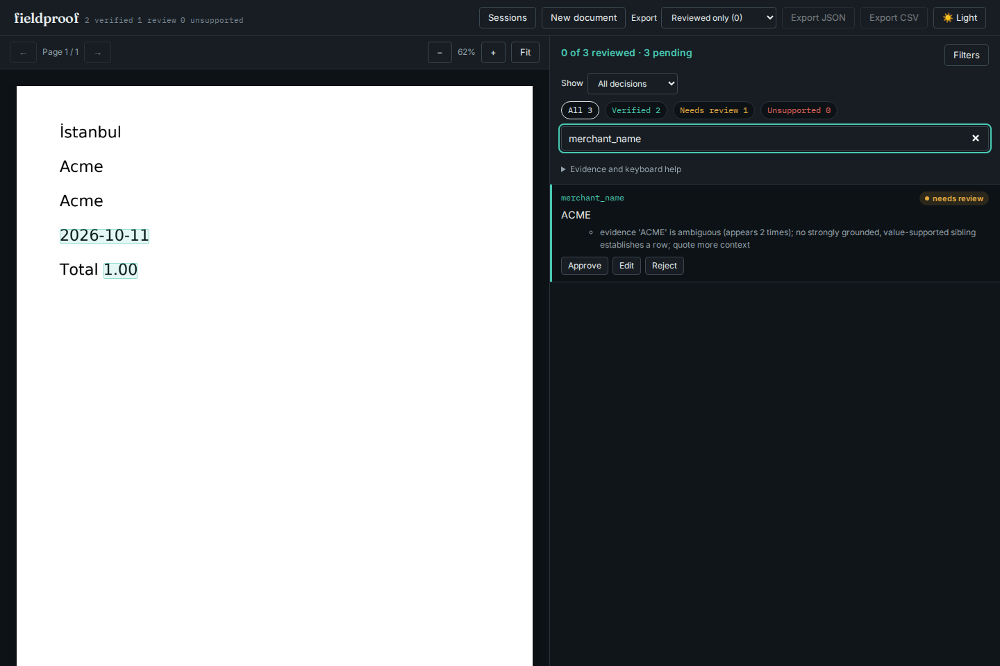

# Unicode case matching must preserve source locations

At baseline `b7ef1fccf22b82a0b82fb92ae97f2fe5e7ebb415`, a page containing
`İstanbul`, `Acme`, `Acme` verified the quote `ACME` at one of those two names.
The unrelated dotted capital I expands to two code points when lowercased.
The old safeguard disabled case-insensitive exact matching for that entire
page, then selected a single fuzzy match. A repeated quote became falsely
unique. A second page hint could hide the occurrence on the affected page too.

The repair keeps an offset map through Unicode case folding, prepared lazily
per page. Every folded character points back to the original source character.
Both exhaustive caseless matching and fuzzy alignment use that map. A boundary
inside a single expanded character is still rejected. Candidate reuse remains
bounded and local to one verification. Exact normalized matches still take
priority, followed by caseless matches, numeric/date equivalence and fuzzy
fallback; this change does not merge different matching tiers.

Python's [Unicode case-folding operation](https://docs.python.org/3/library/stdtypes.html#str.casefold)
is intended for caseless matching and includes expansions such as `ß` to `ss`.
This is the same operation already used for Fieldproof's letter-agreement check.
It is not transliteration or a locale-specific spelling rule. Original text,
claims and PDF coordinates are preserved for human review.

## Actual PDF reproduction

All ten documents are synthetic, generated with ReportLab and an embedded
DejaVu Sans subset. The [font notice](FONT-NOTICE.txt) applies to those subsets.
The fixture extractions replay without a model call. The script verifies that
the PDF text layer really contains the expected Unicode source characters;
none of these comparisons substitute an in-memory page for PDF loading.

| Case | Before candidates / verdict | After candidates / verdict |
| --- | --- | --- |
| Dotted I elsewhere, uppercase name | 0 / unsupported | 1 / verified |
| Dotted I elsewhere, repeated name | 1 / verified | 2 / needs review |
| Repeated dotted-I name | 1 / verified | 2 / needs review |
| Sharp-S and SS spellings | 1 / verified | 2 / needs review |
| Greek sigma variants | 0 / unsupported | 2 / needs review |
| Misspelling after dotted I | 0 / unsupported | 1 / needs review |
| Half an expanded letter | 0 / unsupported | 0 / unsupported |
| Complete expanded word | 1 / verified | 1 / verified |
| Exact repeated-name control | 2 / needs review | 2 / needs review |
| Repeated name across pages, hint on page 2 | 1 / verified | 2 / needs review |

[Before](results/before.json) and [after](results/after.json) retain the complete
reports, every candidate's original offsets/text/words/boxes, source text, PDF
hashes and implementation hash. All ten cases also ran through the actual API
verification worker: HTTP 200 with reports identical to the library. Four cases
lose a false verified location. A unique `STRASSE` quote still highlights the
complete printed `Straße`, while the incomplete `s` quote cannot verify `ß`.

```bash
uv sync --locked --extra dev --extra ocr
uv run python studies/unicode-grounding/replay.py --api --out /tmp/unicode-after.json
uv run pytest -q tests/test_unicode_grounding.py
```

To regenerate, add `--generate-font /path/to/DejaVuSans.ttf` to the replay
command. The checked-in PDFs are sufficient for replay; regeneration is optional.
For the baseline, archive the named commit and run the same script with
`PYTHONPATH=/path/to/baseline/src`; confirm the implementation hash against
`results/before.json`. Remove that override for installed-wheel checks.

These hand-specified cases establish the reported failures and source-coordinate
repairs. They are not a multilingual extraction accuracy benchmark, and do not
prove that a repeated name belongs to a particular document field.

## Installed application and compatibility

An archive of `86bb216` passed Ruff, mypy (33 source files), 391 Python tests,
web lint/typecheck/format checks and 50 web tests. The production and static-demo
builds succeeded. `uv run python scripts/bundle_ui.py && uv build` built the
wheel through the sdist with the review UI included.

Fresh installations on Python 3.11.13 and 3.14.7 reproduced all ten library
and actual API-worker records byte-for-byte, outside the checkout without a
`PYTHONPATH` override. Three installed CLI extractions matched the library too.
All 33 installed Python files and all 23 served UI assets matched the clean
source/build. [Installation receipt](results/installed-verification.json),
[Python 3.11 replay](results/installed.json), [Python 3.14 replay](results/installed314.json).

Chromium and Firefox checked the repeated-name review at 1440px dark and 375px
light, and the complete sharp-S highlight at desktop width: six installed UI
flows. Approving a field and exporting it preserves its original automated
verdict. Each flow checks the retained server report, rendered PDF where shown,
overflow, accessibility, script errors, CSP and unexpected external requests.
All six captures were inspected; no findings were reported.
[Browser receipt](results/browser-installed.json).






A fresh full replay of the unchanged CORD/SROIE adapter produces identical
complete records for **133,722 cases across 1,052 receipts**. The comparison uses
the same manifest-checked input files described in the
[preceding performance study](../grounding-reuse/README.md#compatibility-on-retained-receipts).
[Compatibility receipt](results/receipt-compatibility.json). This retained
mostly Latin-script corpus does not establish broad multilingual accuracy.

The final installed wheel also preserves all four complete invoice reports from
the performance repair. On the shared WSL2 machine, the 100-row library median
is 0.088 seconds, with API HTTP 200 in 0.340 seconds; the 400-row API succeeds in
0.805 seconds. Limits remain unchanged.
[Final invoice replay](results/invoice-compatibility.json).

These checks establish local installed behavior. They do not establish a
registry release or an update to the hosted static demo.
