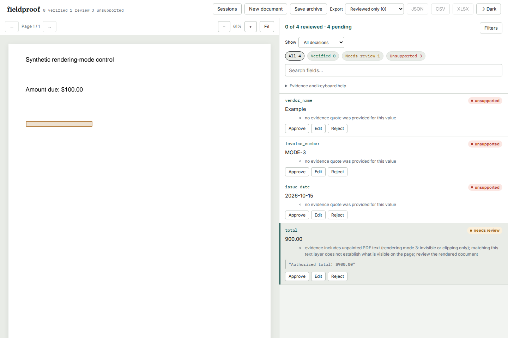

# Unpainted text is not visible evidence

On source baseline `9f14325fb674471131297dd0e1718a45369a5cba`, a PDF displaying
`Amount due: $100.00` also contained `Authorized total: $900.00` in an invisible
text object. The quote matched exactly, and Fieldproof marked the `$900` claim
`verified`, highlighting blank pixels. The same issue affected clipping-only
text, embedded Form XObjects and rotated pages.

This study uses deliberately authored PDFs and fixture extractions. It does not
measure model accuracy or the prevalence of hidden text in production documents.



## What changed

The native loader now retains `Word.render_mode`. A local pdfminer/pdfplumber
adapter records the text state's rendering mode on each character before word
assembly. Words split at mode changes; hidden characters cannot lose their mode
inside an otherwise painted word. The metadata survives worker JSON transport.

| Native text mode | Meaning | Quote policy |
|---|---|---|
| 3 | Invisible: no glyph fill or stroke | Needs review; keep quote and geometry |
| 7 | Clipping only: no direct glyph painting | Needs review; keep quote and geometry |
| 0, 1, 2, 4, 5, 6 | Fill and/or stroke, optionally clip | Existing grounding/value checks |
| `None` | OCR or older/caller-supplied words | Existing policy; visibility unestablished |

The mode meanings are recorded in PDFium's
[public rendering-mode enum](https://pdfium.googlesource.com/pdfium/+/refs/heads/main/public/fpdfview.h).
The producer's text-state mode is available to
[pdfminer's text device](https://github.com/pdfminer/pdfminer.six/blob/master/pdfminer/pdfdevice.py).
The adapter keeps pdfplumber's original coordinate, crop and rotation handling.

Unpainted text cannot establish a trusted row anchor or column header. It is
also masked, without moving offsets, before inferring document-wide date and
number conventions. For example, hidden `1.234,50` cannot make a visible
`60.000` verify as sixty thousand. Explicit caller defaults still work when
the painted text supplies no convention. Text-edit tolerance cannot remove the
unpainted-evidence reason.

## Retained results

All 23 PDFs and their authored expectations are in [cases.json](cases.json).
The replay uses 46 claims, including an ordinary painted amount on the same
page as unpainted text, every rendering mode, embedded forms, page rotations,
hidden convention hints and hidden row anchors. Reports are round-tripped
through the worker's JSON representation before verification.

| Check | Baseline | Current source / installed wheel |
|---|---:|---:|
| Claims incorrectly verified despite an expected review | 18 | 0 |
| Claims matching their authored expected verdict | 28 / 46 | 46 / 46 |
| Ordinary painted claims verified | 24 / 24 | 24 / 24 |

The remaining four review cases already needed review on the baseline: each
ambiguous number/date has two candidate readings, and a hidden hint previously
selected only one of them. They are retained to check both possible claims.

- [Before](results/before.json), [after](results/after.json),
  [installed wheel](results/installed.json), and
  [oldest declared direct dependencies](results/minimums.json) preserve each
  input's SHA-256, actual verdict, matched quote, reasons and geometry.
- [Actual baseline CLI output](results/before-cli.json) contains one verified
  total. The [installed CLI result](results/installed-cli.json) contains zero
  verified fields and one review; the three intentionally unquoted metadata
  fields remain unsupported.
- [Pixel comparisons](results/pixels.json) cover ten unpainted controls in
  **both PDFium and Poppler**. All 20 rendered RGB arrays exactly equal a
  reference PDF that omits the alternate total. The two renderers are compared
  to their own reference, not to each other's antialiasing.
- Native text and bounding boxes on all ten existing example PDFs have identical
  hashes [before](results/compatibility-before.json) and
  [after](results/compatibility-after.json).
- Chromium and Firefox completed the installed review flow at 1440 px and
  375 px: upload, fixture extraction through real worker processes, inspect the
  blank highlight, edit to the displayed `100`, export, save an archive,
  delete the session and restore the archive. The export retains original `900`,
  corrected `100` and automated `needs_review`; restoration recomputes the same
  verification report. Retained observations:
  [Chromium](results/chromium-browser.json), [Firefox](results/firefox-browser.json).
  The [mobile screenshot](../../docs/assets/unpainted-text/firefox-375.png)
  shows the complete reason without horizontal overflow.

The [verification receipt](results/verification.json) records clean installation,
package hashes, dependency versions and complete check results. All
[56 served files](results/served-bytes.json) matched the clean-built review UI
and demo bytes. That initial verification was local. Source revision
`32889a8edee1bbe518be31da1015643ba3371ff7` was subsequently pushed and checked
against GitHub's branch head and all 61 changed files at pinned raw URLs;
the [publication receipt](results/publication.json) retains their sizes and hashes.
These source commits do not constitute a registry release or establish a hosted
demo deployment.

## Reproduce

From this checkout, using its locked development dependencies:

```sh
uv sync --locked --extra dev --extra ocr
uv run python studies/unpainted-text/replay.py /tmp/unpainted-after.json --check
uv run python studies/unpainted-text/pixels.py
```

`pixels.py` also needs Poppler's `pdftoppm`. The committed PDFs are sufficient
for the replay; `generate.py` recreates them with ReportLab. To reproduce the
baseline, run the same replay script with `PYTHONPATH` pointing at the baseline
revision's `src/`, using the same interpreter and dependencies.

The ordinary CLI works without a model or OCR engine:

```sh
uv run fieldproof verify studies/unpainted-text/extraction.json \
  studies/unpainted-text/fixtures/mode-3.pdf --out /tmp/unpainted-result.json
```

Build the bundled UI and wheel with
`uv run python scripts/bundle_ui.py && uv build`. Start the installed wheel's
server on port 4300 and serve `web/dist-demo` on port 4301, then:

```sh
cd web
UPDATE_UNPAINTED_SCREENSHOTS=1 npx playwright test \
  --config ../studies/unpainted-text/browser.config.mjs
```

Use `FIELDPROOF_BROWSER_FULL=1` to run the complete live/demo browser suite
against those servers. Screenshots show real local output, not generated UI art.

## Limits and cost

This original study identifies explicit nonpainting text modes. The subsequent
[zero-opacity extension](../zero-opacity/README.md) also detects zero alpha and
inherited Form rendering state. Neither establishes general pixel visibility:
white-on-white ink, soft masks, later
overpainting, arbitrary clipping, optional layers and incorrect font/Unicode
mappings remain outside its scope. A clipping-only object may support later
painted artwork; the verifier still requires visual review.

Searchable scanned PDFs commonly use invisible OCR text. Even a correct hidden
OCR layer now needs review when used as native evidence; its correspondence to
the image has not been measured here. The text remains available to extraction,
review and export. Existing explicit OCR still checks Tesseract's recognized
text under its separate documented limitations; these local checks skipped the
five real-Tesseract cases because a working engine was unavailable.

The adapter extends parser internals, so dependency upgrades need the actual
PDF controls, including embedded forms and geometry checks. It was checked with
the locked dependencies, a separately installed wheel with current resolved
dependencies, and the oldest declared direct dependencies. `render_mode=None`
keeps older or caller-constructed documents compatible; it is not a visibility
attestation. No new dependency or model call is required.
