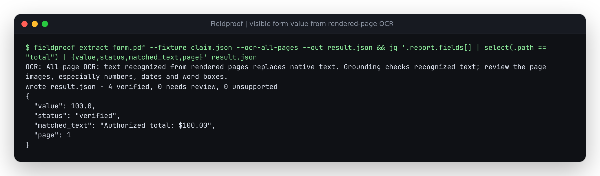

# Recognize the visible form value on a page with native text

The authored [saved-form control](../form-appearances/fixtures/covered-native-total.pdf)
has ordinary page text and a native `$900.00` amount covered by a filled
AcroForm showing `$100.00`. These are invented amounts on a synthetic PDF.
The repaired renderer displays the saved form. Native extraction and
`--ocr-missing-pages` retain the original text layer, so they cannot read the
visible value. The existing `load_scanned_pdf` library helper can recognize it
from the rendered image; the CLI previously had no way to request that on a
page containing native words.

The new explicit choice is `--ocr-all-pages`. It uses OCR words for every page
and records all attempted page numbers, including blank recognition results.
It exposes the existing bounded raster/OCR path, with no new OCR engine or
native/OCR word merging. The library also accepts
`load_pdf_with_ocr(source, mode="all")`.



The capture uses the visible-100 fixture. `jq` selects fields from the actual
saved result; [the captured output](../../docs/assets/visible-form-ocr.txt)
retains the OCR note and recognized text.

| Evidence choice | Visible 100 claim | Covered 900 claim | Matched text |
| --- | --- | --- | --- |
| Native | Needs review | Needs review | `Authorized total: $900.00` |
| Missing-page OCR | Needs review | Needs review | `Authorized total: $900.00` |
| All-page OCR, Tesseract 5.3.4 | Verified against recognized text | Needs review | `Authorized total: $100.00` |

Both `extract` with a stored fixture and `verify` produce these outcomes.
The 900 claim remains 900; the flag changes the source of word evidence,
without correcting the claim. All eight earlier native/missing-page CLI
reports remain byte-identical in this replay. The new flag is refused by the
earlier installed source. Input PDF and extraction bytes stay unchanged.

Try the visible claim from a source checkout with the OCR extra, Tesseract
and its English language data installed:

```sh
fieldproof extract studies/form-appearances/fixtures/covered-native-total.pdf --fixture studies/visible-form-ocr/visible-claim.json --ocr-all-pages --out /tmp/visible-form-result.json
fieldproof verify /tmp/visible-form-result.json studies/form-appearances/fixtures/covered-native-total.pdf --ocr-all-pages
```

`replay.py PYTHON OUTPUT before|after` runs the actual CLI entrypoint in the
specified environment. It copies the same synthetic inputs into isolated
case directories, keeps raw outputs, verifies their hashes afterward, and
records the installed runtime source hashes. The twelve cases cover both
commands, both claimed amounts, and all three evidence choices. The `before`
phase additionally checks refusal of the new flag. Recognition uses English,
144 DPI and one Tesseract OpenMP thread. Geometry and text budgets and the
30-second per-page OCR timeout remain in effect.

This is one legible native control, not an OCR accuracy benchmark. Recognized
numbers, names and dates can be wrong. Replacing the native layer can discard
better text. No form-field metadata is promoted to visible word evidence,
and the review server's native loader does not adopt this option.

## Installed verification

The [artifact receipt](results/verification.json) identifies feature source
`27c3f44166d5fe39ab86373e0d92481474424420` and the clean source archive used
to build the wheel. All 42 Python files match committed source. The wheel's
23 bundled UI files match the preceding verified artifact, and all 65 runtime
files match both isolated installations.

| Installed environment | Python | PDFium wrapper | pytesseract | Result |
| --- | --- | --- | --- | --- |
| Declared direct dependency floors | 3.11.13 | 5.0.0 | 0.3.10 | 854 checks and 12 actual CLI cases pass |
| Current resolved dependencies | 3.14.7 | 5.14.0 | 0.3.13 | 854 checks and 12 actual CLI cases pass |

Every declared direct floor, including development and OCR extras, is pinned
explicitly in [the constraints](results/minimum-constraints.txt) and checked
against installed package metadata. Transitive versions remain compatible
resolver choices. The minimum run retains two dependency deprecation warnings.
The test logs remove the temporary artifact directory from warning paths;
the receipt preserves hashes of the original output.

The [before](results/before.json), [source](results/after.json),
[installed minimum](results/minimum-floor-cli.json) and
[installed current](results/modern-cli.json) receipts retain runtime identities,
matched text, original claims, status and OCR provenance. The adjacent compressed
`*-outputs.json.gz` files retain original report JSON and CLI output. These are
local/source artifact checks; no package-registry release accompanies them.

A separate [public Git installation](results/public-install-identity.json) from
the pinned feature commit reproduces all twelve CLI cases. Its 42 Python files
match the commit, and [all raw CLI outputs](results/public-outputs.json.gz) equal
the current installed wheel's outputs. That source installation contains no
bundled UI; it verifies the documented CLI upgrade. The
[publication receipt](results/publication.json) checks the 27 changed source,
documentation and evidence files at the published documentation commit.
