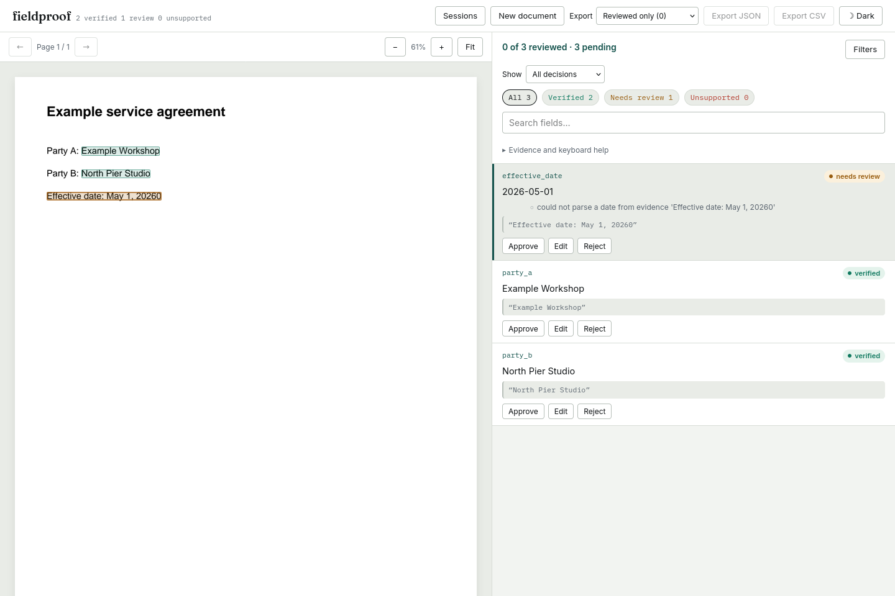

# A written date must keep every digit

At source `7a0b35e`, the fixture-provider command verified a contract's effective
date as `2026-05-01` from the exact printed quote `Effective date: May 1, 20260`.
Grounding found the complete quote with a score of 100, but the value parser
silently dropped the last digit. The same path read `111 January 2026` as
January 11. These are constructed counterexamples, not model or OCR measurements.

The corrected value check sends that claim to review. It retains the original
claim, quote, page and boxes; it does not infer the intended date. Compare the
[before CLI report](cli-before.json) and [after CLI report](cli-after.json), or run:

```sh
uv sync --locked --extra dev
uv run --locked fieldproof extract studies/written-dates/extra-year-digit.pdf --schema contract --fixture studies/written-dates/extra-year-digit.json --out /tmp/written-date-report.json
```

## Shared evidence parsing

Written months now use the same complete-token boundaries as numeric dates.
They cannot begin inside a word/identifier or longer day, or end inside a longer
year/identifier. A sentence's final period and surrounding parentheses remain
valid. This is deliberately conservative about fused OCR words and identifiers.
Grounding and value checks import one set of patterns, preventing a permissive
fallback from accepting a fragment rejected by the other path.

Both paths also share supported written-month interpretation. The previous
value checker rejected `Jan. 1, 2026`, `1 Jan. 2026` and `May 1 2026` despite
grounding recognizing those spellings. They now retain support through the full
verification pipeline. Calendar validity still comes from the standard library.

## Actual PDF replay

[replay.py](replay.py) renders 26 deterministic PDFs and checks two quotes per
PDF: the literal labelled text and a rewritten ISO date. Expectations are
specified independently of the parsing code. Inputs, hashes, verdicts, source
text and boxes are retained in [before.json](before.json) and [after.json](after.json).

| Outcome across 52 constructed claims | Before | After |
| --- | ---: | ---: |
| Unsupported claims verified | 11 | 0 |
| Supported claims not verified | 8 | 2 |

The two remaining supported cases are existing grounding limits: an ISO quote
cannot locate the date inside `(May 1, 2026)` or `Date:May 1, 2026` under the
current whole-word/numeric-modifier rules. Quoting their full printed text
verifies correctly. These cases remain explicit in the replay, not counted as
fixed. This small boundary set does not estimate real-document accuracy.

```sh
uv run --locked python studies/written-dates/replay.py --out /tmp/written-dates.json
```

To compare an older checkout, supply `--src /path/to/old/src --observe-only`.
A date's presence still does not establish its semantic role or the intended
meaning of a malformed source. A human confirmation remains separate from the
automated verdict.

## Installed review workflow

The [clean-build receipt](verification.json) records 375 Python checks,
50 web checks, lint, types, UI bundling and wheel/sdist builds. Fresh Python
3.11.13 and 3.14.7 installations reproduce all 52 PDF cases byte-for-byte and
the actual malformed-year CLI report. The [installed receipt](installed.json)
also compares 33 source files and 23 UI assets with the build, then checks all
23 assets fetched from the installed server.

Chromium and Firefox upload the PDF and extraction fixture to that installed
server, inspect the complete year in the highlighted quote, approve the field
as a human decision, export JSON and reopen the saved session. The original
automated `needs_review` verdict remains unchanged. The two browser scenarios
also check 1440px and 375px layouts, accessibility and absence of off-origin
requests or CSP errors.



Other inspected captures: [Chromium desktop](../../docs/assets/written-dates/chromium-1440.png),
[Chromium mobile](../../docs/assets/written-dates/chromium-375.png),
[Firefox mobile](../../docs/assets/written-dates/firefox-375.png).
The [Chromium](../../docs/assets/written-dates/chromium-observations.json) and
[Firefox](../../docs/assets/written-dates/firefox-observations.json) observations
retain the actual field evidence and approved export. These local package checks
do not establish a PyPI release or an update to the hosted static demo.

The [public-source receipt](public-source.json) later fetched ten pinned files
at `8879cfd` from GitHub and compared their bytes with this checkout, including
the PDF, parser, verdicts and installed/browser evidence. It establishes source
availability, independently of registry and hosted-demo state.

## Receipt compatibility

The [receipt comparison](receipts.json) hash-checks the four pinned CORD/SROIE
annotation files and replays 7,600 date claims over 1,052 documents. All verdicts,
grounding candidate counts, gold-location outcomes and document conventions
are byte-identical to `7a0b35e`. Two unparseable annotated dates stay explicitly
skipped. This is compatibility evidence from existing word annotations, not a
new OCR or extraction run.

```sh
uv run --locked --with pyarrow python studies/date-conventions/receipts.py --src src --out /tmp/written-date-receipts.json
```
