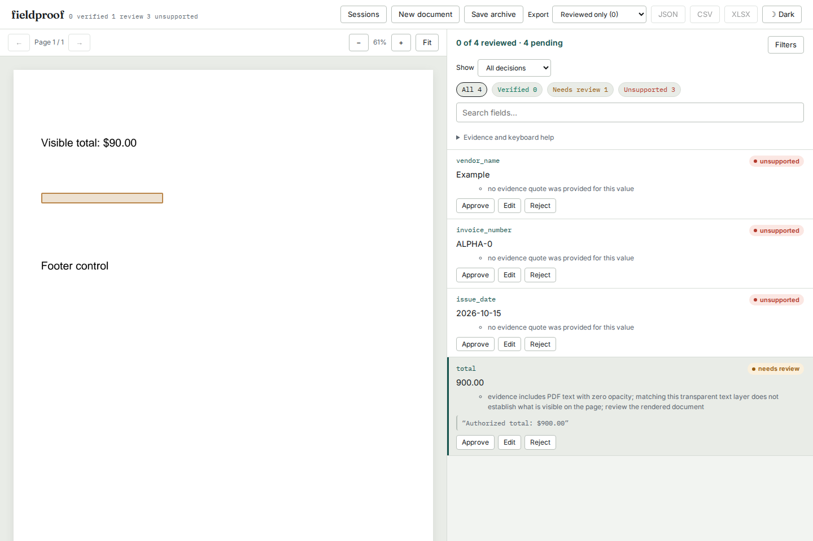

# Zero-opacity text is not visible evidence

Source baseline `17a931ccad5a66743fa3aab977ca9271f50c8e8b` verified a `$900`
claim quoted from a fully transparent text object, while the rendered page
showed `Visible total: $90.00`. The earlier rendering-mode check did not catch
this: ordinary fill mode can still paint at zero opacity. The same study also
reproduced an invisible rendering mode lost when inherited by a Form XObject.

These are authored, synthetic PDFs and fixture extractions. They measure a
specific verification policy, not extraction accuracy or real-world prevalence.

The table and captured receipts below describe the original opacity repair.
The later [renderer glyph bounds](../native-glyph-bounds/README.md) conservatively
send 13 tightly spaced, visible stroked alternate totals to review because their
possible miter ink bounds overlap. All 42 separately filled `Visible total: $90`
claims still verify. The current replay keeps both `authored_expected` and the
current expected outcome; it does not relabel these visible controls as hidden.
The historical PDFs and receipts remain unchanged.



## Policy and implementation

The subsequent [clipping-bound check](../clipped-text/README.md) also covers
native glyph boxes crossing an outer path/Form clipping bound. It is separate
from the zero-alpha policy and the retained results below.

The native parser retains `Word.zero_opacity`. Quotes touching those words
require review with the original text and location preserved. The same words
cannot establish document number/date conventions, row anchors or table headers.
The flag survives the review server's JSON worker boundary. Older caller/OCR
documents remain compatible; missing flags do not establish visibility.

The pdfminer adapter follows `/ca` (nonstroking alpha) and `/CA` (stroking alpha)
independently through `gs`, `q`/`Q`, and Form invocation. Forms inherit the
parent's state; a transparency group resets its internal alphas and composites
with the parent's nonstroking alpha. A transparent enclosing group therefore
suppresses its text even if the group's own alpha changes. Only exact zero is
classified; nonzero alphas are never rounded or multiplied into zero.

| Text operation | Zero-opacity condition |
|---|---|
| Fill (modes 0, 4) | Nonstroking alpha is zero |
| Stroke (modes 1, 5) | Stroking alpha is zero |
| Fill and stroke (modes 2, 6) | Both alphas are zero |
| Any text in a transparent enclosing group | Group's compositing alpha is zero |
| Invisible / clipping-only (modes 3, 7) | Existing rendering-mode review policy |

These semantics follow [ISO 32000-1:2008, Table 58 and section 11.6.4.4](https://opensource.adobe.com/dc-acrobat-sdk-docs/pdfstandards/PDF32000_2008.pdf).
The installed pdfminer parser's `do_gs` is a no-op; Fieldproof's adapter supplies
only the evidence state it needs. It retains the upstream recursive-stream
protection, geometry and font extraction.

## Evidence

The [42 PDFs](fixtures/) cover every painting text mode, both channels
independently, fractional opacity, state restoration, internal/inherited/nested
forms, transparency groups and rotation. [Cases](cases.json) state the intended
visibility before running Fieldproof.

| Check | Baseline | Repaired source |
|---|---:|---:|
| Hidden claims incorrectly verified | 19 | 0 |
| Claims matching the authored verdict | 65 / 84 | 84 / 84 |
| Painted control claims verified | 65 / 65 | 65 / 65 |

[Before](results/before.json) and [after](results/after.json) retain input SHA-256,
actual verdict, matched text, reasons and geometry. The replay transports the
document through JSON before verification, matching the server boundary.

[Independent pixel checks](results/pixels.json) compare every fixture to a PDF
omitting the alternate total, using both PDFium and Poppler. All 84 comparisons
agree with the authored visibility: hidden text changes no RGB pixel; each
painted alternate changes the rendered image. Each renderer is compared to its
own reference; their antialiasing is not assumed identical.

Additional native-PDF regressions cover opacity changes inside a word, hidden
number/date convention hints, row anchors, column headers and legacy transport.
Text-edit tolerance cannot remove the zero-opacity review reason.

The [verification receipt](results/verification.json) records a clean archive
installation, lint, typecheck, 673 passing Python tests (five OCR tests skipped),
70 web unit tests and 90 production browser checks. The wheel was installed
separately on Python 3.14 with current dependencies and Python 3.11 with the
oldest declared direct dependencies; both passed all 84 claims. Every Python
module in both installations matches the clean source.

Chromium and Firefox exercised actual worker processes at desktop and 375 px:
upload, inspect the blank highlight, correct 900 to the displayed 90, export,
save an archive, delete the session and restore it. Export and restoration
retain the original 900 and automated review verdict. Observations:
[Chromium](results/chromium-browser.json), [Firefox](results/firefox-browser.json).
All four screenshots were inspected; the complete reason fits the
[375px view](../../docs/assets/zero-opacity/firefox-375.png) without horizontal
overflow. [All 57 served files](results/served-bytes.json) match the tested
installed review UI and clean-built local demo.

Source and evidence commit `e2ada18851631d0870743df83253fc956745819b` was
pushed to GitHub. A clean-tree, remote-head check and pinned raw-file comparisons
matched all 87 changed files; the [publication receipt](results/publication.json)
records their sizes and SHA-256 hashes. This establishes public source, not a
registry release or a deployed review server.

## Reproduce

```sh
uv sync --locked --extra dev --extra ocr
uv run python studies/zero-opacity/replay.py /tmp/zero-opacity.json --check
uv run python studies/zero-opacity/pixels.py
```

The pixel script needs Poppler's `pdftoppm`. The committed PDFs are sufficient
for the replay. `generate.py` recreates them with ReportLab; its Form resource
dictionaries explicitly retain alpha states so the controls are valid PDF.
For a baseline replay, use the same script/interpreter and set `PYTHONPATH`
to the baseline revision's `src/` directory.

```sh
uv run fieldproof verify studies/zero-opacity/extraction.json \
  studies/zero-opacity/fixtures/mode-0-fill-0-stroke-1.pdf \
  --out /tmp/transparent-result.json
```

Build the bundled review UI and wheel with
`uv run python scripts/bundle_ui.py && uv build`. With the installed wheel's
server running on port 4300:

```sh
cd web
UPDATE_OPACITY_SCREENSHOTS=1 npx playwright test \
  --config ../studies/zero-opacity/browser.config.mjs
```

## Limits

This check detects explicit zero alpha and inherited nonpainting text modes.
It does not establish pixel visibility for arbitrary soft masks, white-on-white
ink, overpainting, optional layers, arbitrary clipping or incorrect character
mappings. A nonzero opacity is not an attestation of legibility. The text stays
available to extraction and review. There are no new dependencies or model calls.

The adapter extends parser internals. Dependency upgrades need actual rendered
controls, especially saved state, ordinary forms and transparency groups.
This source work does not publish a package or deploy a hosted demo.
